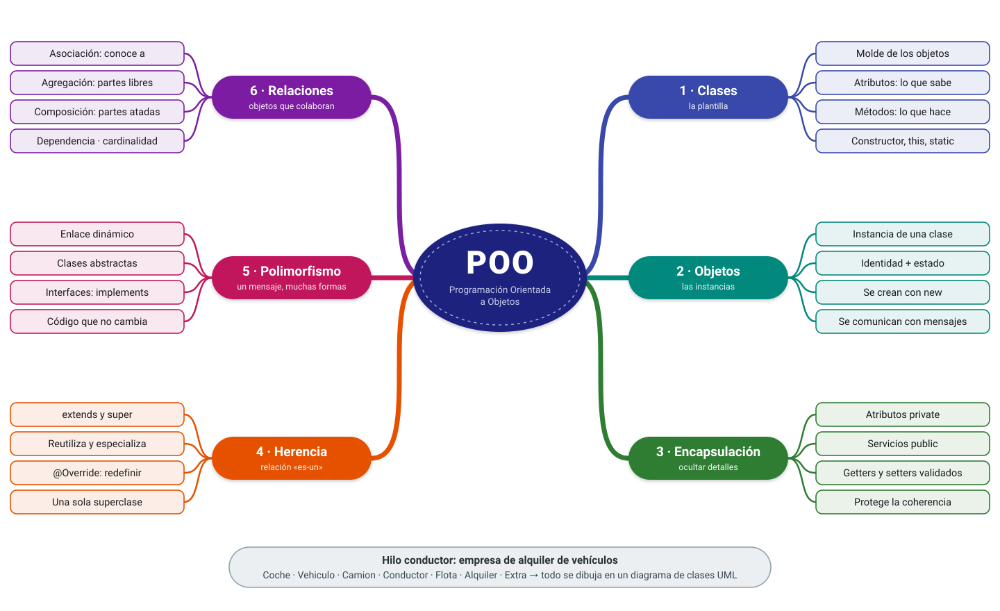

# Mapa mental del curso

Todo el curso en una imagen: en el centro, la programación orientada a objetos; alrededor, las seis ideas que la forman, en el orden en que las hemos visto (siguiendo las agujas del reloj desde arriba a la derecha).

{ target=_blank }

*Pulsa la imagen para abrirla a tamaño completo.*

## Dónde se explica cada rama

| Rama | Capítulo |
|---|---|
| **1 · Clases** | [Capítulo 1](../capitulos/01-clases.md) |
| **2 · Objetos** | [Capítulo 2](../capitulos/02-objetos.md) |
| **3 · Encapsulación** | [Capítulo 3](../capitulos/03-encapsulacion.md) |
| **4 · Herencia** | [Capítulo 4](../capitulos/04-herencia.md) |
| **5 · Polimorfismo** | [Capítulo 5](../capitulos/05-polimorfismo.md) |
| **6 · Relaciones** | [Capítulo 6](../capitulos/06-relaciones.md) |
| **Todo junto, y en UML** | [Capítulo 7](../capitulos/07-caso-practico.md) y [Capítulo 8](../capitulos/08-puente-uml.md) |

!!! tip "Cómo usarlo"
    Antes de un examen, intenta **dibujarlo de memoria** y añadir un ejemplo de cada hoja con los vehículos del curso (por ejemplo, para «Enlace dinámico»: `v.acelerar(200)` da 180 km/h en un coche y 90 en un camión). Después compáralo con la imagen.
