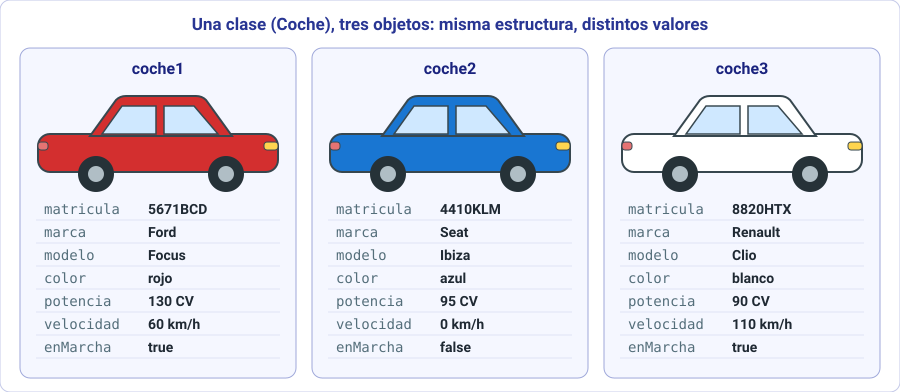

# 1. Clases

## 1.1. Pensar en objetos

Cuando programas de forma tradicional piensas en **los pasos** que debe seguir el programa: leer un dato, calcular, mostrar el resultado. La **programación orientada a objetos** (POO) cambia la pregunta: ¿**qué cosas** existen en el problema y cómo se relacionan entre sí?

Un programa orientado a objetos es una pequeña simulación de una parte de la realidad. Está formado por **objetos** que colaboran enviándose **mensajes**: cada objeto pide servicios a otros y ofrece los suyos. Cada objeto es una **instancia** de alguna **clase**, y las clases se organizan entre sí mediante relaciones, entre ellas la **herencia**. Esta es, en esencia, la definición clásica de Grady Booch.

!!! info "El hilo conductor del curso: los vehículos"
    Todos los ejemplos de este curso giran en torno a una empresa de **alquiler de vehículos**. Empezaremos con un simple `Coche` y, capítulo a capítulo, iremos añadiendo camiones, conductores, alquileres y una flota completa.

## 1.2. Del mundo real a la simulación

Imagina un concesionario con varios coches aparcados. Cada uno es un elemento distinto del mundo real: tiene su **matrícula**, su **marca**, su **color**, y en este momento puede estar parado o circulando a cierta velocidad. Además, cada coche **sabe hacer** cosas: arrancar, acelerar, frenar.

Cualquier elemento del mundo real se puede describir con cuatro ideas. La POO traslada esa misma descripción al software:

| En el mundo real, un coche tiene... | En el programa, un objeto tiene... |
|---|---|
| Una **identidad**: es ese coche y no otro (su matrícula lo distingue) | Una **identidad**: es un objeto distinto de los demás |
| Unas **características**: marca, modelo, color, potencia | Unos **datos**, llamados **atributos** |
| Un **estado** en cada momento: parado, a 60 km/h | Los **valores** que tienen sus atributos en ese momento |
| Unos **comportamientos**: arrancar, acelerar, frenar | Unos **procedimientos**, llamados **métodos** |

Mira ahora tres coches concretos:



Los tres tienen **exactamente los mismos atributos** (matrícula, marca, modelo, color, potencia, velocidad y si están en marcha) y **pueden hacer lo mismo** (arrancar, acelerar, frenar). Lo que cambia es el **valor** de cada atributo: el Ford es rojo y va a 60 km/h, el Seat está parado, el Renault va a 110 km/h.

Esa estructura común, que comparten todos los coches, es lo que describe una **clase**. Cada coche concreto, con sus valores, es un **objeto**.

## 1.3. Qué es una clase

Una **clase** es una plantilla que describe objetos que van a tener **la misma estructura** (los mismos atributos) y **el mismo comportamiento** (los mismos métodos). En el mundo real agrupamos los elementos en **categorías** (cualquier coche pertenece a la categoría *automóvil*); en el programa, los objetos que comparten estructura y comportamiento se agrupan en **clases**.

Una clase tiene una **doble naturaleza**:

| Como... | Una clase es... |
|---|---|
| **Módulo** | Un mecanismo para organizar el software: encapsula en un mismo sitio los datos y las operaciones relacionados. |
| **Tipo de dato** | Un nuevo tipo que podemos usar para declarar variables, igual que `int` o `double`. Define los valores posibles y las operaciones aplicables. |

!!! info "Un programa orientado a objetos es una colección estructurada de clases"
    Escribir un programa OO consiste, en gran medida, en **definir clases** y hacer que sus objetos colaboren.

### Abstracción: quedarse con lo importante

Una clase **no describe todo** lo que es un coche: es un **modelo simplificado** que conserva solo lo que importa para el problema. A esta idea se la llama **abstracción**. El mismo elemento real se modela de forma distinta según el sistema:

| Sistema | El «coche» se describe con... |
|---|---|
| Concesionario | precio, stock, año de fabricación, equipamiento |
| Taller | matrícula, kilometraje, historial de averías |
| Tráfico (DGT) | matrícula, titular, fecha de la última ITV, multas |
| Nuestra empresa de alquiler | matrícula, marca, modelo, color, potencia, velocidad |

!!! tip "La pregunta de diseño"
    Antes de definir una clase pregúntate: *¿qué necesita saber y qué necesita hacer un objeto de esta clase para resolver mi problema?* Todo lo demás sobra.

## 1.4. De qué se compone una clase

Los componentes de una clase se llaman **miembros**. Los dos tipos principales son los **atributos** y los **métodos**.

### Atributos

Un **atributo** es un dato que guarda cada objeto de la clase. Determina la **estructura de almacenamiento** de los objetos y todo lo que un objeto «**sabe**» se expresa mediante sus atributos. Cada atributo tiene un **nombre** y un **tipo**.

| Atributo | Tipo | Ejemplo de valor |
|---|---|---|
| `matricula` | texto (`String`) | `"5671BCD"` |
| `marca` | texto (`String`) | `"Ford"` |
| `modelo` | texto (`String`) | `"Focus"` |
| `color` | texto (`String`) | `"rojo"` |
| `potencia` | entero (`int`) | `130` (CV) |
| `velocidad` | entero (`int`) | `60` (km/h) |
| `enMarcha` | lógico (`boolean`) | `true` |

El conjunto de valores de los atributos de un objeto en un instante dado es su **estado**.

### Métodos

Un **método** es una operación que pueden realizar los objetos de la clase. Todo lo que un objeto «**puede hacer**» se expresa mediante sus métodos. Los métodos son, además, **la única vía** para consultar y modificar los atributos desde fuera del objeto. Un método tiene un **nombre**, unos **parámetros** (los datos que necesita) y un **resultado** (lo que devuelve, o nada).

| Método | Parámetros | Qué hace |
|---|---|---|
| `ponerEnMarcha()` | ninguno | Arranca el coche |
| `acelerar(incremento)` | un entero | Aumenta la velocidad |
| `frenar(decremento)` | un entero | Reduce la velocidad |
| `getVelocidad()` | ninguno | Devuelve la velocidad actual |
| `pintar(color)` | un texto | Cambia el color del coche |

### Tipos de métodos

No todos los métodos cumplen el mismo papel. En una clase encontrarás habitualmente estos tipos:

| Tipo | Para qué sirve | Ejemplo en `Coche` |
|---|---|---|
| **Constructor** | Crea el objeto y lo deja en un estado inicial válido | `Coche(matricula, marca, ...)` |
| **De consulta** (*getter*) | Devuelve el valor de un atributo sin modificarlo | `getVelocidad()`, `getColor()` |
| **De modificación** (*setter*) | Cambia el valor de un atributo | `pintar(color)` |
| **De comportamiento** | Realiza una acción propia del objeto y suele cambiar su estado | `ponerEnMarcha()`, `acelerar(...)`, `frenar(...)` |
| **Auxiliar** (privado) | Utilidad interna que usan otros métodos; no se ofrece al exterior | *(los verás en el [capítulo 3](03-encapsulacion.md))* |
| **De clase** (`static`) | Pertenece a la clase y no a un objeto concreto | `getTotalCoches()` |
| **Redefinido** | Sustituye un método que todas las clases heredan | `toString()` |

## 1.5. La clase `Coche` en Java

La clase es la unidad fundamental de programación en Java. Define la **interfaz** (lo que ofrece) y la **implementación** (cómo lo hace) de sus objetos, y **todo objeto es instancia de alguna clase**.

```java
public class NombreClase {
    // atributos
    // constructores
    // métodos
}
```

!!! note "Reglas básicas"
    - Una clase `public` debe estar en un archivo con **su mismo nombre** (`Coche` en `Coche.java`).
    - Por convención, los nombres de clase empiezan por **mayúscula** (`Coche`, `Vehiculo`) y los de atributos y métodos por **minúscula** (`velocidad`, `acelerar`).
    - Java no admite variables ni métodos «sueltos»: todo está dentro de alguna clase.

### Atributos en Java

La sintaxis básica para declarar un atributo es:

```text
[final] [static] acceso tipo nombre;
```

```java
private String marca;
private int potencia;
private final String matricula;                  // constante: no cambia tras crearse
private static int totalCoches = 0;              // compartido por todos los coches
```

- `acceso` indica quién puede ver el atributo (`public`, `private`, `protected` o ninguno). Lo estudiaremos en el [capítulo 3](03-encapsulacion.md); por ahora usa `private`.
- `final` significa que el valor **no se puede modificar** después de asignarlo.
- `static` significa que el atributo es **de la clase** y lo comparten todos sus objetos.

**Valores por defecto.** Java da un valor inicial a los atributos que no inicializas explícitamente, según su tipo:

| Tipo del atributo | Valor inicial |
|---|---|
| `boolean` | `false` |
| `char` | `'\u0000'` (carácter nulo) |
| `byte`, `short`, `int`, `long` | `0` |
| `float`, `double` | `0.0` |
| Referencia a un objeto (`String`, `Coche`...) | `null` |

!!! warning "Las variables locales no tienen valor por defecto"
    Las variables declaradas **dentro de un método** o constructor deben recibir un valor antes de usarse; si no, el programa no compila.

    ```java
    int x;
    System.out.println(x);   // error: variable x might not have been initialized
    ```

### Métodos en Java

La sintaxis básica para declarar un método es:

```text
[final] [static] [abstract] acceso tipo nombre(parámetros) { ... }
```

- `tipo` es el **tipo de retorno**: un tipo primitivo, una clase, un array o `void` si no devuelve nada.
- `parámetros` es una lista de cero o más elementos con la forma `tipo nombre`, separados por comas.
- Todo método que no sea `void` debe terminar con un `return` seguido de una expresión del tipo de retorno.

```java
public int getVelocidad() {          // devuelve un entero
    return velocidad;
}

public void acelerar(int incremento) {   // no devuelve nada
    velocidad = velocidad + incremento;
}
```

**Sobrecarga.** Una clase puede tener **varios métodos con el mismo nombre** si difieren en el número, el tipo o el orden de sus parámetros. El compilador elige el que corresponde a los argumentos con que se invoca. Por ejemplo, `frenar(int)` reduce la velocidad en una cantidad y `frenar()` detiene el coche del todo.

!!! warning "El tipo de retorno no basta"
    Dos métodos que solo se diferencian en el tipo de retorno **no** son una sobrecarga válida: el compilador no podría decidir cuál usar.

### Constructores y `this`

Un **constructor** se ejecuta al crear un objeto y lo deja en un estado inicial válido. Se reconoce porque se llama **exactamente igual que la clase** y **no tiene tipo de retorno** (ni siquiera `void`).

Dentro de los métodos no estáticos y de los constructores, `this` es una referencia **al propio objeto**. Sirve sobre todo para distinguir un atributo de un parámetro con el mismo nombre:

```java
public Coche(String matricula, String marca, String modelo, String color, int potencia) {
    this.matricula = matricula;     // atributo = parámetro
    this.marca = marca;
    // ...
}
```

Sin `this`, `matricula = matricula;` asignaría el parámetro a sí mismo y el atributo no cambiaría.

!!! info "Constructor por defecto"
    Si **no escribes ningún constructor**, el compilador genera uno sin parámetros que deja los atributos con sus valores por defecto. En cuanto escribes **alguno**, ese constructor automático deja de existir. Una clase puede tener varios constructores (sobrecarga).

### Miembros de clase (`static`)

Normalmente cada objeto tiene **su propia copia** de cada atributo. Si queremos un valor **compartido por todos los objetos** de la clase, como el número de coches creados, usamos `static`. Los atributos estáticos pertenecen a la **clase** y se manejan con **métodos estáticos**, que se invocan con el nombre de la clase: `Coche.getTotalCoches()`.

!!! warning "Un método estático solo accede a miembros estáticos"
    Un método `static` no pertenece a ningún objeto en concreto, así que **no puede usar `this`** ni acceder a atributos de objeto.

### La clase completa

Reunamos todo en la clase `Coche`. Cada bloque de código está marcado con el tipo de miembro que contiene:

```java
// Coche.java
public class Coche {

    // ----- Atributo de clase (compartido por todos los coches) -----
    private static int totalCoches = 0;

    // ----- Atributos de objeto -----
    private final String matricula;
    private String marca;
    private String modelo;
    private String color;
    private int potencia;        // en CV
    private int velocidad;       // en km/h
    private boolean enMarcha;

    // ----- Constructor -----
    public Coche(String matricula, String marca, String modelo, String color, int potencia) {
        this.matricula = matricula;
        this.marca = marca;
        this.modelo = modelo;
        this.color = color;
        this.potencia = potencia;
        this.velocidad = 0;
        this.enMarcha = false;
        totalCoches++;
    }

    // ----- Métodos de comportamiento -----
    public void ponerEnMarcha() {
        enMarcha = true;
    }

    public void parar() {
        velocidad = 0;
        enMarcha = false;
    }

    public void acelerar(int incremento) {
        velocidad = velocidad + incremento;
    }

    public void frenar(int decremento) {
        velocidad = Math.max(0, velocidad - decremento);
    }

    public void frenar() {                       // sobrecarga: frena del todo
        velocidad = 0;
    }

    // ----- Métodos de consulta (getters) -----
    public String getMatricula() {
        return matricula;
    }

    public String getMarca() {
        return marca;
    }

    public String getModelo() {
        return modelo;
    }

    public String getColor() {
        return color;
    }

    public int getPotencia() {
        return potencia;
    }

    public int getVelocidad() {
        return velocidad;
    }

    public boolean isEnMarcha() {
        return enMarcha;
    }

    // ----- Método de modificación -----
    public void pintar(String color) {
        this.color = color;
    }

    // ----- Método de clase -----
    public static int getTotalCoches() {
        return totalCoches;
    }

    // ----- Método redefinido -----
    @Override
    public String toString() {
        return "Coche{matricula=" + matricula + ", marca=" + marca + ", modelo=" + modelo
                + ", color=" + color + ", potencia=" + potencia + " CV"
                + ", velocidad=" + velocidad + " km/h, enMarcha=" + enMarcha + "}";
    }
}
```

!!! note "`toString()` y `@Override`"
    `toString()` devuelve una representación en texto del objeto. Todas las clases lo tienen aunque no lo escribas, pero la versión por defecto no es útil; aquí la **redefinimos**. `@Override` le indica al compilador que estamos sustituyendo un método heredado. Entenderás el porqué en el [capítulo 4](04-herencia.md).

!!! tip "En UML"
    Una clase se dibuja como un rectángulo con tres compartimentos: **nombre**, **atributos** y **operaciones**. Los atributos y operaciones van precedidos de un símbolo de visibilidad: `-` privado, `+` público.

    ```mermaid
    classDiagram
        class Coche {
            -String matricula
            -String marca
            -String modelo
            -String color
            -int potencia
            -int velocidad
            -boolean enMarcha
            +Coche(String matricula, String marca, String modelo, String color, int potencia)
            +ponerEnMarcha() void
            +parar() void
            +acelerar(int incremento) void
            +frenar(int decremento) void
            +getVelocidad() int
            +pintar(String color) void
        }
    ```

## Resumen del capítulo

- Una **clase** es la plantilla de unos objetos: define su **estructura** (atributos) y su **comportamiento** (métodos). Es a la vez **módulo** y **tipo de dato**.
- La **abstracción** consiste en modelar solo lo relevante del problema.
- Los **atributos** son los datos («lo que sabe»); los **métodos** son las operaciones («lo que puede hacer»).
- Hay varios **tipos de métodos**: constructores, de consulta, de modificación, de comportamiento, auxiliares, de clase y redefinidos.
- En Java, `this` es el propio objeto y `static` crea miembros de la clase, compartidos por todos los objetos.

## Actividades

**Actividad 1.** Para un sistema de gestión de un taller, describe la clase `Moto`: propón al menos cinco atributos y cuatro métodos, e indica de qué tipo es cada método (consulta, comportamiento...).

??? success "Solución orientativa"
    - **Atributos:** `matricula`, `marca`, `modelo`, `cilindrada`, `kilometraje`.
    - **Métodos:** `Moto(...)` (constructor), `getKilometraje()` (consulta), `registrarRecorrido(km)` (comportamiento), `cambiarAceite()` (comportamiento).

    Otras respuestas son válidas si responden a la pregunta de diseño: *¿qué necesita saber y hacer una moto en este sistema?*

**Actividad 2.** El «coche» aparece en una aseguradora y en una empresa de alquiler. Indica dos atributos relevantes en ambos sistemas y dos que solo lo sean en uno de ellos.

??? success "Solución orientativa"
    - **En ambos:** `matricula`, `marca` (también `modelo`).
    - **Solo en la aseguradora:** `valorAsegurado`, `historialSiniestros`.
    - **Solo en el alquiler:** `precioPorDia`, `disponible`.

    Es la abstracción en acción: el mismo elemento real, modelos distintos.

**Actividad 3.** Escribe la clase `Bicicleta` con los atributos `marca` y `marchas`, un constructor con los dos, un método `getMarchas()` y un método `toString()`.

??? success "Solución"
    ```java
    // Bicicleta.java
    public class Bicicleta {
        private String marca;
        private int marchas;

        public Bicicleta(String marca, int marchas) {
            this.marca = marca;
            this.marchas = marchas;
        }

        public int getMarchas() {
            return marchas;
        }

        @Override
        public String toString() {
            return "Bicicleta{marca=" + marca + ", marchas=" + marchas + "}";
        }
    }
    ```
