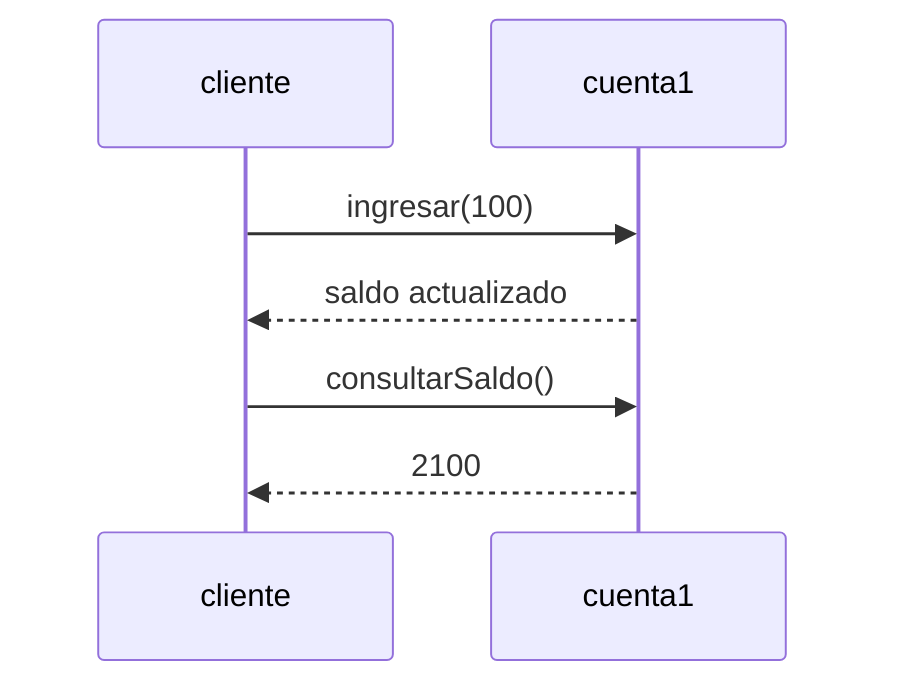

# 1. Objetos

## 1.1. Pensar en objetos

Cuando programas de forma tradicional piensas en **los pasos** que debe seguir el programa: leer un dato, calcular, mostrar el resultado. La **programación orientada a objetos** (POO) cambia la pregunta: ¿**qué cosas** existen en el problema y cómo se relacionan entre sí?

Un programa orientado a objetos es una pequeña simulación de una parte de la realidad. Está formado por **objetos** que colaboran enviándose **mensajes**: cada objeto pide servicios a otros y ofrece los suyos. Cada objeto es una **instancia** de alguna **clase**, y las clases se organizan entre sí mediante relaciones, entre ellas la **herencia**. Esta es, en esencia, la definición clásica de Grady Booch.

!!! info "Dos bloques para recorrer el curso"
    Los **elementos** de la POO son los objetos y las clases (capítulos 1 y 2). Los **principios** que dan sentido al paradigma son la encapsulación, la herencia y el polimorfismo (capítulos 3, 4 y 5).

## 1.2. Del mundo real a la simulación

Cualquier elemento del mundo real, por ejemplo un coche, un alumno o una factura, se puede describir con cuatro ideas. La POO traslada esa misma descripción al software:

| En el mundo real, un elemento tiene... | En el programa, un objeto tiene... |
|---|---|
| Una **identidad**: es él y no otro | Una **identidad**: es un objeto distinto de los demás |
| Unas **características** (marca, color, potencia) | Unos **datos**, llamados **atributos** |
| Un **estado** en cada momento (en marcha, a 60 km/h) | Los **valores** que tienen sus atributos en ese momento |
| Unos **comportamientos** (acelerar, frenar) | Unos **procedimientos**, llamados **métodos** |

Un **objeto** es, por tanto, un «paquete» de software independiente formado por un conjunto de datos junto con los procedimientos que operan sobre ellos. Puede representar algo **real** (un coche, un alumno) o algo **abstracto** (una factura, un pedido, una cuenta bancaria).

## 1.3. Atributos y métodos

Cada objeto constituye un universo cerrado y bien definido:

- Todo lo que un objeto **«sabe»** se expresa en sus **atributos**.
- Todo lo que un objeto **«puede hacer»** se expresa en sus **métodos**.

!!! example "Un coche como objeto"
    | Atributo | Valor |
    |---|---|
    | matrícula | 5671BCD |
    | marca | Ford |
    | modelo | Focus |
    | estado | en marcha |
    | potencia | 130 CV |
    | color | rojo |
    | luces | encendidas |
    | velocidad | 60 km/h |
    | peso | 1500 kg |

    **Métodos:** `ponerEnMarcha()`, `parar()`, `acelerar()`, `frenar()`, `encenderLuces()`, `apagarLuces()`.

Los objetos abstractos se describen igual. Una **factura** «sabe» su número, su importe y su fecha de emisión, y «puede» calcular su importe, enviarse al cliente o verificar si ha sido pagada:

| Atributos | Métodos |
|---|---|
| `numeroFactura` | `calcularImporte()` |
| `importe` | `enviar()` |
| `fechaEmision` | `verificarPago()` |

## 1.4. Identidad y estado

Dos conceptos conviene distinguir bien:

- **Identidad.** Dos coches de la misma marca, modelo y color, con idéntico valor en todos sus atributos, siguen siendo **dos objetos distintos**. La identidad no depende de los valores.
- **Estado.** Es el conjunto de valores de los atributos en un instante dado, y **cambia con el tiempo**. Los métodos son los que consultan y modifican ese estado.

| | Antes de `acelerar()` | Después de `acelerar()` |
|---|---|---|
| velocidad | 60 km/h | 80 km/h |
| estado | en marcha | en marcha |
| matrícula | 5671BCD | 5671BCD |

La velocidad (estado) ha cambiado; la matrícula (que identifica al coche) no.

## 1.5. Mensajes: cómo colaboran los objetos

Un sistema orientado a objetos es un conjunto de objetos que **interactúan enviándose mensajes**. Mediante un mensaje, un objeto solicita un servicio a otro. El objeto que lo recibe es quien decide **cómo** llevarlo a cabo.

!!! note "Mensaje = llamada a un método"
    En Java, enviar el mensaje `ingresar(100)` al objeto `cuenta1` se escribe `cuenta1.ingresar(100);`. Lo veremos en el capítulo 2.

## 1.6. Abstracción: quedarse con lo importante

Un objeto de un programa **no es** el objeto real: es un **modelo simplificado** que conserva solo lo que importa para el problema. A esta idea se la llama **abstracción**.

El mismo elemento del mundo real se modela de forma distinta según el sistema:

| Sistema | La «persona» se describe con... |
|---|---|
| Hospital | número de historia, grupo sanguíneo, alergias |
| Biblioteca | número de carné, libros prestados, fecha de devolución |
| Empresa | puesto, sueldo, departamento |

!!! tip "La pregunta de diseño"
    Antes de definir un objeto pregúntate: *¿qué necesita saber y qué necesita hacer este objeto para resolver mi problema?* Todo lo demás sobra.

## Resumen del capítulo

- Un **objeto** es un paquete de software con **datos** (atributos) y **procedimientos** (métodos).
- Se caracteriza por su **identidad**, su **estado** y su **comportamiento**.
- Los objetos **colaboran** enviándose **mensajes**.
- La **abstracción** consiste en modelar solo lo relevante del problema.

## Actividades

**Actividad 1.** Para un sistema de matrícula de un instituto, describe el objeto *Alumno*: propón al menos cinco atributos y cuatro métodos.

??? success "Solución orientativa"
    - **Atributos:** `nia`, `nombre`, `apellidos`, `fechaNacimiento`, `curso`.
    - **Métodos:** `matricular()`, `anularMatricula()`, `cambiarGrupo()`, `consultarNotas()`.

    Otras respuestas son válidas si responden a la pregunta de diseño: *¿qué necesita saber y hacer un alumno en este sistema?*

**Actividad 2.** El objeto *Libro* aparece en una librería online y en una biblioteca pública. Indica dos atributos que sean relevantes en ambos sistemas y dos que solo lo sean en uno de ellos.

??? success "Solución orientativa"
    - **En ambos:** `titulo`, `autor` (también `isbn`).
    - **Solo en la librería:** `precio`, `stock`.
    - **Solo en la biblioteca:** `ubicacionEstanteria`, `fechaDevolucion`.

    Es la abstracción en acción: el mismo elemento real, modelos distintos.

**Actividad 3.** Existen `cuenta1` y `cuenta2`, ambas con titular «Pérez» y saldo 2000 €. ¿Son el mismo objeto? Si ejecutamos `cuenta1.ingresar(100)`, ¿qué ocurre con `cuenta2`?

??? success "Solución"
    No son el mismo objeto: tienen **identidad** distinta aunque su estado coincida. Tras `cuenta1.ingresar(100)`, el estado de `cuenta1` pasa a 2100 € y **`cuenta2` no cambia**, porque cada objeto guarda sus propios valores.
