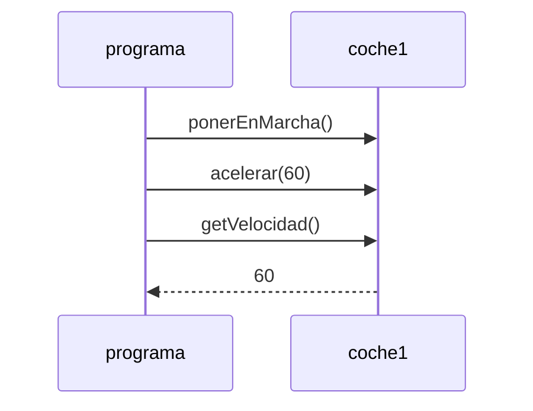

# 2. Objetos

En el [capítulo 1](01-clases.md) definimos la **plantilla**: la clase `Coche`. Ahora vamos a **usarla**: fabricar coches concretos, cada uno con sus valores, y hacer que hagan cosas.

## 2.1. Qué es un objeto

Un **objeto** es una **instancia de una clase**, creada en tiempo de ejecución. Es un «paquete» de software independiente que contiene **un valor para cada atributo** de la clase y puede recibir los **mensajes** que definen sus métodos.

Puede representar algo **real** (un coche, un alumno) o algo **abstracto** (una factura, un alquiler). Todo objeto se caracteriza por tres cosas:

| Característica | Qué es | En un `Coche` |
|---|---|---|
| **Identidad** | Lo distingue de cualquier otro objeto | Es *ese* coche y no otro |
| **Estado** | Los valores que tienen sus atributos en un instante | Rojo, 130 CV, a 60 km/h, en marcha |
| **Comportamiento** | Lo que puede hacer, definido por los métodos de su clase | Arrancar, acelerar, frenar |

Durante la ejecución de un programa se crean muchos objetos que **colaboran** entre sí.

## 2.2. Crear objetos: la instanciación

La creación de un objeto a partir de una clase se llama **instanciación**. En Java se hace con el operador `new`, que reserva memoria para el objeto y ejecuta su **constructor**.

```java
Coche coche1 = new Coche("5671BCD", "Ford", "Focus", "rojo", 130);
```

Los tres coches de la ilustración del capítulo anterior se crean así:

```java
// PruebaCoches.java
public class PruebaCoches {
    public static void main(String[] args) {
        // Instanciación: tres objetos de la misma clase
        Coche coche1 = new Coche("5671BCD", "Ford", "Focus", "rojo", 130);
        Coche coche2 = new Coche("4410KLM", "Seat", "Ibiza", "azul", 95);
        Coche coche3 = new Coche("8820HTX", "Renault", "Clio", "blanco", 90);

        // Mensajes: cada objeto cambia su propio estado
        coche1.ponerEnMarcha();
        coche1.acelerar(60);
        coche3.ponerEnMarcha();
        coche3.acelerar(110);

        System.out.println(coche1);
        System.out.println(coche2);
        System.out.println(coche3);
        System.out.println("Coches creados: " + Coche.getTotalCoches());
    }
}
```

```text
Coche{matricula=5671BCD, marca=Ford, modelo=Focus, color=rojo, potencia=130 CV, velocidad=60 km/h, enMarcha=true}
Coche{matricula=4410KLM, marca=Seat, modelo=Ibiza, color=azul, potencia=95 CV, velocidad=0 km/h, enMarcha=false}
Coche{matricula=8820HTX, marca=Renault, modelo=Clio, color=blanco, potencia=90 CV, velocidad=110 km/h, enMarcha=true}
Coches creados: 3
```

Muchas instancias de una misma clase pueden existir **simultáneamente** en memoria, cada una con **sus propios valores**. Observa que al acelerar `coche1` no cambia la velocidad de `coche2`.

La última línea usa el método estático `Coche.getTotalCoches()`: se invoca con el **nombre de la clase** porque el contador es de la clase, no de un objeto.

## 2.3. Mensajes: cómo colaboran los objetos

Un sistema orientado a objetos es un conjunto de objetos que **interactúan enviándose mensajes**. Mediante un mensaje, un objeto solicita un servicio a otro. El objeto que lo recibe es quien decide **cómo** llevarlo a cabo.



!!! note "Mensaje = llamada a un método"
    En Java, enviar el mensaje `acelerar(60)` al objeto `coche1` se escribe `coche1.acelerar(60);`. El objeto que recibe el mensaje ejecuta el método correspondiente **de su clase**.

## 2.4. Identidad y estado

Dos conceptos que conviene distinguir bien:

- **Identidad.** Dos coches con idéntico valor en todos sus atributos siguen siendo **dos objetos distintos**. La identidad no depende de los valores.
- **Estado.** Es el conjunto de valores de los atributos en un instante dado, y **cambia con el tiempo** cuando el objeto recibe mensajes.

| | Antes de `acelerar(20)` | Después de `acelerar(20)` |
|---|---|---|
| `velocidad` | 60 km/h | 80 km/h |
| `matricula` | 5671BCD | 5671BCD |

La velocidad (estado) ha cambiado; la matrícula (que identifica al coche) no.

## 2.5. Referencias a objetos

Una variable cuyo tipo es una clase **no contiene el objeto**, sino una **referencia** (la «dirección») a él. Declarar la variable no crea ningún objeto: el objeto se crea con `new`.

```java
Coche miCoche;                                   // referencia: vale null
miCoche = new Coche("1111AAA", "Opel", "Corsa", "gris", 75);   // ahora apunta a un objeto
```

Dos variables pueden referirse **al mismo objeto**. Copiar una referencia no copia el objeto. El operador `==` compara referencias, es decir, pregunta «¿son el mismo objeto?»:

```java
// PruebaIdentidad.java
public class PruebaIdentidad {
    public static void main(String[] args) {
        Coche x = new Coche("2222BBB", "Seat", "Ibiza", "azul", 95);
        Coche y = new Coche("2222BBB", "Seat", "Ibiza", "azul", 95);   // mismos valores, otro objeto
        Coche z = x;                                                   // z apunta al MISMO objeto que x

        System.out.println("x == y: " + (x == y));
        System.out.println("x == z: " + (x == z));

        x.pintar("verde");
        System.out.println("Color de x: " + x.getColor());
        System.out.println("Color de y: " + y.getColor());
        System.out.println("Color de z: " + z.getColor());
    }
}
```

```text
x == y: false
x == z: true
Color de x: verde
Color de y: azul
Color de z: verde
```

`x` e `y` tienen los mismos valores pero son objetos distintos (identidades distintas). `x` y `z` son **dos nombres para un único objeto**: pintar uno cambia lo que ve el otro.

Una referencia que vale `null` no apunta a ningún objeto. Enviarle un mensaje provoca el error `NullPointerException`:

```java
Coche c = null;
c.ponerEnMarcha();    // NullPointerException en tiempo de ejecución
```

### El recolector de basura

Los objetos consumen memoria mientras existen. En Java **no tienes que liberarla a mano**: un proceso llamado **recolector de basura** (*garbage collector*) detecta los objetos a los que ya no apunta ninguna referencia y recupera su espacio.

```java
Coche c = new Coche("3333CCC", "Fiat", "Panda", "blanco", 70);
c = new Coche("4444DDD", "Kia", "Rio", "negro", 85);   // el Fiat queda sin referencias
```

## Resumen del capítulo

- Un **objeto** es una **instancia** de una clase, con identidad, estado y comportamiento.
- Se crea con `new`, que ejecuta el constructor; cada objeto tiene **sus propios valores**.
- Los objetos **colaboran** enviándose **mensajes** (llamadas a métodos).
- La **identidad** distingue a un objeto de otro aunque tengan el mismo estado; el **estado** cambia con el tiempo.
- Las variables guardan **referencias**: dos referencias pueden apuntar al mismo objeto, y `null` no apunta a ninguno.

## Actividades

**Actividad 1.** ¿Qué imprime este programa? Explica por qué.

```java
// PruebaActividad.java
public class PruebaActividad {
    public static void main(String[] args) {
        Coche a = new Coche("0001AAA", "Opel", "Corsa", "gris", 75);
        Coche b = new Coche("0001AAA", "Opel", "Corsa", "gris", 75);
        Coche c = a;
        c.pintar("negro");
        System.out.println(a.getColor());
        System.out.println(b.getColor());
        System.out.println(a == c);
    }
}
```

??? success "Solución"
    ```text
    negro
    gris
    true
    ```
    `c` es una copia de la **referencia** de `a`, así que ambas apuntan al mismo objeto y pintar `c` cambia lo que ve `a`. `b` es otro objeto distinto, aunque sus valores coincidan.

**Actividad 2.** Escribe un programa que cree un `Coche`, lo ponga en marcha, lo acelere a 80 km/h, lo frene 30 km/h y muestre la velocidad final.

??? success "Solución"
    ```java
    // PruebaMensajes.java
    public class PruebaMensajes {
        public static void main(String[] args) {
            Coche coche = new Coche("5555EEE", "Toyota", "Yaris", "plata", 100);
            coche.ponerEnMarcha();
            coche.acelerar(80);
            coche.frenar(30);
            System.out.println("Velocidad final: " + coche.getVelocidad() + " km/h");
        }
    }
    ```

    ```text
    Velocidad final: 50 km/h
    ```

**Actividad 3.** Retoma la clase `Bicicleta` del capítulo anterior y añade un **contador estático** que indique cuántas bicicletas se han creado, con el método estático `getTotalBicicletas()`.

??? success "Solución"
    ```java
    // Bicicleta.java
    public class Bicicleta {
        private static int totalBicicletas = 0;   // compartido por todas
        private String marca;
        private int marchas;

        public Bicicleta(String marca, int marchas) {
            this.marca = marca;
            this.marchas = marchas;
            totalBicicletas++;                    // cada instanciación suma una
        }

        public int getMarchas() {
            return marchas;
        }

        public static int getTotalBicicletas() {
            return totalBicicletas;
        }

        @Override
        public String toString() {
            return "Bicicleta{marca=" + marca + ", marchas=" + marchas + "}";
        }
    }
    ```
    Tras `new Bicicleta("Orbea", 21); new Bicicleta("BH", 18);`, la llamada `Bicicleta.getTotalBicicletas()` devuelve `2`.
