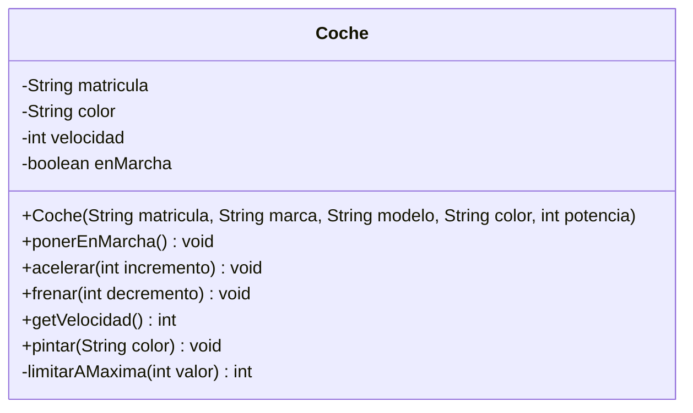

# 3. Encapsulación

## 3.1. La idea: una caja con botones

Cuando conduces no necesitas saber cómo funciona el motor: te basta con el volante, el acelerador y los pedales. Esos mandos son la **interfaz** del coche; el motor es su **implementación**, y queda oculta. Gracias a eso puedes conducir cualquier coche y, además, el fabricante puede cambiar el motor sin que tengas que aprender a conducir de nuevo.

La **encapsulación** (u **ocultamiento de información**) aplica esa idea a los objetos:

- Los **datos** (atributos) de un objeto normalmente están **ocultos**: solo se pueden tocar desde dentro del propio objeto.
- Algunas **operaciones** son accesibles desde fuera y constituyen los **servicios** que el objeto ofrece a los demás.
- Otras operaciones también están ocultas: son utilidades internas que el objeto usa para hacer su trabajo.

Los demás objetos solo ven el «qué» (los servicios), nunca el «cómo».

## 3.2. Modificadores de acceso

En Java el grado de ocultamiento se controla con los **modificadores de acceso**, que se aplican a atributos, métodos y constructores. Todo lo que hay en una clase es siempre accesible desde el código de **esa misma clase**; los modificadores regulan el acceso desde **otras** clases.

| Modificador | Misma clase | Mismo paquete | Subclase (otro paquete) | Resto |
|---|:---:|:---:|:---:|:---:|
| `private` | ✔ | ✘ | ✘ | ✘ |
| *(ninguno)* — paquete | ✔ | ✔ | ✘ | ✘ |
| `protected` | ✔ | ✔ | ✔ | ✘ |
| `public` | ✔ | ✔ | ✔ | ✔ |

!!! tip "Regla práctica"
    Atributos **`private`**; métodos **`public`** solo para los servicios que quieres ofrecer; métodos **`private`** para el trabajo interno. Abre el acceso únicamente cuando haya una razón.

## 3.3. El problema de no encapsular

Observa qué ocurre si dejamos la velocidad de un coche al alcance de cualquiera:

```java
public class CocheInseguro {
    public int velocidad;      // ¡cualquiera puede modificarlo!
}
```

```java
CocheInseguro c = new CocheInseguro();
c.velocidad = -300;            // nadie lo impide: velocidad negativa
c.velocidad = 900;             // ni un coche que supera los 900 km/h
```

Cualquier parte del programa puede dejar el objeto en un estado **inválido**, y si hay un error será imposible saber dónde se produjo.

## 3.4. La solución: atributos privados y métodos que controlan el acceso

Con atributos privados, la velocidad solo cambia a través de los métodos de la propia clase, que **comprueban** que lo que se pide tiene sentido. Así queda la clase `Coche` del [capítulo 1](01-clases.md) una vez encapsulada:

```java
// Coche.java
public class Coche {

    public static final int VELOCIDAD_MAXIMA = 220;   // constante pública: nadie puede cambiarla
    private static int totalCoches = 0;

    private final String matricula;
    private String marca;
    private String modelo;
    private String color;
    private int potencia;
    private int velocidad;
    private boolean enMarcha;

    public Coche(String matricula, String marca, String modelo, String color, int potencia) {
        if (potencia <= 0) {
            throw new IllegalArgumentException("La potencia debe ser positiva");
        }
        this.matricula = matricula;
        this.marca = marca;
        this.modelo = modelo;
        this.color = color;
        this.potencia = potencia;
        this.velocidad = 0;
        this.enMarcha = false;
        totalCoches++;
    }

    public void ponerEnMarcha() {
        enMarcha = true;
    }

    public void parar() {
        velocidad = 0;
        enMarcha = false;
    }

    public void acelerar(int incremento) {
        if (incremento <= 0) {
            throw new IllegalArgumentException("El incremento debe ser positivo");
        }
        if (!enMarcha) {
            throw new IllegalStateException("El coche está parado: hay que ponerlo en marcha");
        }
        velocidad = limitarAMaxima(velocidad + incremento);
    }

    public void frenar(int decremento) {
        if (decremento <= 0) {
            throw new IllegalArgumentException("El decremento debe ser positivo");
        }
        velocidad = Math.max(0, velocidad - decremento);
    }

    public void frenar() {
        velocidad = 0;
    }

    // Método auxiliar privado: utilidad interna, no forma parte del servicio
    private static int limitarAMaxima(int valor) {
        return Math.min(valor, VELOCIDAD_MAXIMA);
    }

    public String getMatricula() {
        return matricula;
    }

    public String getMarca() {
        return marca;
    }

    public String getModelo() {
        return modelo;
    }

    public String getColor() {
        return color;
    }

    public int getPotencia() {
        return potencia;
    }

    public int getVelocidad() {
        return velocidad;
    }

    public boolean isEnMarcha() {
        return enMarcha;
    }

    public void pintar(String color) {
        this.color = color;
    }

    public static int getTotalCoches() {
        return totalCoches;
    }

    @Override
    public String toString() {
        return "Coche{matricula=" + matricula + ", marca=" + marca + ", modelo=" + modelo
                + ", color=" + color + ", potencia=" + potencia + " CV"
                + ", velocidad=" + velocidad + " km/h, enMarcha=" + enMarcha + "}";
    }
}
```

```java
// PruebaEncapsulacion.java
public class PruebaEncapsulacion {
    public static void main(String[] args) {
        Coche coche = new Coche("5671BCD", "Ford", "Focus", "rojo", 130);

        try {
            coche.acelerar(50);                       // el coche aún no está en marcha
        } catch (IllegalStateException e) {
            System.out.println("Error: " + e.getMessage());
        }

        coche.ponerEnMarcha();
        coche.acelerar(150);
        System.out.println("Velocidad: " + coche.getVelocidad());

        coche.acelerar(150);                          // intenta superar el máximo
        System.out.println("Velocidad: " + coche.getVelocidad());

        try {
            coche.acelerar(-10);
        } catch (IllegalArgumentException e) {
            System.out.println("Error: " + e.getMessage());
        }
    }
}
```

```text
Error: El coche está parado: hay que ponerlo en marcha
Velocidad: 150
Velocidad: 220
Error: El incremento debe ser positivo
```

!!! note "Sobre `throw` y `try/catch`"
    `throw new IllegalArgumentException(...)` interrumpe la ejecución e informa de que alguien ha usado el método de forma incorrecta. `try/catch` permite capturar ese error y reaccionar. Las excepciones se estudian con detalle en el módulo de Programación.

## 3.5. Getters y setters

Para leer o modificar un atributo privado desde fuera se ofrecen métodos públicos:

- **Getter** (*de consulta*): devuelve el valor. Por convención `getColor()`, o `isEnMarcha()` para booleanos.
- **Setter** (*de modificación*): asigna un valor nuevo. Por convención `setColor(...)`; en `Coche` lo hemos llamado `pintar(...)` porque expresa mejor la acción.

La ventaja de un método de modificación frente a un atributo público es que puede **validar** el valor antes de aceptarlo.

!!! warning "No generes getters y setters por inercia"
    Encapsular **no** significa crear un getter y un setter para cada atributo. Eso solo traslada el problema. Pregúntate para cada atributo: ¿necesita leerse desde fuera? ¿Debe poder cambiarse? En `Coche`:

    - **No existe `setVelocidad`**: la velocidad solo cambia con `acelerar` y `frenar`, que mantienen el coche en un estado coherente.
    - **No existe `setMatricula`**: la matrícula es `final`, identifica al coche y no cambia.
    - **Sí existe `pintar`**: cambiar el color es una operación legítima.

## 3.6. Métodos privados auxiliares

No todos los métodos de una clase son servicios para el exterior. `limitarAMaxima` es una utilidad **interna** que `acelerar` usa para no superar la velocidad máxima. Al ser `private`, ninguna otra clase puede llamarla, y podemos cambiarla o eliminarla sin afectar a nadie. Es el tipo de método **auxiliar** que vimos en el [capítulo 1](01-clases.md#tipos-de-metodos).

## 3.7. Por qué compensa

- **Protege la coherencia** del objeto: no puede quedar en un estado inválido.
- **Localiza los errores**: si la velocidad es incorrecta, el fallo está en la clase `Coche`, no en cualquier parte del programa.
- **Permite cambiar la implementación** sin afectar a quien usa la clase. Si mañana `Coche` guarda la velocidad en metros por segundo en lugar de km/h, basta con cambiar dentro de la clase:

```java
private double velocidadMs;      // ahora se guarda en m/s

public int getVelocidad() {
    return (int) Math.round(velocidadMs * 3.6);   // pero se sigue ofreciendo en km/h
}
```

El resto del programa sigue llamando a `getVelocidad()` igual que antes.

## 3.8. En UML

En un diagrama de clases, la visibilidad se indica con un símbolo delante de cada atributo y método:

| Símbolo | Visibilidad | Java |
|:---:|---|---|
| `+` | Pública | `public` |
| `-` | Privada | `private` |
| `#` | Protegida | `protected` |
| `~` | Paquete | *(sin modificador)* |



Fíjate en que los atributos son privados (`-`), los servicios públicos (`+`) y el método auxiliar, privado: es la encapsulación hecha visible.

## Resumen del capítulo

- La **encapsulación** oculta los datos y expone solo los servicios del objeto.
- En Java se controla con `private`, *paquete*, `protected` y `public`.
- Atributos **privados**; acceso mediante métodos que pueden **validar**.
- Un setter no es obligatorio: ofrece solo lo que el objeto debe permitir.
- Los métodos **auxiliares** son privados.
- En UML se representa con `+`, `-`, `#` y `~`.

## Actividades

**Actividad 1.** Indica qué modificador de acceso usarías en cada caso y por qué: (a) el atributo `velocidad` de un coche; (b) el método `acelerar`; (c) un método auxiliar que comprueba si una matrícula tiene un formato válido y solo se usa dentro de la clase.

??? success "Solución"
    - (a) `private`: solo la propia clase debe tocar la velocidad.
    - (b) `public`: es un servicio que otros objetos deben poder pedir.
    - (c) `private`: es un detalle interno de la implementación.

**Actividad 2.** Escribe la clase `Deposito` con la capacidad (fija, positiva) y el nivel actual (inicialmente 0). Su método `repostar(double litros)` debe rechazar cantidades no positivas y, si los litros no caben, llenar solo lo que quede libre. Devuelve los litros realmente añadidos.

??? success "Solución"
    ```java
    // Deposito.java
    public class Deposito {
        private final double capacidad;
        private double nivel;

        public Deposito(double capacidad) {
            if (capacidad <= 0) {
                throw new IllegalArgumentException("La capacidad debe ser positiva");
            }
            this.capacidad = capacidad;
        }

        public double repostar(double litros) {
            if (litros <= 0) {
                throw new IllegalArgumentException("Los litros deben ser positivos");
            }
            double libre = capacidad - nivel;
            double anadido = Math.min(litros, libre);   // solo lo que cabe
            nivel += anadido;
            return anadido;
        }

        public double getNivel() {
            return nivel;
        }

        public double getCapacidad() {
            return capacidad;
        }
    }
    ```

**Actividad 3.** ¿Por qué la clase `Coche` no tiene un método `setVelocidad`? ¿Qué problema aparecería si lo tuviera?

??? success "Solución"
    Con `setVelocidad(int)` cualquier clase podría asignar la velocidad que quisiera, saltándose las comprobaciones de `acelerar` y `frenar` (por ejemplo, dejarla negativa, superar la máxima o acelerar con el coche parado). Sin él, la única forma de cambiar la velocidad es mediante operaciones que mantienen el objeto coherente.
