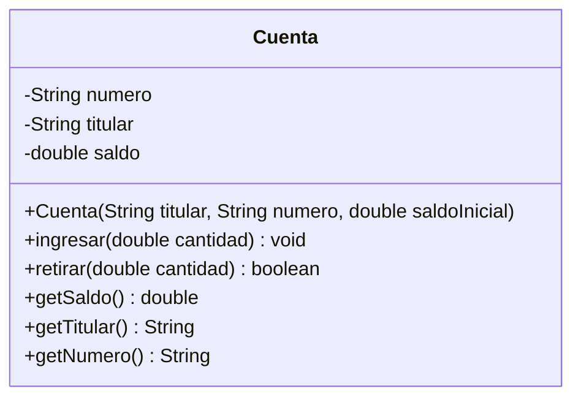

# 3. Encapsulación

## 3.1. La idea: una caja con botones

Cuando conduces no necesitas saber cómo funciona el motor: te basta con el volante, el acelerador y los pedales. Esos mandos son la **interfaz** del coche; el motor es su **implementación**, y queda oculta. Gracias a eso puedes conducir cualquier coche y, además, el fabricante puede cambiar el motor sin que tengas que aprender a conducir de nuevo.

La **encapsulación** (u **ocultamiento de información**) aplica esa idea a los objetos:

- Los **datos** (atributos) de un objeto normalmente están **ocultos**: solo se pueden tocar desde dentro del propio objeto.
- Algunas **operaciones** son accesibles desde fuera y constituyen los **servicios** que el objeto ofrece a los demás.
- Otras operaciones también están ocultas: son utilidades internas que el objeto usa para hacer su trabajo.

Los demás objetos solo ven el «qué» (los servicios), nunca el «cómo».

## 3.2. Modificadores de acceso

En Java el grado de ocultamiento se controla con los **modificadores de acceso**, que se aplican a atributos, métodos y constructores. Todo lo que hay en una clase es siempre accesible desde el código de **esa misma clase**; los modificadores regulan el acceso desde **otras** clases.

| Modificador | Misma clase | Mismo paquete | Subclase (otro paquete) | Resto |
|---|:---:|:---:|:---:|:---:|
| `private` | ✔ | ✘ | ✘ | ✘ |
| *(ninguno)* — paquete | ✔ | ✔ | ✘ | ✘ |
| `protected` | ✔ | ✔ | ✔ | ✘ |
| `public` | ✔ | ✔ | ✔ | ✔ |

!!! tip "Regla práctica"
    Atributos **`private`**; métodos **`public`** solo para los servicios que quieres ofrecer; métodos **`private`** para el trabajo interno. Abre el acceso únicamente cuando haya una razón.

## 3.3. El problema de no encapsular

Observa qué ocurre si dejamos el saldo de una cuenta al alcance de cualquiera:

```java
public class CuentaInsegura {
    public double saldo;      // ¡cualquiera puede modificarlo!
}
```

```java
CuentaInsegura c = new CuentaInsegura();
c.saldo = -5000;              // nadie lo impide: el objeto queda en un estado absurdo
```

Cualquier parte del programa puede dejar el objeto en un estado **inválido**, y si hay un error será imposible saber dónde se produjo.

## 3.4. La solución: atributos privados y métodos que controlan el acceso

Con atributos privados, el saldo solo cambia a través de los métodos de la propia clase, que **comprueban** que lo que se pide tiene sentido:

```java
// Cuenta.java
public class Cuenta {

    private final String numero;     // no cambia nunca tras crearse
    private String titular;
    private double saldo;

    public Cuenta(String titular, String numero, double saldoInicial) {
        if (saldoInicial < 0) {
            throw new IllegalArgumentException("El saldo inicial no puede ser negativo");
        }
        this.titular = titular;
        this.numero = numero;
        this.saldo = saldoInicial;
    }

    public void ingresar(double cantidad) {
        if (cantidad <= 0) {
            throw new IllegalArgumentException("La cantidad a ingresar debe ser positiva");
        }
        saldo += cantidad;
    }

    public boolean retirar(double cantidad) {
        if (cantidad <= 0) {
            throw new IllegalArgumentException("La cantidad a retirar debe ser positiva");
        }
        if (cantidad > saldo) {
            return false;            // saldo insuficiente: no se retira nada
        }
        saldo -= cantidad;
        return true;
    }

    public double getSaldo() {
        return saldo;
    }

    public String getTitular() {
        return titular;
    }

    public String getNumero() {
        return numero;
    }
}
```

```java
// PruebaEncapsulacion.java
public class PruebaEncapsulacion {
    public static void main(String[] args) {
        Cuenta cuenta = new Cuenta("Pérez", "154000345", 2000);

        cuenta.ingresar(500);
        System.out.println("Saldo: " + cuenta.getSaldo());
        System.out.println("¿Retirada de 3000? " + cuenta.retirar(3000));
        System.out.println("¿Retirada de 1000? " + cuenta.retirar(1000));
        System.out.println("Saldo: " + cuenta.getSaldo());

        try {
            cuenta.ingresar(-50);
        } catch (IllegalArgumentException e) {
            System.out.println("Error: " + e.getMessage());
        }
    }
}
```

```text
Saldo: 2500.0
¿Retirada de 3000? false
¿Retirada de 1000? true
Saldo: 1500.0
Error: La cantidad a ingresar debe ser positiva
```

!!! note "Sobre `throw` y `try/catch`"
    `throw new IllegalArgumentException(...)` interrumpe la ejecución e informa de que alguien ha usado el método de forma incorrecta. `try/catch` permite capturar ese error y reaccionar. Las excepciones se estudian con detalle en el módulo de Programación.

## 3.5. Getters y setters

Para leer o modificar un atributo privado desde fuera se ofrecen métodos públicos:

- **Getter** (*acceso*): devuelve el valor. Por convención `getNombre()`, o `isActivo()` para booleanos.
- **Setter** (*modificación*): asigna un valor nuevo. Por convención `setNombre(...)`.

La ventaja de un setter frente a un atributo público es que puede **validar** el valor antes de aceptarlo. Así queda la clase `Persona` del capítulo 2 con la edad protegida:

```java
public class Persona {
    private final String dni;          // el DNI no se puede cambiar
    private int edad;
    // ...

    public Persona(String dni, String nombre, int edad, String estadoCivil) {
        this.dni = dni;
        this.edad = validarEdad(edad);
        // ...
    }

    public void setEdad(int edad) {
        this.edad = validarEdad(edad);
    }

    // Método privado: utilidad interna, no forma parte del servicio
    private static int validarEdad(int edad) {
        if (edad < 0) {
            throw new IllegalArgumentException("La edad no puede ser negativa");
        }
        return edad;
    }
}
```

!!! warning "No generes getters y setters por inercia"
    Encapsular **no** significa crear un getter y un setter para cada atributo. Eso solo traslada el problema. Pregúntate para cada atributo: ¿necesita leerse desde fuera? ¿Debe poder cambiarse? En `Cuenta` **no existe `setSaldo`** a propósito: el saldo solo debe variar mediante `ingresar` y `retirar`.

## 3.6. Por qué compensa

- **Protege la coherencia** del objeto: no puede quedar en un estado inválido.
- **Localiza los errores**: si el saldo es incorrecto, el fallo está en la clase `Cuenta`, no en cualquier parte del programa.
- **Permite cambiar la implementación** sin afectar a quien usa la clase. Si mañana `Persona` guarda la fecha de nacimiento en lugar de la edad, basta con cambiar dentro de la clase:

```java
private LocalDate fechaNacimiento;

public int getEdad() {
    return Period.between(fechaNacimiento, LocalDate.now()).getYears();
}
```

El resto del programa sigue llamando a `getEdad()` igual que antes.

## 3.7. En UML

En un diagrama de clases, la visibilidad se indica con un símbolo delante de cada atributo y método:

| Símbolo | Visibilidad | Java |
|:---:|---|---|
| `+` | Pública | `public` |
| `-` | Privada | `private` |
| `#` | Protegida | `protected` |
| `~` | Paquete | *(sin modificador)* |



Fíjate en que los atributos son privados (`-`) y los servicios públicos (`+`): es la encapsulación hecha visible.

## Resumen del capítulo

- La **encapsulación** oculta los datos y expone solo los servicios del objeto.
- En Java se controla con `private`, *paquete*, `protected` y `public`.
- Atributos **privados**; acceso mediante métodos que pueden **validar**.
- Un setter no es obligatorio: ofrece solo lo que el objeto debe permitir.
- En UML se representa con `+`, `-`, `#` y `~`.

## Actividades

**Actividad 1.** Indica qué modificador de acceso usarías en cada caso y por qué: (a) el atributo `saldo` de una cuenta; (b) el método `ingresar` de la cuenta; (c) un método auxiliar que valida el formato de un IBAN y solo se usa dentro de la clase.

??? success "Solución"
    - (a) `private`: solo la propia clase debe tocar el saldo.
    - (b) `public`: es un servicio que otros objetos deben poder pedir.
    - (c) `private`: es un detalle interno de la implementación.

**Actividad 2.** Escribe la clase `Termostato` con un atributo `temperatura` (inicialmente 20.0). Solo debe aceptar valores entre 5.0 y 35.0; fuera de ese rango, `setTemperatura` lanzará una `IllegalArgumentException`.

??? success "Solución"
    ```java
    // Termostato.java
    public class Termostato {
        private static final double MIN = 5.0;
        private static final double MAX = 35.0;

        private double temperatura = 20.0;

        public double getTemperatura() {
            return temperatura;
        }

        public void setTemperatura(double temperatura) {
            if (temperatura < MIN || temperatura > MAX) {
                throw new IllegalArgumentException(
                        "Temperatura fuera de rango (" + MIN + " a " + MAX + ")");
            }
            this.temperatura = temperatura;
        }
    }
    ```

**Actividad 3.** ¿Por qué la clase `Cuenta` no tiene un método `setSaldo`? ¿Qué problema aparecería si lo tuviera?

??? success "Solución"
    Con `setSaldo(double)` cualquier clase podría asignar el saldo que quisiera, saltándose las comprobaciones de `ingresar` y `retirar` (por ejemplo, dejarlo negativo o inventar dinero). Sin él, la única forma de cambiar el saldo es mediante operaciones que mantienen el objeto coherente.
