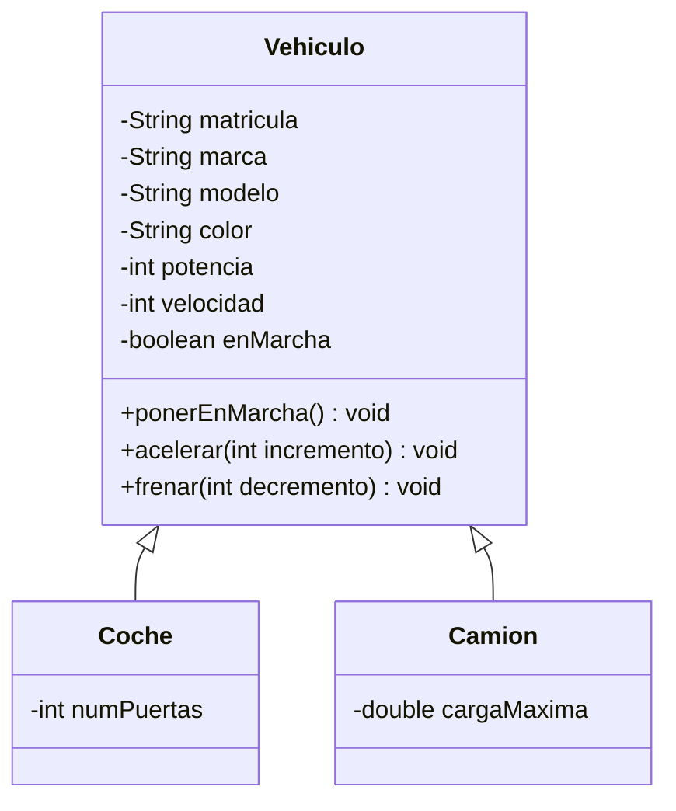
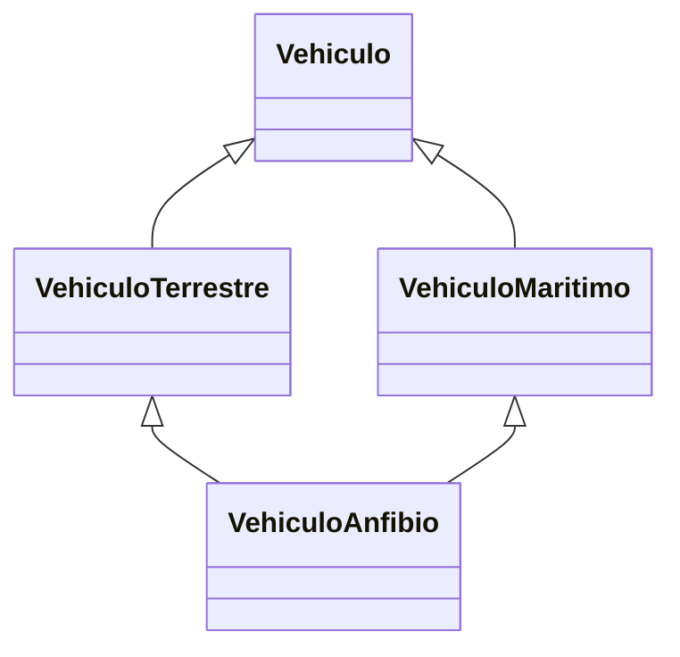
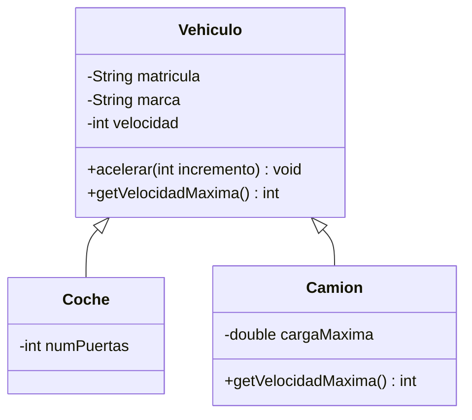

# 4. Herencia

## 4.1. Agrupar clases: superclases y subclases

En el [capítulo 1](01-clases.md) vimos que los objetos con la misma estructura y comportamiento se agrupan en clases. Pero las **clases** también se parecen entre sí y pueden reagruparse. Imagina que nuestra empresa de alquiler incorpora **camiones**. Un camión también tiene matrícula, marca, velocidad y puede acelerar y frenar, igual que un coche. Copiar todo el código de `Coche` en una clase `Camion` sería un error: cualquier cambio habría que hacerlo dos veces.

La solución es la **herencia**: una clase (la **subclase** o clase derivada) **reutiliza los atributos y métodos** de otra (la **superclase** o clase base) y puede añadir los suyos o modificar los heredados. Extraemos lo común a una clase `Vehiculo`, y `Coche` y `Camion` se limitan a añadir lo que los distingue.



Lo común (`matricula`, `acelerar()`...) se define **una sola vez** en `Vehiculo`; cada subclase añade solo lo que la distingue. Se establece así una **jerarquía de clases**.

- **Generalización:** subir en la jerarquía, de lo concreto a lo genérico (de `Camion` a `Vehiculo`).
- **Especialización:** bajar en la jerarquía, de lo genérico a lo concreto (de `Vehiculo` a `Camion`).

## 4.2. La relación «es-un»

La herencia modela una relación **«es-un»** (*is-a*): un coche **es un** vehículo; un camión **es un** vehículo. Este es el test para saber si la herencia tiene sentido:

> Si puedes decir «*la subclase* **es un** *la superclase*» sin que suene raro, la herencia es adecuada.

Una subclase hereda **todo lo que es de la superclase** y, además, puede:

- **Añadir** atributos y métodos nuevos (ampliar la interfaz).
- **Redefinir** métodos heredados para darles un comportamiento propio.

## 4.3. Herencia en Java: `extends`

En Java se hereda con la palabra clave `extends`. Primero, la superclase `Vehiculo`, con lo común a todos los vehículos. Es el `Coche` del capítulo 3 sin la parte específica de los coches (observa el método `getVelocidadMaxima()`, que usaremos enseguida):

```java
// Vehiculo.java
public class Vehiculo {

    private final String matricula;
    private String marca;
    private String modelo;
    private String color;
    private int potencia;
    private int velocidad;
    private boolean enMarcha;

    public Vehiculo(String matricula, String marca, String modelo, String color, int potencia) {
        if (potencia <= 0) {
            throw new IllegalArgumentException("La potencia debe ser positiva");
        }
        this.matricula = matricula;
        this.marca = marca;
        this.modelo = modelo;
        this.color = color;
        this.potencia = potencia;
    }

    public void ponerEnMarcha() {
        enMarcha = true;
    }

    public void parar() {
        velocidad = 0;
        enMarcha = false;
    }

    public void acelerar(int incremento) {
        if (incremento <= 0) {
            throw new IllegalArgumentException("El incremento debe ser positivo");
        }
        if (!enMarcha) {
            throw new IllegalStateException("El vehículo está parado: hay que ponerlo en marcha");
        }
        velocidad = Math.min(velocidad + incremento, getVelocidadMaxima());
    }

    public void frenar(int decremento) {
        if (decremento <= 0) {
            throw new IllegalArgumentException("El decremento debe ser positivo");
        }
        velocidad = Math.max(0, velocidad - decremento);
    }

    // Velocidad máxima por defecto; las subclases pueden redefinirla
    public int getVelocidadMaxima() {
        return 180;
    }

    public String getMatricula() {
        return matricula;
    }

    public String getMarca() {
        return marca;
    }

    public String getModelo() {
        return modelo;
    }

    public String getColor() {
        return color;
    }

    public int getPotencia() {
        return potencia;
    }

    public int getVelocidad() {
        return velocidad;
    }

    public boolean isEnMarcha() {
        return enMarcha;
    }

    public void pintar(String color) {
        this.color = color;
    }

    @Override
    public String toString() {
        return "Vehiculo{matricula=" + matricula + ", marca=" + marca + ", modelo=" + modelo
                + ", color=" + color + ", velocidad=" + velocidad + " km/h}";
    }
}
```

Ahora `Coche` hereda de `Vehiculo`:

```java
public class Coche extends Vehiculo {
    // ...
}
```

`Coche` **hereda** de `Vehiculo` todos sus atributos y métodos. Un objeto `Coche` tiene matrícula, marca, velocidad... aunque no los haya escrito en su clase, y puede recibir mensajes como `acelerar()` o `pintar()`.

!!! warning "Heredar no es poder acceder"
    Los atributos de `Vehiculo` son `private`. El objeto `Coche` **los contiene**, pero el código de `Coche` no puede escribir `velocidad` directamente: debe usar los métodos públicos heredados (`getVelocidad()`). Es la encapsulación del [capítulo 3](03-encapsulacion.md) en acción. Si quisieras que las subclases accedan directamente, usarías `protected`, pero se recomienda evitarlo salvo necesidad.

## 4.4. Constructores y `super`

Los **constructores no se heredan**. Cada clase tiene los suyos. Como un `Coche` es, ante todo, un `Vehiculo`, al crearlo hay que construir primero esa parte: la subclase **debe invocar un constructor de la superclase** con `super(...)`, y debe ser la **primera sentencia** del constructor.

```java
// Coche.java
public class Coche extends Vehiculo {

    private final int numPuertas;

    public Coche(String matricula, String marca, String modelo, String color,
                 int potencia, int numPuertas) {
        super(matricula, marca, modelo, color, potencia);   // construye la parte Vehiculo
        this.numPuertas = numPuertas;
    }

    public int getNumPuertas() {
        return numPuertas;
    }

    @Override
    public String toString() {
        return super.toString() + " | Coche{puertas=" + numPuertas + "}";
    }
}
```

Si no escribes la llamada a `super(...)`, el compilador añade `super();` por su cuenta. Eso solo funciona si la superclase tiene un constructor **sin parámetros**; si no, obtendrás un error de compilación:

```text
error: constructor Vehiculo in class Vehiculo cannot be applied to given types;
```

!!! info "Orden de construcción"
    Al crear un objeto se ejecutan los constructores **de arriba abajo**: primero el de la superclase y después el de la subclase.

## 4.5. Redefinición de métodos (*override*)

Una subclase puede **redefinir** (o *sobrescribir*) un método heredado escribiendo otro con **la misma firma** (mismo nombre y mismos parámetros). Se recomienda marcarlo con `@Override`: si te equivocas en la firma, el compilador te avisa.

Para reutilizar el comportamiento de la superclase dentro del método redefinido se usa `super.nombreMetodo(...)`. Lo hemos hecho en `Coche.toString()`, que completa el texto de `Vehiculo.toString()`.

Un camión es más lento que un coche: su velocidad máxima es 90 km/h. `Camion` **redefine** `getVelocidadMaxima()`:

```java
// Camion.java
public class Camion extends Vehiculo {

    private final double cargaMaxima;      // en kg

    public Camion(String matricula, String marca, String modelo, String color,
                  int potencia, double cargaMaxima) {
        super(matricula, marca, modelo, color, potencia);
        this.cargaMaxima = cargaMaxima;
    }

    public double getCargaMaxima() {
        return cargaMaxima;
    }

    @Override
    public int getVelocidadMaxima() {
        return 90;                         // redefine el valor de Vehiculo (180)
    }

    @Override
    public String toString() {
        return super.toString() + " | Camion{cargaMaxima=" + cargaMaxima + " kg}";
    }
}
```

```java
// PruebaHerencia.java
public class PruebaHerencia {
    public static void main(String[] args) {
        Coche coche = new Coche("5671BCD", "Ford", "Focus", "rojo", 130, 5);
        Camion camion = new Camion("1234XYZ", "Volvo", "FH", "blanco", 460, 18000);

        coche.ponerEnMarcha();
        camion.ponerEnMarcha();
        coche.acelerar(200);               // acelerar() está en Vehiculo
        camion.acelerar(200);

        System.out.println("Coche: " + coche.getVelocidad() + " km/h");
        System.out.println("Camión: " + camion.getVelocidad() + " km/h");

        coche.pintar("negro");             // método heredado
        System.out.println(coche);
    }
}
```

```text
Coche: 180 km/h
Camión: 90 km/h
Vehiculo{matricula=5671BCD, marca=Ford, modelo=Focus, color=negro, velocidad=180 km/h} | Coche{puertas=5}
```

Ambos reciben el mismo mensaje `acelerar(200)`, pero el coche llega a 180 y el camión se queda en 90. Si te preguntas cómo lo logra el método `acelerar()` de `Vehiculo`, lo verás en el [capítulo 5](05-polimorfismo.md).

!!! note "Redefinir no es sobrecargar"
    | | Sobrecarga (*overload*) | Redefinición (*override*) |
    |---|---|---|
    | Dónde | En la **misma** clase | En una **subclase** |
    | Firma | Mismo nombre, parámetros **distintos** | Mismo nombre y **mismos** parámetros |
    | Para qué | Ofrecer varias formas de invocar | Cambiar el comportamiento heredado |

### Cómo se busca un método

Cuando un objeto recibe un mensaje, Java busca el método **en su propia clase** y, si no lo encuentra, **sube por la jerarquía**: primero la superclase, luego la superclase de ésta, y así sucesivamente. Si `coche.pintar("negro")` no está en `Coche`, se encuentra en `Vehiculo`.

Todas las clases de Java heredan, en última instancia, de la clase `Object`, que es la raíz de la jerarquía. Por eso todos los objetos tienen `toString()`, aunque no lo hayas escrito.

### Impedir la herencia o la redefinición

- Una clase `final` **no puede tener subclases**.
- Un método `final` **no puede redefinirse** en las subclases.

## 4.6. Herencia simple y múltiple

- **Herencia simple:** una clase hereda de **una única** superclase. Es el caso de `Coche` respecto a `Vehiculo`.
- **Herencia múltiple:** una clase hereda de **varias** superclases a la vez.



La herencia múltiple trae **conflictos**: si las dos superclases tienen un método o un atributo con el mismo nombre, ¿cuál hereda la subclase? Pueden chocar los nombres, los valores, los valores por defecto o las restricciones. Los lenguajes que la admiten resuelven esos conflictos con una **lista de precedencia** de clases o con una **herencia selectiva**.

!!! info "En Java"
    Una clase **solo puede extender una clase** (`extends` admite una única superclase). Para obtener parte de las ventajas de la herencia múltiple se usan las **interfaces**, que veremos en el [capítulo 5](05-polimorfismo.md).

## 4.7. Ventajas y precauciones

**Ventajas**

- **Reutilización del software:** se escribe una vez y se aprovecha en todas las subclases.
- **Menor coste y mayor seguridad:** código ya probado.
- **Consistencia de la interfaz:** las subclases de una misma superclase se comportan de forma parecida.
- **Prototipado rápido:** se parte de clases existentes.

**Precauciones**

!!! warning "Herencia no es «copiar código»"
    Hereda solo cuando se cumpla la relación **«es-un»**. Una clase `Coche` **no** hereda de `Motor`: un coche **tiene un** motor. Heredar para reutilizar código cuando no hay una relación «es-un» crea jerarquías confusas y frágiles. Esa relación «tiene-un» se modela con **asociación, agregación o composición**, que veremos en el [capítulo 6](06-relaciones.md).

## 4.8. En UML

La herencia (**generalización**) se dibuja con una **flecha de línea continua y punta triangular hueca** que va de la subclase a la superclase.



En el diagrama solo aparecen los elementos **propios** de cada clase; lo heredado no se repite. `Camion` vuelve a mostrar `getVelocidadMaxima()` porque lo **redefine**.

## Resumen del capítulo

- La **herencia** permite que una subclase reutilice y especialice la superclase.
- Debe cumplirse la relación **«es-un»**.
- En Java: `extends`, `super(...)` en el constructor, `super.metodo()` y `@Override`.
- Los constructores **no se heredan**; el de la superclase se invoca con `super(...)`.
- Java solo admite **herencia simple** entre clases.
- En UML: flecha con triángulo hueco hacia la superclase.

## Actividades

**Actividad 1.** Indica en cuáles de estas parejas tiene sentido la herencia y justifica con el test «es-un»: (a) `Furgoneta` / `Vehiculo`; (b) `Coche` / `Motor`; (c) `Moto` / `Vehiculo`; (d) `Flota` / `Vehiculo`.

??? success "Solución"
    - (a) **Sí**: una furgoneta *es un* vehículo.
    - (b) **No**: un coche *tiene un* motor. Es composición, no herencia.
    - (c) **Sí**: una moto *es un* vehículo.
    - (d) **No**: una flota *no es* un vehículo; *está formada por* vehículos. Es una agregación.

**Actividad 2.** Escribe la clase `Furgoneta`, un tipo de camión ligero: subclase de `Camion`, cuya velocidad máxima es 130 km/h.

??? success "Solución"
    ```java
    // Furgoneta.java
    public class Furgoneta extends Camion {

        public Furgoneta(String matricula, String marca, String modelo, String color,
                         int potencia, double cargaMaxima) {
            super(matricula, marca, modelo, color, potencia, cargaMaxima);
        }

        @Override
        public int getVelocidadMaxima() {
            return 130;
        }
    }
    ```

**Actividad 3.** ¿Qué imprime este programa? Explica el orden.

```java
// PruebaOrden.java
class A {
    A() { System.out.println("Constructor de A"); }
}

class B extends A {
    B() { System.out.println("Constructor de B"); }
}

class C extends B {
    C() { System.out.println("Constructor de C"); }
}

public class PruebaOrden {
    public static void main(String[] args) {
        new C();
    }
}
```

??? success "Solución"
    ```text
    Constructor de A
    Constructor de B
    Constructor de C
    ```
    Aunque `B` y `C` no escriben `super()`, el compilador lo añade como primera sentencia. Por eso se construye siempre **de arriba abajo**: primero la superclase.
