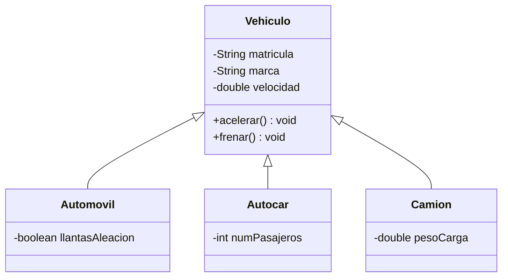
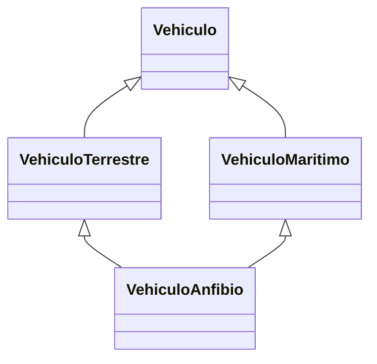
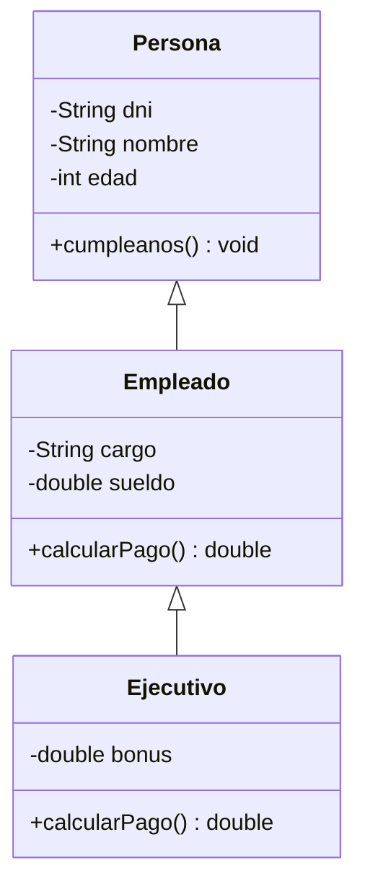

# 4. Herencia

## 4.1. Agrupar clases: superclases y subclases

En el [capítulo 2](02-clases.md) vimos que los objetos con la misma estructura y comportamiento se agrupan en clases. Pero las **clases** también se parecen entre sí y pueden reagruparse. Automóviles, autocares y camiones son clases distintas, pero todos son **vehículos**: tienen matrícula, marca, velocidad y pueden acelerar y frenar.

La **herencia** es el mecanismo por el que una clase (la **subclase** o clase derivada) **reutiliza los atributos y métodos** de otra (la **superclase** o clase base), y puede añadir los suyos o modificar los heredados.



Lo común (`matricula`, `acelerar()`...) se define **una sola vez** en `Vehiculo`; cada subclase añade solo lo que la distingue. Se establece así una **jerarquía de clases**.

- **Generalización:** subir en la jerarquía, de lo concreto a lo genérico (de `Camion` a `Vehiculo`).
- **Especialización:** bajar en la jerarquía, de lo genérico a lo concreto (de `Vehiculo` a `Camion`).

## 4.2. La relación «es-un»

La herencia modela una relación **«es-un»** (*is-a*): un automóvil **es un** vehículo; un empleado **es una** persona. Este es el test para saber si la herencia tiene sentido:

> Si puedes decir «*la subclase* **es un** *la superclase*» sin que suene raro, la herencia es adecuada.

Una subclase hereda **todo lo que es de la superclase** y, además, puede:

- **Añadir** atributos y métodos nuevos (ampliar la interfaz).
- **Redefinir** métodos heredados para darles un comportamiento propio.

## 4.3. Herencia en Java: `extends`

En Java se hereda con la palabra clave `extends`:

```java
public class Empleado extends Persona {
    // ...
}
```

`Empleado` **hereda** de `Persona` todos sus atributos y métodos. Un objeto `Empleado` tiene `dni`, `nombre`, `edad` y `estadoCivil` aunque no los haya escrito en su clase, y puede recibir mensajes como `getNombre()` o `cumpleanos()`.

!!! warning "Heredar no es poder acceder"
    Los atributos de `Persona` son `private`. El objeto `Empleado` **los contiene**, pero el código de `Empleado` no puede escribir `nombre` directamente: debe usar los métodos públicos heredados (`getNombre()`). Es la encapsulación del [capítulo 3](03-encapsulacion.md) en acción. Si quisieras que las subclases accedan directamente, usarías `protected`, pero se recomienda evitarlo salvo necesidad.

## 4.4. Constructores y `super`

Los **constructores no se heredan**. Cada clase tiene los suyos. Como un `Empleado` es, ante todo, una `Persona`, al crearlo hay que construir primero esa parte: la subclase **debe invocar un constructor de la superclase** con `super(...)`, y debe ser la **primera sentencia** del constructor.

```java
// Empleado.java
public class Empleado extends Persona {

    private String cargo;
    private double sueldo;

    public Empleado(String dni, String nombre, int edad, String estadoCivil,
                    String cargo, double sueldo) {
        super(dni, nombre, edad, estadoCivil);   // construye la parte Persona
        this.cargo = cargo;
        this.sueldo = sueldo;
    }

    public String getCargo() {
        return cargo;
    }

    public double getSueldo() {
        return sueldo;
    }

    public void subeSueldo(double cantidad) {
        sueldo += cantidad;
    }

    public double calcularPago() {
        return sueldo;
    }

    @Override
    public String toString() {
        return super.toString() + " | Empleado{cargo=" + cargo + ", sueldo=" + sueldo + "}";
    }
}
```

Si no escribes la llamada a `super(...)`, el compilador añade `super();` por su cuenta. Eso solo funciona si la superclase tiene un constructor **sin parámetros**; si no, obtendrás un error de compilación:

```text
error: constructor Persona in class Persona cannot be applied to given types;
```

!!! info "Orden de construcción"
    Al crear un objeto se ejecutan los constructores **de arriba abajo**: primero el de la superclase y después el de la subclase.

## 4.5. Redefinición de métodos (*override*)

Una subclase puede **redefinir** (o *sobrescribir*) un método heredado escribiendo otro con **la misma firma** (mismo nombre y mismos parámetros). Se recomienda marcarlo con `@Override`: si te equivocas en la firma, el compilador te avisa.

Para reutilizar el comportamiento de la superclase dentro del método redefinido se usa `super.nombreMetodo(...)`. Lo hemos hecho en `Empleado.toString()`, que completa el texto de `Persona.toString()`.

Veamos una nueva subclase, `Ejecutivo`, que cobra además un *bonus*:

```java
// Ejecutivo.java
public class Ejecutivo extends Empleado {

    private double bonus;

    public Ejecutivo(String dni, String nombre, int edad, String estadoCivil,
                     String cargo, double sueldo, double bonus) {
        super(dni, nombre, edad, estadoCivil, cargo, sueldo);
        this.bonus = bonus;
    }

    public double getBonus() {
        return bonus;
    }

    @Override
    public double calcularPago() {
        return super.calcularPago() + bonus;     // sueldo + bonus
    }

    @Override
    public String toString() {
        return super.toString() + " | Ejecutivo{bonus=" + bonus + "}";
    }
}
```

```java
// PruebaHerencia.java
public class PruebaHerencia {
    public static void main(String[] args) {
        Empleado emp = new Empleado("452697419Z", "Maria", 25, "soltera", "Programadora", 1000);
        Ejecutivo eje = new Ejecutivo("987654321X", "Lucía", 48, "casada", "Directora", 3000, 500);

        emp.cumpleanos();                       // método heredado de Persona
        System.out.println(emp.getNombre() + " tiene " + emp.getEdad() + " años");
        System.out.println(emp.getNombre() + " cobra " + emp.calcularPago());
        System.out.println(eje.getNombre() + " cobra " + eje.calcularPago());
        System.out.println(eje);
    }
}
```

```text
Maria tiene 26 años
Maria cobra 1000.0
Lucía cobra 3500.0
Persona{dni=987654321X, nombre=Lucía, edad=48, estadoCivil=casada} | Empleado{cargo=Directora, sueldo=3000.0} | Ejecutivo{bonus=500.0}
```

!!! note "Redefinir no es sobrecargar"
    | | Sobrecarga (*overload*) | Redefinición (*override*) |
    |---|---|---|
    | Dónde | En la **misma** clase | En una **subclase** |
    | Firma | Mismo nombre, parámetros **distintos** | Mismo nombre y **mismos** parámetros |
    | Para qué | Ofrecer varias formas de invocar | Cambiar el comportamiento heredado |

### Cómo se busca un método

Cuando un objeto recibe un mensaje, Java busca el método **en su propia clase** y, si no lo encuentra, **sube por la jerarquía**: primero la superclase, luego la superclase de ésta, y así sucesivamente. Si `eje.getNombre()` no está en `Ejecutivo` ni en `Empleado`, se encuentra en `Persona`.

Todas las clases de Java heredan, en última instancia, de la clase `Object`, que es la raíz de la jerarquía. Por eso todos los objetos tienen `toString()`, aunque no lo hayas escrito.

### Impedir la herencia o la redefinición

- Una clase `final` **no puede tener subclases**.
- Un método `final` **no puede redefinirse** en las subclases.

## 4.6. Herencia simple y múltiple

- **Herencia simple:** una clase hereda de **una única** superclase. Es el caso de `Empleado` respecto a `Persona`.
- **Herencia múltiple:** una clase hereda de **varias** superclases a la vez.



La herencia múltiple trae **conflictos**: si las dos superclases tienen un método o un atributo con el mismo nombre, ¿cuál hereda la subclase? Pueden chocar los nombres, los valores, los valores por defecto o las restricciones. Los lenguajes que la admiten resuelven esos conflictos con una **lista de precedencia** de clases o con una **herencia selectiva**.

!!! info "En Java"
    Una clase **solo puede extender una clase** (`extends` admite una única superclase). Para obtener parte de las ventajas de la herencia múltiple se usan las **interfaces**, que veremos en el [capítulo 5](05-polimorfismo.md).

## 4.7. Ventajas y precauciones

**Ventajas**

- **Reutilización del software:** se escribe una vez y se aprovecha en todas las subclases.
- **Menor coste y mayor seguridad:** código ya probado.
- **Consistencia de la interfaz:** las subclases de una misma superclase se comportan de forma parecida.
- **Prototipado rápido:** se parte de clases existentes.

**Precauciones**

!!! warning "Herencia no es «copiar código»"
    Hereda solo cuando se cumpla la relación **«es-un»**. Una clase `Coche` **no** hereda de `Motor`: un coche **tiene un** motor. Heredar para reutilizar código cuando no hay una relación «es-un» crea jerarquías confusas y frágiles. Esa relación «tiene-un» se modela con **asociación, agregación o composición**, que veremos en el [capítulo 6](06-relaciones.md).

## 4.8. En UML

La herencia (**generalización**) se dibuja con una **flecha de línea continua y punta triangular hueca** que va de la subclase a la superclase.



En el diagrama solo aparecen los elementos **propios** de cada clase; lo heredado no se repite. `Ejecutivo` vuelve a mostrar `calcularPago()` porque lo **redefine**.

## Resumen del capítulo

- La **herencia** permite que una subclase reutilice y especialice la superclase.
- Debe cumplirse la relación **«es-un»**.
- En Java: `extends`, `super(...)` en el constructor, `super.metodo()` y `@Override`.
- Los constructores **no se heredan**; el de la superclase se invoca con `super(...)`.
- Java solo admite **herencia simple** entre clases.
- En UML: flecha con triángulo hueco hacia la superclase.

## Actividades

**Actividad 1.** Indica en cuáles de estas parejas tiene sentido la herencia y justifica con el test «es-un»: (a) `Estudiante` / `Persona`; (b) `Coche` / `Motor`; (c) `Cuadrado` / `Figura`; (d) `Pila` / `ArrayList`.

??? success "Solución"
    - (a) **Sí**: un estudiante *es una* persona.
    - (b) **No**: un coche *tiene un* motor. Es composición, no herencia.
    - (c) **Sí**: un cuadrado *es una* figura.
    - (d) **No**: una pila *no es* una lista; heredaría métodos (insertar en medio, por ejemplo) que no tienen sentido en una pila. Es mejor que la pila *use* una lista internamente.

**Actividad 2.** Escribe la clase `Profesor`, subclase de `Persona`, con un atributo `modulo` y un `toString()` que reutilice el de `Persona`.

??? success "Solución"
    ```java
    // Profesor.java
    public class Profesor extends Persona {
        private String modulo;

        public Profesor(String dni, String nombre, int edad, String estadoCivil, String modulo) {
            super(dni, nombre, edad, estadoCivil);
            this.modulo = modulo;
        }

        public String getModulo() {
            return modulo;
        }

        @Override
        public String toString() {
            return super.toString() + " | Profesor{modulo=" + modulo + "}";
        }
    }
    ```

**Actividad 3.** ¿Qué imprime este programa? Explica el orden.

```java
// PruebaOrden.java
class A {
    A() { System.out.println("Constructor de A"); }
}

class B extends A {
    B() { System.out.println("Constructor de B"); }
}

class C extends B {
    C() { System.out.println("Constructor de C"); }
}

public class PruebaOrden {
    public static void main(String[] args) {
        new C();
    }
}
```

??? success "Solución"
    ```text
    Constructor de A
    Constructor de B
    Constructor de C
    ```
    Aunque `B` y `C` no escriben `super()`, el compilador lo añade como primera sentencia. Por eso se construye siempre **de arriba abajo**: primero la superclase.
