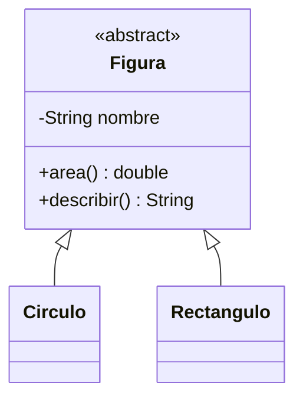
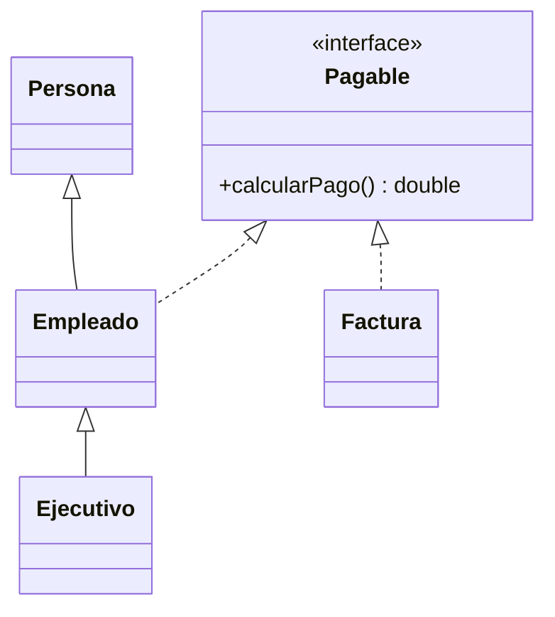

# 5. Polimorfismo

## 5.1. Un mismo mensaje, muchas formas

**Polimorfismo** significa «muchas formas». En POO es la capacidad de que **objetos de clases distintas respondan al mismo mensaje cada uno a su manera**.

Piensa en la orden «*págales a todos los empleados*». A un empleado normal se le paga su sueldo; a un ejecutivo, su sueldo más un *bonus*. Quien da la orden no necesita saber de qué tipo es cada empleado: envía el mismo mensaje (`calcularPago()`) y **cada objeto sabe lo que tiene que hacer**.

Esto es posible gracias a la herencia ([capítulo 4](04-herencia.md)) y a la redefinición de métodos.

## 5.2. Polimorfismo y enlace dinámico

Una variable cuyo tipo es una **superclase** puede referirse a un objeto de **cualquiera de sus subclases**, porque una subclase *es un* caso particular de la superclase:

```java
Empleado e = new Ejecutivo("987654321X", "Lucía", 48, "casada", "Directora", 3000, 500);
```

Cuando se envía un mensaje a esa variable, **Java decide en tiempo de ejecución** qué versión del método ejecutar, según la clase **real** del objeto y no según el tipo de la variable. A este mecanismo se le llama **enlace dinámico** (*dynamic binding*).

```java
// PruebaPolimorfismo.java
public class PruebaPolimorfismo {
    public static void main(String[] args) {
        Empleado[] plantilla = {
            new Empleado("153647458S", "Pepe", 35, "casado", "Analista", 1500),
            new Empleado("452697419Z", "Maria", 25, "soltera", "Programadora", 1000),
            new Ejecutivo("987654321X", "Lucía", 48, "casada", "Directora", 3000, 500)
        };

        double total = 0;
        for (Empleado e : plantilla) {
            System.out.println(e.getNombre() + " cobra " + e.calcularPago());
            total += e.calcularPago();
        }
        System.out.println("Total: " + total);
    }
}
```

```text
Pepe cobra 1500.0
Maria cobra 1000.0
Lucía cobra 3500.0
Total: 6000.0
```

El bucle trata a todos como `Empleado`, pero para Lucía se ejecuta la versión de `Ejecutivo`. Si mañana se añade un nuevo tipo de empleado con otra forma de calcular el pago, **este código no cambia**.

!!! tip "La gran ventaja"
    El polimorfismo permite escribir código que trabaja con la **superclase** y sigue funcionando con subclases que aún no existen. Es lo que hace que los programas OO sean fáciles de ampliar.

### Tipo de la variable frente a tipo del objeto

El compilador solo deja usar los métodos que existen **en el tipo de la variable**:

```java
// PruebaCasting.java
public class PruebaCasting {
    public static void main(String[] args) {
        Persona p = new Ejecutivo("987654321X", "Lucía", 48, "casada", "Directora", 3000, 500);

        System.out.println(p.getNombre());          // correcto: está en Persona
        // p.calcularPago();                         // ERROR de compilación: Persona no lo tiene

        if (p instanceof Empleado) {                // ¿el objeto real es un Empleado?
            Empleado e = (Empleado) p;              // conversión (cast) a la subclase
            System.out.println(e.calcularPago());   // se ejecuta la versión de Ejecutivo
        }
    }
}
```

```text
Lucía
3500.0
```

- **Conversión hacia arriba** (de subclase a superclase): siempre es válida y automática.
- **Conversión hacia abajo** (de superclase a subclase): hay que escribirla explícitamente con `(Subclase)` y solo funciona si el objeto real es de esa clase. `instanceof` permite comprobarlo antes.

## 5.3. Clases abstractas

A veces una superclase es tan genérica que **no tiene sentido crear objetos de ella**. ¿Cómo se calcula el área de una «figura» a secas? No se puede: depende de si es un círculo o un rectángulo. Una **clase abstracta** describe lo común y **deja sin implementar** lo que cada subclase debe resolver a su manera.

- Se declara con `abstract`.
- **No se puede instanciar**: `new Figura(...)` da error de compilación.
- Puede tener atributos, constructores y métodos normales.
- Puede tener **métodos abstractos**: solo la firma, **sin cuerpo**, terminada en `;`.
- Una subclase **debe implementar todos los métodos abstractos** o ser también abstracta.

```java
// Figura.java
public abstract class Figura {

    private final String nombre;

    public Figura(String nombre) {
        this.nombre = nombre;
    }

    // Método abstracto: cada figura sabe calcular su área
    public abstract double area();

    // Método normal, que usa el abstracto
    public String describir() {
        return nombre + " con área " + Math.round(area() * 100) / 100.0;
    }
}
```

```java
// Circulo.java
public class Circulo extends Figura {

    private final double radio;

    public Circulo(double radio) {
        super("Círculo");
        this.radio = radio;
    }

    @Override
    public double area() {
        return Math.PI * radio * radio;
    }
}
```

```java
// Rectangulo.java
public class Rectangulo extends Figura {

    private final double base;
    private final double altura;

    public Rectangulo(double base, double altura) {
        super("Rectángulo");
        this.base = base;
        this.altura = altura;
    }

    @Override
    public double area() {
        return base * altura;
    }
}
```

```java
// PruebaFiguras.java
public class PruebaFiguras {
    public static void main(String[] args) {
        // Figura f = new Figura("genérica");   // ERROR: Figura es abstracta
        Figura[] figuras = { new Circulo(5), new Rectangulo(4, 3) };

        for (Figura f : figuras) {
            System.out.println(f.describir());
        }
    }
}
```

```text
Círculo con área 78.54
Rectángulo con área 12.0
```

Observa que `describir()` está escrito **una sola vez**, en `Figura`, y llama a `area()` sin saber qué figura es. Cada objeto responde con su versión: polimorfismo otra vez.

## 5.4. Interfaces

Una **interfaz** es un **contrato**: una lista de métodos que una clase se compromete a ofrecer, sin decir cómo. Se declara con `interface` y las clases que la cumplen la **implementan** con `implements`.

```java
// Pagable.java
public interface Pagable {
    double calcularPago();      // implícitamente público y abstracto
}
```

Cualquier clase que se declare `Pagable` debe proporcionar `calcularPago()`. Lo interesante es que **clases sin relación de herencia** pueden cumplir el mismo contrato. Un empleado se paga, pero también una factura de un proveedor:

```java
// Factura.java
public class Factura implements Pagable {

    private final String numero;
    private final double importe;

    public Factura(String numero, double importe) {
        this.numero = numero;
        this.importe = importe;
    }

    public String getNumero() {
        return numero;
    }

    @Override
    public double calcularPago() {
        return importe;
    }
}
```

`Empleado` solo necesita declarar que implementa la interfaz (`Ejecutivo` la hereda de `Empleado`):

??? note "Empleado.java con la interfaz `Pagable`"
    ```java
    // Empleado.java
    public class Empleado extends Persona implements Pagable {

        private String cargo;
        private double sueldo;

        public Empleado(String dni, String nombre, int edad, String estadoCivil,
                        String cargo, double sueldo) {
            super(dni, nombre, edad, estadoCivil);
            this.cargo = cargo;
            this.sueldo = sueldo;
        }

        public String getCargo() {
            return cargo;
        }

        public double getSueldo() {
            return sueldo;
        }

        public void subeSueldo(double cantidad) {
            sueldo += cantidad;
        }

        @Override
        public double calcularPago() {
            return sueldo;
        }

        @Override
        public String toString() {
            return super.toString() + " | Empleado{cargo=" + cargo + ", sueldo=" + sueldo + "}";
        }
    }
    ```

Ahora podemos tratar como `Pagable` a objetos totalmente distintos:

```java
// PruebaPagos.java
public class PruebaPagos {
    public static void main(String[] args) {
        Pagable[] pagos = {
            new Factura("F-001", 250.0),
            new Empleado("452697419Z", "Maria", 25, "soltera", "Programadora", 1000),
            new Ejecutivo("987654321X", "Lucía", 48, "casada", "Directora", 3000, 500)
        };

        double total = 0;
        for (Pagable p : pagos) {
            total += p.calcularPago();
        }
        System.out.println("Total a pagar: " + total);
    }
}
```

```text
Total a pagar: 4750.0
```

Una clase **puede implementar varias interfaces** (`class A implements X, Y`). Así Java ofrece parte de lo que aportaría la herencia múltiple sin sus conflictos: las interfaces solo declaran *qué* hay que hacer, no *cómo*, de modo que no hay implementaciones que choquen.

### Clase abstracta o interfaz

| | Clase abstracta | Interfaz |
|---|---|---|
| Qué expresa | Una **base común** con parte del código ya hecha («es-un») | Un **contrato** o capacidad («sabe hacer») |
| Atributos de instancia | Sí | No (solo constantes) |
| Métodos con cuerpo | Sí | Normalmente no (existen los métodos `default`, de uso más avanzado) |
| Una clase puede... | Extender **una** | Implementar **varias** |
| Se usa con | `extends` | `implements` |

## 5.5. Sobrecarga, redefinición y polimorfismo

Conviene no mezclar tres ideas parecidas:

| Concepto | Qué es | Cuándo se decide qué método se ejecuta |
|---|---|---|
| **Sobrecarga** | Varios métodos con el mismo nombre y distintos parámetros en una clase | En **compilación** |
| **Redefinición** | Una subclase reescribe un método heredado | En **ejecución** |
| **Polimorfismo** | Tratar objetos de distintas clases a través de un tipo común y que cada uno responda a su manera | En **ejecución** (enlace dinámico) |

## 5.6. En UML

Una **clase abstracta** se marca con el estereotipo `<<abstract>>` (en muchas herramientas, además, su nombre aparece en cursiva). Una **interfaz** se marca con `<<interface>>`. La **implementación** de una interfaz se dibuja con una **flecha discontinua con punta triangular hueca**.





## Resumen del capítulo

- El **polimorfismo** permite que objetos distintos respondan al mismo mensaje de forma distinta.
- Se apoya en la **herencia**, la **redefinición** y el **enlace dinámico** (la versión se elige en ejecución).
- Una **clase abstracta** no se instancia y puede declarar métodos abstractos que las subclases implementan.
- Una **interfaz** es un contrato que pueden cumplir clases no relacionadas; una clase puede implementar varias.
- En UML: `<<abstract>>`, `<<interface>>` y flecha discontinua con triángulo hueco.

## Actividades

**Actividad 1.** Dado `Persona p = new Empleado(...);`, indica si compilan estas líneas: (a) `p.getNombre();` (b) `p.getCargo();` (c) `((Empleado) p).getCargo();`

??? success "Solución"
    - (a) **Sí**: `getNombre()` está en `Persona`.
    - (b) **No**: la variable es de tipo `Persona`, que no tiene `getCargo()`.
    - (c) **Sí**: la conversión a `Empleado` permite usar los métodos de `Empleado`. Funciona porque el objeto real es un `Empleado`.

**Actividad 2.** Añade a la jerarquía de figuras la clase `Triangulo` (con `base` y `altura`) y comprueba que `PruebaFiguras` funciona con ella **sin modificar** la clase `Figura`.

??? success "Solución"
    ```java
    // Triangulo.java
    public class Triangulo extends Figura {

        private final double base;
        private final double altura;

        public Triangulo(double base, double altura) {
            super("Triángulo");
            this.base = base;
            this.altura = altura;
        }

        @Override
        public double area() {
            return base * altura / 2;
        }
    }
    ```
    Basta con añadir `new Triangulo(6, 5)` al array: `describir()` imprimirá `Triángulo con área 15.0`.

**Actividad 3.** Un `Autonomo` cobra por horas (`horas * precioHora`). Haz que pueda incluirse en el array `Pagable[]` del ejemplo sin que sea ni `Empleado` ni `Factura`.

??? success "Solución"
    ```java
    // Autonomo.java
    public class Autonomo implements Pagable {
        private final String nombre;
        private final double horas;
        private final double precioHora;

        public Autonomo(String nombre, double horas, double precioHora) {
            this.nombre = nombre;
            this.horas = horas;
            this.precioHora = precioHora;
        }

        public String getNombre() {
            return nombre;
        }

        @Override
        public double calcularPago() {
            return horas * precioHora;
        }
    }
    ```
    Como implementa `Pagable`, un `Autonomo` se puede añadir al array sin tocar el resto del código.
