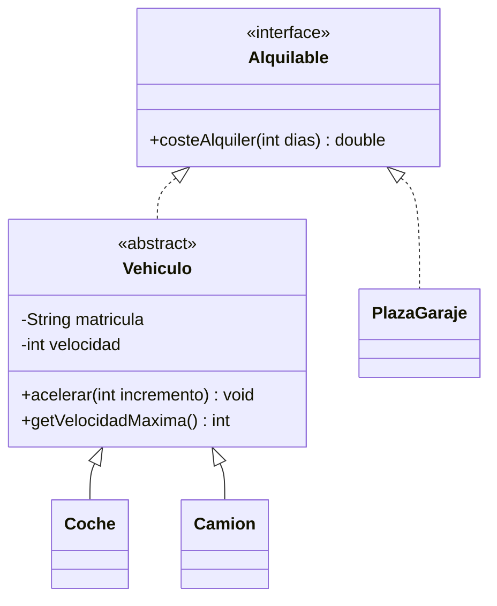

# 5. Polimorfismo

## 5.1. Un mismo mensaje, muchas formas

**Polimorfismo** significa «muchas formas». En POO es la capacidad de que **objetos de clases distintas respondan al mismo mensaje cada uno a su manera**.

Piensa en la orden «*calcula lo que cuesta alquilar este vehículo tres días*». Alquilar un coche cuesta una cosa; alquilar un camión, otra distinta. Quien da la orden no necesita saber de qué tipo es cada vehículo: envía el mismo mensaje (`costeAlquiler(3)`) y **cada objeto sabe lo que tiene que hacer**.

Esto es posible gracias a la herencia ([capítulo 4](04-herencia.md)) y a la redefinición de métodos.

## 5.2. Polimorfismo y enlace dinámico

Una variable cuyo tipo es una **superclase** puede referirse a un objeto de **cualquiera de sus subclases**, porque una subclase *es un* caso particular de la superclase:

```java
Vehiculo v = new Camion("1234XYZ", "Volvo", "FH", "blanco", 460, 18000);
```

Cuando se envía un mensaje a esa variable, **Java decide en tiempo de ejecución** qué versión del método ejecutar, según la clase **real** del objeto y no según el tipo de la variable. A este mecanismo se le llama **enlace dinámico** (*dynamic binding*).

```java
// PruebaPolimorfismo.java
public class PruebaPolimorfismo {
    public static void main(String[] args) {
        Vehiculo[] garaje = {
            new Coche("5671BCD", "Ford", "Focus", "rojo", 130, 5),
            new Camion("1234XYZ", "Volvo", "FH", "blanco", 460, 18000)
        };

        for (Vehiculo v : garaje) {
            v.ponerEnMarcha();
            v.acelerar(200);
            System.out.println(v.getMatricula() + " circula a " + v.getVelocidad() + " km/h");
        }
    }
}
```

```text
5671BCD circula a 180 km/h
1234XYZ circula a 90 km/h
```

El bucle trata a todos como `Vehiculo`, pero cada uno responde a su manera. Y aquí está la respuesta a la pregunta que quedó abierta en el capítulo anterior. El método `acelerar()` de `Vehiculo` termina con `Math.min(velocidad + incremento, getVelocidadMaxima())`. La llamada a `getVelocidadMaxima()` se envía al **propio objeto**, y para un camión el enlace dinámico ejecuta la versión de `Camion` (90) y no la de `Vehiculo` (180). Si mañana se añade un nuevo tipo de vehículo con otra velocidad máxima, **este código no cambia**.

!!! tip "La gran ventaja"
    El polimorfismo permite escribir código que trabaja con la **superclase** y sigue funcionando con subclases que aún no existen. Es lo que hace que los programas OO sean fáciles de ampliar.

### Tipo de la variable frente a tipo del objeto

El compilador solo deja usar los métodos que existen **en el tipo de la variable**:

```java
// PruebaCasting.java
public class PruebaCasting {
    public static void main(String[] args) {
        Vehiculo v = new Coche("5671BCD", "Ford", "Focus", "rojo", 130, 5);

        System.out.println(v.getMarca());           // correcto: está en Vehiculo
        // v.getNumPuertas();                        // ERROR de compilación: Vehiculo no lo tiene

        if (v instanceof Coche) {                   // ¿el objeto real es un Coche?
            Coche c = (Coche) v;                    // conversión (cast) a la subclase
            System.out.println(c.getNumPuertas() + " puertas");
        }
    }
}
```

```text
Ford
5 puertas
```

- **Conversión hacia arriba** (de subclase a superclase): siempre es válida y automática.
- **Conversión hacia abajo** (de superclase a subclase): hay que escribirla explícitamente con `(Subclase)` y solo funciona si el objeto real es de esa clase. `instanceof` permite comprobarlo antes.

## 5.3. Clases abstractas

A veces una superclase es tan genérica que **no tiene sentido crear objetos de ella**. ¿Cuánto cuesta alquilar un «vehículo» a secas? No se puede saber: depende de si es un coche o un camión. Una **clase abstracta** describe lo común y **deja sin implementar** lo que cada subclase debe resolver a su manera.

- Se declara con `abstract`.
- **No se puede instanciar**: `new Vehiculo(...)` da error de compilación.
- Puede tener atributos, constructores y métodos normales.
- Puede tener **métodos abstractos**: solo la firma, **sin cuerpo**, terminada en `;`.
- Una subclase **debe implementar todos los métodos abstractos** o ser también abstracta.

```java
public abstract class Vehiculo {
    // ... atributos y métodos normales, como antes ...

    // Método abstracto: cada tipo de vehículo sabe calcular su coste
    public abstract double costeAlquiler(int dias);
}
```

```java
public class Coche extends Vehiculo {
    // ...
    @Override
    public double costeAlquiler(int dias) {
        return 40.0 * dias;           // implementación propia del coche
    }
}
```

Los métodos normales de la clase abstracta pueden **usar** los abstractos sin saber cómo se implementan; cada subclase responde con su versión: polimorfismo otra vez.

## 5.4. Interfaces

Una **interfaz** es un **contrato**: una lista de métodos que una clase se compromete a ofrecer, sin decir cómo. Se declara con `interface` y las clases que la cumplen la **implementan** con `implements`.

Nuestra empresa no alquila solo vehículos: también **plazas de garaje**. Una plaza no es un vehículo, pero se alquila igual. Lo que tienen en común es la capacidad de calcular su coste de alquiler, así que lo expresamos como contrato:

```java
// Alquilable.java
public interface Alquilable {
    double costeAlquiler(int dias);      // implícitamente público y abstracto
}
```

Cualquier clase que se declare `Alquilable` debe proporcionar `costeAlquiler`. Lo interesante es que **clases sin relación de herencia** pueden cumplir el mismo contrato:

```java
// PlazaGaraje.java
public class PlazaGaraje implements Alquilable {

    private final String codigo;

    public PlazaGaraje(String codigo) {
        this.codigo = codigo;
    }

    public String getCodigo() {
        return codigo;
    }

    @Override
    public double costeAlquiler(int dias) {
        return 5.0 * dias;
    }
}
```

`Vehiculo` cumple el contrato (y por eso lo declaramos abstracto: deja a sus subclases implementar el método). Estas son las clases con los cambios de este capítulo:

??? note "Vehiculo.java, Coche.java y Camion.java actualizados"
    ```java
    // Vehiculo.java
    public abstract class Vehiculo implements Alquilable {

        private final String matricula;
        private String marca;
        private String modelo;
        private String color;
        private int potencia;
        private int velocidad;
        private boolean enMarcha;

        public Vehiculo(String matricula, String marca, String modelo, String color, int potencia) {
            if (potencia <= 0) {
                throw new IllegalArgumentException("La potencia debe ser positiva");
            }
            this.matricula = matricula;
            this.marca = marca;
            this.modelo = modelo;
            this.color = color;
            this.potencia = potencia;
        }

        public void ponerEnMarcha() {
            enMarcha = true;
        }

        public void parar() {
            velocidad = 0;
            enMarcha = false;
        }

        public void acelerar(int incremento) {
            if (incremento <= 0) {
                throw new IllegalArgumentException("El incremento debe ser positivo");
            }
            if (!enMarcha) {
                throw new IllegalStateException("El vehículo está parado: hay que ponerlo en marcha");
            }
            velocidad = Math.min(velocidad + incremento, getVelocidadMaxima());
        }

        public void frenar(int decremento) {
            if (decremento <= 0) {
                throw new IllegalArgumentException("El decremento debe ser positivo");
            }
            velocidad = Math.max(0, velocidad - decremento);
        }

        public int getVelocidadMaxima() {
            return 180;
        }

        public String getMatricula() {
            return matricula;
        }

        public String getMarca() {
            return marca;
        }

        public String getModelo() {
            return modelo;
        }

        public String getColor() {
            return color;
        }

        public int getPotencia() {
            return potencia;
        }

        public int getVelocidad() {
            return velocidad;
        }

        public boolean isEnMarcha() {
            return enMarcha;
        }

        public void pintar(String color) {
            this.color = color;
        }

        @Override
        public String toString() {
            return "Vehiculo{matricula=" + matricula + ", marca=" + marca + ", modelo=" + modelo
                    + ", color=" + color + ", velocidad=" + velocidad + " km/h}";
        }
    }
    ```

    ```java
    // Coche.java
    public class Coche extends Vehiculo {

        private final int numPuertas;

        public Coche(String matricula, String marca, String modelo, String color,
                     int potencia, int numPuertas) {
            super(matricula, marca, modelo, color, potencia);
            this.numPuertas = numPuertas;
        }

        public int getNumPuertas() {
            return numPuertas;
        }

        @Override
        public double costeAlquiler(int dias) {
            return 40.0 * dias;
        }

        @Override
        public String toString() {
            return super.toString() + " | Coche{puertas=" + numPuertas + "}";
        }
    }
    ```

    ```java
    // Camion.java
    public class Camion extends Vehiculo {

        private final double cargaMaxima;

        public Camion(String matricula, String marca, String modelo, String color,
                      int potencia, double cargaMaxima) {
            super(matricula, marca, modelo, color, potencia);
            this.cargaMaxima = cargaMaxima;
        }

        public double getCargaMaxima() {
            return cargaMaxima;
        }

        @Override
        public int getVelocidadMaxima() {
            return 90;
        }

        @Override
        public double costeAlquiler(int dias) {
            return 85.0 * dias + 50.0;       // tarifa diaria + seguro fijo
        }

        @Override
        public String toString() {
            return super.toString() + " | Camion{cargaMaxima=" + cargaMaxima + " kg}";
        }
    }
    ```

Ahora podemos tratar como `Alquilable` a objetos totalmente distintos:

```java
// PruebaAlquiler.java
public class PruebaAlquiler {
    public static void main(String[] args) {
        Coche coche = new Coche("5671BCD", "Ford", "Focus", "rojo", 130, 5);
        Camion camion = new Camion("1234XYZ", "Volvo", "FH", "blanco", 460, 18000);

        // Polimorfismo por herencia: Vehiculo
        Vehiculo[] flota = { coche, camion };
        for (Vehiculo v : flota) {
            System.out.println(v.getMatricula() + ": " + v.costeAlquiler(3) + " EUR");
        }

        // Polimorfismo por interfaz: objetos sin relación de herencia
        Alquilable[] catalogo = { coche, camion, new PlazaGaraje("P-12") };
        double total = 0;
        for (Alquilable a : catalogo) {
            total += a.costeAlquiler(3);
        }
        System.out.println("Total 3 días: " + total + " EUR");
    }
}
```

```text
5671BCD: 120.0 EUR
1234XYZ: 305.0 EUR
Total 3 días: 440.0 EUR
```

Una clase **puede implementar varias interfaces** (`class A implements X, Y`). Así Java ofrece parte de lo que aportaría la herencia múltiple sin sus conflictos: las interfaces solo declaran *qué* hay que hacer, no *cómo*, de modo que no hay implementaciones que choquen.

### Clase abstracta o interfaz

| | Clase abstracta | Interfaz |
|---|---|---|
| Qué expresa | Una **base común** con parte del código ya hecha («es-un») | Un **contrato** o capacidad («sabe hacer») |
| Atributos de instancia | Sí | No (solo constantes) |
| Métodos con cuerpo | Sí | Normalmente no (existen los métodos `default`, de uso más avanzado) |
| Una clase puede... | Extender **una** | Implementar **varias** |
| Se usa con | `extends` | `implements` |

## 5.5. Sobrecarga, redefinición y polimorfismo

Conviene no mezclar tres ideas parecidas:

| Concepto | Qué es | Cuándo se decide qué método se ejecuta |
|---|---|---|
| **Sobrecarga** | Varios métodos con el mismo nombre y distintos parámetros en una clase | En **compilación** |
| **Redefinición** | Una subclase reescribe un método heredado | En **ejecución** |
| **Polimorfismo** | Tratar objetos de distintas clases a través de un tipo común y que cada uno responda a su manera | En **ejecución** (enlace dinámico) |

## 5.6. En UML

Una **clase abstracta** se marca con el estereotipo `<<abstract>>` (en muchas herramientas, además, su nombre aparece en cursiva). Una **interfaz** se marca con `<<interface>>`. La **implementación** de una interfaz se dibuja con una **flecha discontinua con punta triangular hueca**.



## Resumen del capítulo

- El **polimorfismo** permite que objetos distintos respondan al mismo mensaje de forma distinta.
- Se apoya en la **herencia**, la **redefinición** y el **enlace dinámico** (la versión se elige en ejecución).
- Una **clase abstracta** no se instancia y puede declarar métodos abstractos que las subclases implementan.
- Una **interfaz** es un contrato que pueden cumplir clases no relacionadas; una clase puede implementar varias.
- En UML: `<<abstract>>`, `<<interface>>` y flecha discontinua con triángulo hueco.

## Actividades

**Actividad 1.** Dado `Vehiculo v = new Coche(...);`, indica si compilan estas líneas: (a) `v.getMarca();` (b) `v.getNumPuertas();` (c) `((Coche) v).getNumPuertas();`

??? success "Solución"
    - (a) **Sí**: `getMarca()` está en `Vehiculo`.
    - (b) **No**: la variable es de tipo `Vehiculo`, que no tiene `getNumPuertas()`.
    - (c) **Sí**: la conversión a `Coche` permite usar los métodos de `Coche`. Funciona porque el objeto real es un `Coche`.

**Actividad 2.** Añade la clase `Moto` (con un atributo `cilindrada`) cuyo alquiler cuesta 30 € al día. Comprueba que se puede añadir al array `flota` del ejemplo **sin modificar** la clase `Vehiculo`.

??? success "Solución"
    ```java
    // Moto.java
    public class Moto extends Vehiculo {

        private final int cilindrada;

        public Moto(String matricula, String marca, String modelo, String color,
                    int potencia, int cilindrada) {
            super(matricula, marca, modelo, color, potencia);
            this.cilindrada = cilindrada;
        }

        public int getCilindrada() {
            return cilindrada;
        }

        @Override
        public double costeAlquiler(int dias) {
            return 30.0 * dias;
        }
    }
    ```
    Basta con añadir `new Moto("9999ZZZ", "Honda", "CBR", "negro", 60, 500)` al array: el bucle llama a `costeAlquiler(3)` y la moto responde con su versión (`90.0`).

**Actividad 3.** Un `Remolque` se alquila por un precio fijo diario, pero **no es un vehículo** (no tiene motor ni velocidad). Haz que pueda incluirse en el array `Alquilable[]` del ejemplo.

??? success "Solución"
    ```java
    // Remolque.java
    public class Remolque implements Alquilable {

        private final String codigo;
        private final double precioDia;

        public Remolque(String codigo, double precioDia) {
            this.codigo = codigo;
            this.precioDia = precioDia;
        }

        public String getCodigo() {
            return codigo;
        }

        @Override
        public double costeAlquiler(int dias) {
            return precioDia * dias;
        }
    }
    ```
    Como implementa `Alquilable`, un `Remolque` se puede añadir al array sin tocar el resto del código y sin que tenga que heredar de `Vehiculo`.
