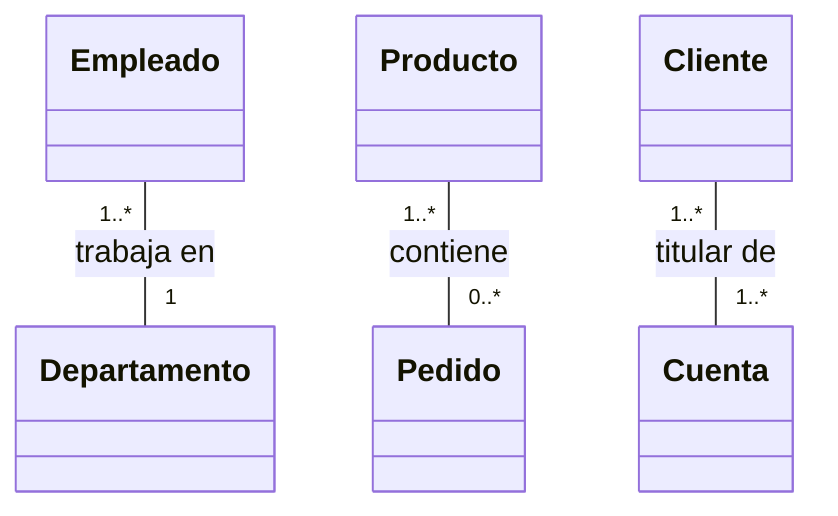
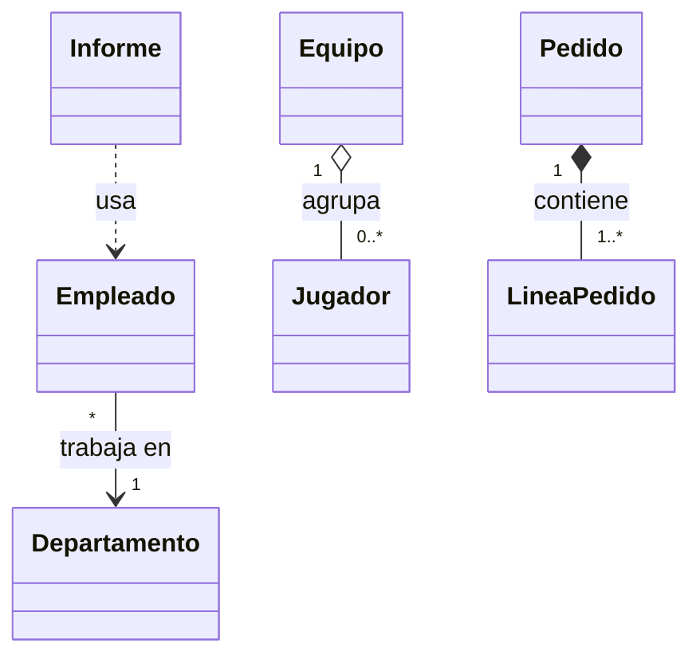

# 6. Relaciones entre objetos

## 6.1. Más allá de la herencia

Los objetos no viven aislados. Además de tener atributos, métodos y estar organizados en jerarquías de herencia, se **relacionan con otros objetos**: un empleado trabaja en un departamento, un pedido contiene líneas, un informe usa los datos de un empleado.

En este capítulo veremos las relaciones más importantes entre clases:

| Relación | Idea | Ejemplo |
|---|---|---|
| **Asociación** | A conoce a B | Un empleado pertenece a un departamento |
| **Agregación** | A está formada por B, pero B existe por sí mismo | Un equipo y sus jugadores |
| **Composición** | A está formada por B y B no existe sin A | Un pedido y sus líneas |
| **Dependencia** | A usa a B de forma puntual | Un informe recibe un empleado |

La herencia ([capítulo 4](04-herencia.md)) es otra relación entre clases, de tipo «es-un». Las de este capítulo son de tipo «**tiene-un**» o «**usa-un**».

## 6.2. Asociación

Una **asociación** es una relación estructural que describe una **conexión duradera** entre los objetos de dos clases: los objetos se unen para trabajar juntos. Algunos ejemplos:

| Clase | Clase |
|---|---|
| Empleado | Departamento |
| Cliente | Póliza |
| Conductor | Vehículo |
| Producto | Pedido |

En Java se implementa **insertando en una clase un atributo cuyo tipo es la otra clase**:

```java
public class Empleado extends Persona {

    private String cargo;
    private double sueldo;
    private Departamento departamento;      // asociación: Empleado → Departamento

    // ...

    public Departamento getDepartamento() {
        return departamento;
    }
}
```

Una asociación puede ser **unidireccional** (solo `Empleado` conoce a su `Departamento`) o **bidireccional** (el `Departamento` también conoce a sus empleados). Es preferible la más sencilla que resuelva el problema: la bidireccional obliga a mantener coherentes las dos referencias.

## 6.3. Cardinalidad

Las asociaciones (y las agregaciones y composiciones) tienen **cardinalidad** o **multiplicidad**: cuántos objetos de una clase se relacionan con **un** objeto de la otra.

| Notación | Significado |
|:---:|---|
| `1` | Exactamente uno |
| `0..1` | Cero o uno (opcional) |
| `*` o `0..*` | Cero o más |
| `1..*` | Uno o más |
| `n..m` | Entre `n` y `m` |

El número que aparece **junto a una clase** indica cuántos objetos **de esa clase** intervienen por cada objeto de la otra.



Se lee así:

- **Empleado / Departamento:** cada departamento tiene uno o más empleados y cada empleado pertenece a **un** departamento.
- **Producto / Pedido:** un pedido contiene uno o más productos; un producto puede estar en cero o más pedidos.
- **Cliente / Cuenta:** un cliente es titular de una o más cuentas, y una cuenta puede tener varios titulares (cuenta compartida).

!!! tip "Cardinalidad y código"
    Si el máximo es **1**, basta con un atributo simple (`Departamento departamento`). Si el máximo es **muchos** (`*`, `1..*`), el atributo es una **colección** (`List<Jugador> jugadores`).

Por ejemplo, un `Cliente` con varias `Cuenta`:

```java
// Cliente.java
import java.util.ArrayList;
import java.util.List;

public class Cliente {

    private final String nombre;
    private final List<Cuenta> cuentas = new ArrayList<>();   // cardinalidad 1..*

    public Cliente(String nombre) {
        this.nombre = nombre;
    }

    public void abrirCuenta(Cuenta cuenta) {
        cuentas.add(cuenta);
    }

    public double getSaldoTotal() {
        double total = 0;
        for (Cuenta c : cuentas) {
            total += c.getSaldo();
        }
        return total;
    }

    public String getNombre() {
        return nombre;
    }
}
```

## 6.4. Agregación y composición

Cuando una clase está **estructuralmente compuesta** por objetos de otra u otras clases hablamos de una relación **parte-todo**: el objeto compuesto (el «todo») está formado por otros objetos (las «partes»). Hay dos grados:

| | Agregación | Composición |
|---|---|---|
| **Vínculo** | Débil | Fuerte |
| **¿Puede existir la parte sin el todo?** | **Sí** | **No** |
| **¿Quién crea las partes?** | Se crean fuera y se **reciben** | El todo las **crea** y las controla |
| **Si el todo desaparece...** | Las partes siguen existiendo | Las partes desaparecen con él |
| **Ejemplo** | Equipo → Jugador | Pedido → LíneaPedido |

### Agregación: un equipo y sus jugadores

Un jugador existe independientemente del equipo: puede cambiar de equipo o no tener ninguno. El equipo **recibe** jugadores ya creados:

```java
// Jugador.java
public class Jugador {

    private final String nombre;

    public Jugador(String nombre) {
        this.nombre = nombre;
    }

    public String getNombre() {
        return nombre;
    }
}
```

```java
// Equipo.java
import java.util.ArrayList;
import java.util.Collections;
import java.util.List;

public class Equipo {

    private final String nombre;
    private final List<Jugador> jugadores = new ArrayList<>();

    public Equipo(String nombre) {
        this.nombre = nombre;
    }

    public void fichar(Jugador jugador) {          // recibe un jugador YA creado
        jugadores.add(jugador);
    }

    public void despedir(Jugador jugador) {
        jugadores.remove(jugador);
    }

    public List<Jugador> getJugadores() {
        return Collections.unmodifiableList(jugadores);
    }

    public String getNombre() {
        return nombre;
    }
}
```

### Composición: un pedido y sus líneas

Una línea de pedido solo tiene sentido dentro de su pedido: si el pedido se elimina, sus líneas también. Por eso el **pedido crea sus propias líneas** y no las entrega a nadie para que las gestione por su cuenta:

```java
// LineaPedido.java
public class LineaPedido {

    private final String producto;
    private final int cantidad;
    private final double precioUnitario;

    public LineaPedido(String producto, int cantidad, double precioUnitario) {
        this.producto = producto;
        this.cantidad = cantidad;
        this.precioUnitario = precioUnitario;
    }

    public String getProducto() {
        return producto;
    }

    public double getSubtotal() {
        return cantidad * precioUnitario;
    }
}
```

```java
// Pedido.java
import java.util.ArrayList;
import java.util.List;

public class Pedido {

    private final String numero;
    private final List<LineaPedido> lineas = new ArrayList<>();

    public Pedido(String numero) {
        this.numero = numero;
    }

    public void agregarLinea(String producto, int cantidad, double precioUnitario) {
        lineas.add(new LineaPedido(producto, cantidad, precioUnitario));   // el pedido CREA sus líneas
    }

    public int getNumeroLineas() {
        return lineas.size();
    }

    public double getTotal() {
        double total = 0;
        for (LineaPedido linea : lineas) {
            total += linea.getSubtotal();
        }
        return total;
    }
}
```

!!! note "La frontera depende del modelo"
    ¿Un `Monitor` es parte de un `Ordenador` por agregación o por composición? Depende del problema que modelas. Si en tu sistema los monitores se gestionan por separado (se compran, se reasignan), es **agregación**; si solo existen como componente de un equipo concreto, **composición**. No hay una única respuesta correcta: lo importante es razonar y justificar la decisión.

## 6.5. Dependencia

La **dependencia** es la relación más débil: una clase **usa** a otra de forma puntual, normalmente como **parámetro** de un método o como **variable local**, pero no la guarda como atributo. Si cambia la clase usada, la que la usa puede verse afectada.

```java
// Informe.java
public class Informe {

    // Informe NO guarda ningún Empleado: solo lo usa mientras dura la llamada
    public String generarFicha(Empleado empleado) {
        return "FICHA: " + empleado.getNombre() + " - " + empleado.getCargo();
    }
}
```

## 6.6. Comprobación conjunta

```java
// PruebaRelaciones.java
public class PruebaRelaciones {
    public static void main(String[] args) {
        // Agregación: el jugador existe por su cuenta
        Jugador ana = new Jugador("Ana");
        Jugador luis = new Jugador("Luis");
        Equipo equipo = new Equipo("Los Pinos");
        equipo.fichar(ana);
        equipo.fichar(luis);
        System.out.println("Jugadores: " + equipo.getJugadores().size());
        equipo.despedir(ana);
        System.out.println("Jugadores: " + equipo.getJugadores().size()
                + ", pero " + ana.getNombre() + " sigue existiendo");

        // Composición: las líneas pertenecen al pedido
        Pedido pedido = new Pedido("P-001");
        pedido.agregarLinea("Teclado", 2, 25.0);
        pedido.agregarLinea("Ratón", 1, 12.5);
        System.out.println("Líneas: " + pedido.getNumeroLineas() + ", total: " + pedido.getTotal());

        // Dependencia: el informe solo usa al empleado
        Informe informe = new Informe();
        Empleado maria = new Empleado("452697419Z", "Maria", 25, "soltera", "Programadora", 1000);
        System.out.println(informe.generarFicha(maria));

        // Asociación con colección: un cliente y sus cuentas
        Cliente cliente = new Cliente("Pérez");
        cliente.abrirCuenta(new Cuenta("Pérez", "154000345", 2000));
        cliente.abrirCuenta(new Cuenta("Pérez", "154000346", 500));
        System.out.println("Saldo total de " + cliente.getNombre() + ": " + cliente.getSaldoTotal());
    }
}
```

```text
Jugadores: 2
Jugadores: 1, pero Ana sigue existiendo
Líneas: 2, total: 62.5
FICHA: Maria - Programadora
Saldo total de Pérez: 2500.0
```

## 6.7. ¿Qué relación uso?

Haz estas preguntas en orden, y quédate con la primera que responda que sí:

| Pregunta | Relación |
|---|---|
| ¿`A` **es un** tipo de `B`? | **Herencia** |
| ¿`A` está formada por `B` y `B` **no tiene sentido sin A**? | **Composición** |
| ¿`A` está formada por `B`, pero `B` **existe por sí mismo**? | **Agregación** |
| ¿`A` **conoce a `B`** de forma duradera, sin que sea «parte» de ella? | **Asociación** |
| ¿`A` solo **usa** a `B` puntualmente (parámetro o variable local)? | **Dependencia** |

### Jerarquías «es-un» frente a «parte-de»

Para dominar la complejidad organizamos las abstracciones de dos maneras complementarias:

- **Clasificación** («es-un»): un piano *es un* instrumento de cuerda, que *es un* instrumento musical. Es la **herencia**.
- **Composición** («parte-de»): un corazón *es parte del* sistema circulatorio, que *es parte del* cuerpo humano. Son la **agregación** y la **composición**.

## 6.8. En UML



| Relación | Línea | Extremo | Java |
|---|---|---|---|
| **Asociación** | Continua | Flecha abierta (si es dirigida) | Atributo del tipo asociado |
| **Agregación** | Continua | **Rombo hueco** en el lado del todo | Colección; las partes se reciben |
| **Composición** | Continua | **Rombo relleno** en el lado del todo | Colección; el todo crea las partes |
| **Dependencia** | **Discontinua** | Flecha abierta | Parámetro o variable local |
| **Herencia** | Continua | Triángulo hueco hacia la superclase | `extends` |
| **Realización** | Discontinua | Triángulo hueco hacia la interfaz | `implements` |

## Resumen del capítulo

- Entre los objetos, además de la herencia («es-un»), hay relaciones «tiene-un» y «usa-un».
- **Asociación:** conexión duradera; en Java, un atributo del otro tipo.
- **Agregación:** todo-partes, las partes existen por sí solas.
- **Composición:** todo-partes, las partes dependen del todo.
- **Dependencia:** uso puntual, sin guardar la referencia.
- La **cardinalidad** indica cuántos objetos intervienen; si el máximo es «muchos», se usa una colección.

## Actividades

**Actividad 1.** Clasifica cada relación como asociación, agregación, composición o dependencia, y justifica tu respuesta: (a) `Factura` – `LineaFactura`; (b) `Biblioteca` – `Libro`; (c) `Profesor` – `Modulo` que imparte; (d) `Calculadora` que recibe un `Empleado` para calcular su IRPF y no lo guarda.

??? success "Solución"
    - (a) **Composición**: las líneas solo tienen sentido dentro de su factura y desaparecen con ella.
    - (b) **Agregación**: la biblioteca está formada por libros, pero un libro puede existir fuera de ella (o pasar a otra).
    - (c) **Asociación**: el profesor conoce los módulos que imparte de forma duradera, pero un módulo no es «parte» del profesor.
    - (d) **Dependencia**: solo se usa mientras dura el cálculo y no se guarda como atributo.

**Actividad 2.** Dibuja el diagrama de clases de un instituto: un **Departamento** tiene uno o más **Profesores**; un profesor pertenece a un departamento; un profesor imparte uno o más **Módulos** y un módulo es impartido por uno o más profesores.

??? success "Solución"
    ```mermaid
    classDiagram
        Departamento "1" o-- "1..*" Profesor : agrupa
        Profesor "1..*" -- "1..*" Modulo : imparte
    ```
    El departamento se modela como agregación (un profesor podría cambiar de departamento) y la relación profesor–módulo como asociación con cardinalidad muchos a muchos.

**Actividad 3.** En la clase `Cliente`, ¿por qué el atributo `cuentas` es una `List<Cuenta>` y no un simple `Cuenta cuenta`? ¿Cómo cambiaría la clase si la cardinalidad fuese exactamente `1`?

??? success "Solución"
    Porque la cardinalidad es `1..*`: un cliente puede tener **varias** cuentas, y un atributo simple solo permite una. Si la cardinalidad fuese exactamente `1`, bastaría `private Cuenta cuenta;` (asignada en el constructor) y los métodos `abrirCuenta` y `getSaldoTotal` se simplificarían a trabajar con una sola cuenta.
