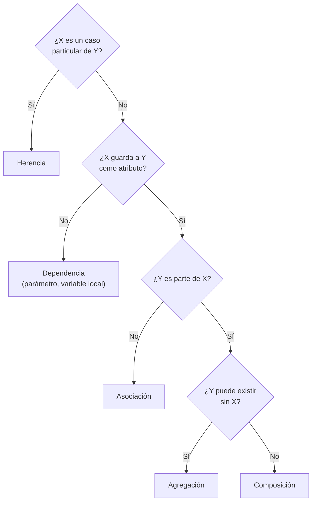
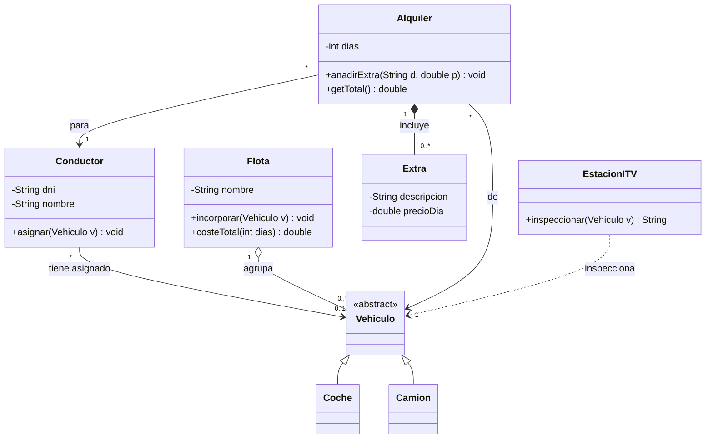

# 6. Relaciones entre objetos

## 6.1. Más allá de la herencia

Hasta ahora hemos visto una relación entre **clases**: la herencia («un `Coche` *es un* `Vehiculo`»). Pero un programa real está formado por objetos que **colaboran** entre sí, y esa colaboración también hay que modelarla.

Pensemos en nuestra empresa de alquiler:

- Un conductor tiene asignado un vehículo.
- Una flota agrupa muchos vehículos.
- Un alquiler incluye extras (GPS, silla infantil…).
- Una estación de ITV inspecciona vehículos.

En ninguno de estos casos hay un «es-un». Son relaciones de tipo «**tiene-un**» o «**usa-un**», y se resuelven casi siempre de la misma manera en Java: **un objeto guarda una referencia a otro** (como atributo) o **lo recibe como parámetro**.

| Relación | Pregunta que la identifica | Ejemplo |
|---|---|---|
| **Herencia** | ¿X *es un* Y? | Un `Coche` es un `Vehiculo` |
| **Asociación** | ¿X *conoce / usa* a Y de forma duradera? | Un `Conductor` tiene asignado un `Vehiculo` |
| **Agregación** | ¿X *agrupa* a Y, pero Y puede existir sin X? | Una `Flota` agrupa `Vehiculo`s |
| **Composición** | ¿Y *forma parte* de X y no tiene sentido sin X? | Un `Alquiler` tiene `Extra`s |
| **Dependencia** | ¿X *usa* a Y solo en un momento concreto? | Una `EstacionITV` inspecciona un `Vehiculo` |

Las cuatro últimas, de la más débil a la más fuerte, son las **relaciones entre objetos**. Las vemos una a una.

## 6.2. Asociación

La **asociación** es la relación más general: un objeto **conoce a otro** y puede enviarle mensajes durante su vida. En Java se implementa con un **atributo cuyo tipo es otra clase**.

```java
// Conductor.java
public class Conductor {

    private final String dni;
    private final String nombre;
    private Vehiculo vehiculoAsignado;      // asociación: 0 ó 1 vehículo

    public Conductor(String dni, String nombre) {
        this.dni = dni;
        this.nombre = nombre;
    }

    public String getDni() {
        return dni;
    }

    public String getNombre() {
        return nombre;
    }

    public Vehiculo getVehiculoAsignado() {
        return vehiculoAsignado;
    }

    public void asignar(Vehiculo vehiculo) {
        this.vehiculoAsignado = vehiculo;
    }

    public void liberarVehiculo() {
        this.vehiculoAsignado = null;
    }

    public String describirAsignacion() {
        if (vehiculoAsignado == null) {
            return nombre + " no tiene vehículo asignado";
        }
        return nombre + " conduce " + vehiculoAsignado.getMarca() + " "
                + vehiculoAsignado.getModelo() + " (" + vehiculoAsignado.getMatricula() + ")";
    }
}
```

Fíjate en que el atributo guarda una **referencia** ([sección 2.5](02-objetos.md)): el conductor no *contiene* una copia del coche, sino que **apunta al mismo objeto**. Y como puede no tener vehículo, el método `describirAsignacion()` comprueba `null` antes de usarlo.

```java
// PruebaAsociacion.java
public class PruebaAsociacion {
    public static void main(String[] args) {
        Vehiculo coche = new Coche("5671BCD", "Ford", "Focus", "rojo", 130, 5);
        Conductor ana = new Conductor("12345678Z", "Ana");

        System.out.println(ana.describirAsignacion());
        ana.asignar(coche);
        System.out.println(ana.describirAsignacion());

        ana.getVehiculoAsignado().ponerEnMarcha();    // actúa sobre el MISMO objeto
        System.out.println(coche.isEnMarcha());
    }
}
```

```text
Ana no tiene vehículo asignado
Ana conduce Ford Focus (5671BCD)
true
```

### Navegabilidad

En el ejemplo, `Conductor` conoce a `Vehiculo`, pero `Vehiculo` **no sabe** quién lo conduce. La asociación se puede recorrer en **un solo sentido**: es **unidireccional**. Si también quisiéramos preguntarle a un vehículo por su conductor, añadiríamos un atributo `Conductor` en `Vehiculo` y la asociación sería **bidireccional**.

!!! tip "Elige el menor número de sentidos posible"
    Cada sentido que se añade hay que mantenerlo coherente (si `ana` conduce el coche, el coche debe saber que lo conduce `ana`). Por eso conviene empezar con asociaciones unidireccionales y añadir el otro sentido solo cuando haga falta.

## 6.3. Cardinalidad

La **cardinalidad** (o multiplicidad) indica **cuántos objetos** de una clase pueden estar relacionados con un objeto de la otra. Se escribe junto a cada extremo de la relación.

| Notación | Significado | Ejemplo en nuestro hilo |
|---|---|---|
| `1` | Exactamente uno | Un `Alquiler` es de un único `Vehiculo` |
| `0..1` | Cero o uno (opcional) | Un `Conductor` tiene, como mucho, un vehículo asignado |
| `*` ó `0..*` | Cero o muchos | Una `Flota` puede tener cero o muchos vehículos |
| `1..*` | Uno o muchos (al menos uno) | Un `Taller` emplea al menos un `Mecanico` (actividad 2) |
| `3..5` | Un rango concreto | Un `Coche` tiene entre 3 y 5 puertas |

Se leen en los dos sentidos. En `Conductor "0..*" --> "0..1" Vehiculo`:

- Un conductor tiene **0 ó 1** vehículos asignados.
- Un vehículo puede estar asignado a **0 ó muchos** conductores (por ejemplo, en turnos distintos).

### Cómo se implementa

| Cardinalidad máxima | Implementación habitual |
|---|---|
| `1` ó `0..1` | Un atributo simple (`Vehiculo vehiculo`). Si es `0..1`, puede valer `null` |
| `*` ó `1..*` | Una colección: `List<Vehiculo>` (o un array si el tamaño es fijo) |

Veremos la colección en la siguiente sección, con la clase `Flota`.

## 6.4. Agregación y composición

Ambas modelan una relación **todo-parte** («X *tiene* Y»). Lo que las distingue es **de quién depende la vida de la parte**.

### Agregación: una flota y sus vehículos

En la **agregación** las partes **existen por sí mismas**: pueden crearse antes que el todo, sobrevivir cuando el todo desaparece o pasar de un todo a otro. Una `Flota` agrupa vehículos, pero un vehículo puede venderse, pasar a otra flota o seguir existiendo sin ninguna.

```java
// Flota.java
import java.util.ArrayList;
import java.util.Collections;
import java.util.List;

public class Flota {

    private final String nombre;
    private final List<Vehiculo> vehiculos = new ArrayList<>();   // 0..*

    public Flota(String nombre) {
        this.nombre = nombre;
    }

    public String getNombre() {
        return nombre;
    }

    public void incorporar(Vehiculo vehiculo) {
        vehiculos.add(vehiculo);                  // el vehículo se crea FUERA de la flota
    }

    public void retirar(Vehiculo vehiculo) {
        vehiculos.remove(vehiculo);               // retirarlo no destruye el vehículo
    }

    public int getNumVehiculos() {
        return vehiculos.size();
    }

    public Vehiculo buscarPorMatricula(String matricula) {
        for (Vehiculo v : vehiculos) {
            if (v.getMatricula().equals(matricula)) {
                return v;
            }
        }
        return null;
    }

    public double costeTotal(int dias) {
        double total = 0;
        for (Vehiculo v : vehiculos) {
            total += v.costeAlquiler(dias);       // polimorfismo (capítulo 5)
        }
        return total;
    }

    public List<Vehiculo> getVehiculos() {
        return Collections.unmodifiableList(vehiculos);   // solo lectura: protege la colección
    }
}
```

Observa tres detalles:

- Los vehículos **llegan desde fuera** (`incorporar(Vehiculo)`): la flota no los crea.
- La lista es `private` y `getVehiculos()` devuelve una vista de **solo lectura**: es la encapsulación del [capítulo 3](03-encapsulacion.md) aplicada a una colección.
- `costeTotal()` recorre la lista de `Vehiculo` y cada uno responde a su manera: el polimorfismo del [capítulo 5](05-polimorfismo.md) en acción.

```java
// PruebaAgregacion.java
public class PruebaAgregacion {
    public static void main(String[] args) {
        Vehiculo focus = new Coche("5671BCD", "Ford", "Focus", "rojo", 130, 5);
        Vehiculo ibiza = new Coche("4410KLM", "Seat", "Ibiza", "azul", 95, 3);
        Vehiculo fh = new Camion("1234XYZ", "Volvo", "FH", "blanco", 460, 18000);

        Flota flota = new Flota("Flota Centro");
        flota.incorporar(focus);
        flota.incorporar(ibiza);
        flota.incorporar(fh);

        System.out.println(flota.getNombre() + ": " + flota.getNumVehiculos() + " vehículos");
        System.out.println("Coste de alquilar toda la flota 2 días: " + flota.costeTotal(2) + " EUR");

        flota.retirar(ibiza);
        System.out.println("Tras retirar el Ibiza: " + flota.getNumVehiculos() + " vehículos");
        System.out.println("El Ibiza sigue existiendo: " + ibiza.getMarca() + " " + ibiza.getModelo());
    }
}
```

```text
Flota Centro: 3 vehículos
Coste de alquilar toda la flota 2 días: 380.0 EUR
Tras retirar el Ibiza: 2 vehículos
El Ibiza sigue existiendo: Seat Ibiza
```

La última línea es la clave de la agregación: al sacar el Ibiza de la flota, **el objeto sigue vivo**.

### Composición: un alquiler y sus extras

En la **composición** las partes **no tienen sentido sin el todo**: nacen con él y mueren con él. Un extra («GPS durante 3 días», «silla infantil durante 3 días») solo existe como parte de un alquiler concreto; si se cancela el alquiler, esos extras dejan de existir. Por eso el **todo crea a sus partes** y **no las comparte** con nadie.

```java
// Extra.java
public class Extra {

    private final String descripcion;
    private final double precioDia;

    public Extra(String descripcion, double precioDia) {
        this.descripcion = descripcion;
        this.precioDia = precioDia;
    }

    public String getDescripcion() {
        return descripcion;
    }

    public double getPrecioDia() {
        return precioDia;
    }
}
```

```java
// Alquiler.java
import java.util.ArrayList;
import java.util.List;

public class Alquiler {

    private final Vehiculo vehiculo;                       // asociación (1)
    private final Conductor conductor;                     // asociación (1)
    private final int dias;
    private final List<Extra> extras = new ArrayList<>();  // composición (0..*)

    public Alquiler(Vehiculo vehiculo, Conductor conductor, int dias) {
        if (dias <= 0) {
            throw new IllegalArgumentException("El alquiler debe ser de al menos un día");
        }
        this.vehiculo = vehiculo;
        this.conductor = conductor;
        this.dias = dias;
    }

    public void anadirExtra(String descripcion, double precioDia) {
        extras.add(new Extra(descripcion, precioDia));     // el alquiler CREA sus extras
    }

    public int getNumExtras() {
        return extras.size();
    }

    public Vehiculo getVehiculo() {
        return vehiculo;
    }

    public Conductor getConductor() {
        return conductor;
    }

    public double getTotal() {
        double total = vehiculo.costeAlquiler(dias);
        for (Extra e : extras) {
            total += e.getPrecioDia() * dias;
        }
        return total;
    }
}
```

Fíjate en la diferencia con `Flota.incorporar(Vehiculo)`: aquí **no se recibe un `Extra` ya creado**, sino los datos para que el propio `Alquiler` lo cree con `new`. Nadie fuera del alquiler tiene una referencia a esos extras.

```java
// PruebaComposicion.java
public class PruebaComposicion {
    public static void main(String[] args) {
        Vehiculo focus = new Coche("5671BCD", "Ford", "Focus", "rojo", 130, 5);
        Conductor ana = new Conductor("12345678Z", "Ana");

        Alquiler alquiler = new Alquiler(focus, ana, 3);
        alquiler.anadirExtra("GPS", 5.0);
        alquiler.anadirExtra("Silla infantil", 3.5);

        System.out.println("Alquiler de " + alquiler.getConductor().getNombre()
                + " con " + alquiler.getNumExtras() + " extras");
        System.out.println("Total: " + alquiler.getTotal() + " EUR");
    }
}
```

```text
Alquiler de Ana con 2 extras
Total: 145.5 EUR
```

El total son 120 € del coche (3 días × 40 €) más 25,5 € de extras ((5 + 3,5) × 3 días).

Observa también que el `Alquiler` **asocia** un `Vehiculo` y un `Conductor` (existen antes y después del alquiler) pero **compone** sus `Extra`: en una misma clase conviven los dos tipos de relación.

### Cómo decidir entre agregación y composición

Hazte estas preguntas sobre la **parte**:

| Pregunta | Si la respuesta es sí… |
|---|---|
| ¿Puede existir sin el todo? | Agregación |
| ¿Puede pasar de un todo a otro? | Agregación |
| ¿Desaparece cuando desaparece el todo? | Composición |
| ¿Solo tiene sentido dentro de ese todo? | Composición |

Muchas veces **depende del contexto del problema**: en una aplicación de alquiler los extras son parte de un alquiler (composición), pero en una tienda de accesorios con inventario propio, un GPS existe por sí mismo y sería una agregación. No hay una respuesta única: hay que justificar la elección con el enunciado.

## 6.5. Dependencia

La **dependencia** es la relación **más débil**: una clase **usa** a otra de forma **puntual**, normalmente porque recibe un objeto como **parámetro** de un método (o lo crea o devuelve), pero **no lo guarda** como atributo.

```java
// EstacionITV.java
public class EstacionITV {

    public String inspeccionar(Vehiculo vehiculo) {      // recibe el vehículo, no lo guarda
        if (vehiculo.isEnMarcha()) {
            return vehiculo.getMatricula() + ": no se puede inspeccionar con el vehículo en marcha";
        }
        return vehiculo.getMatricula() + ": ITV favorable";
    }
}
```

La estación de ITV no «tiene» ningún vehículo: lo conoce solo mientras dura la llamada. Si cambia la clase `Vehiculo` (por ejemplo, desaparece `isEnMarcha()`), `EstacionITV` dejará de compilar: de ahí el nombre, **depende** de ella.

```java
// PruebaDependencia.java
public class PruebaDependencia {
    public static void main(String[] args) {
        Vehiculo focus = new Coche("5671BCD", "Ford", "Focus", "rojo", 130, 5);
        EstacionITV itv = new EstacionITV();

        System.out.println(itv.inspeccionar(focus));
        focus.ponerEnMarcha();
        System.out.println(itv.inspeccionar(focus));
    }
}
```

```text
5671BCD: ITV favorable
5671BCD: no se puede inspeccionar con el vehículo en marcha
```

## 6.6. ¿Qué relación uso?

Un criterio práctico para decidir, de más fuerte a más débil:



### Jerarquías «es-un» frente a «parte-de»

Un error muy común es usar herencia cuando lo correcto es una relación todo-parte:

| Frase | ¿Es herencia? |
|---|---|
| «Un `Coche` **es un** `Vehiculo`» | Sí → herencia |
| «Un `Camion` **es un** `Vehiculo`» | Sí → herencia |
| «Una `Flota` **es un** `Vehiculo`» | No: una flota **tiene** vehículos → agregación |
| «Un `Alquiler` **es un** `Extra`» | No: un alquiler **tiene** extras → composición |

Si la frase «X es un Y» suena rara, probablemente la relación no es de herencia.

## 6.7. En UML

Cada relación tiene su propio símbolo. Fíjate en el rombo: **vacío** para la agregación y **relleno** para la composición; el rombo se dibuja en el lado del **todo**.



| Relación | Símbolo UML | Línea |
|---|---|---|
| Herencia | Flecha con triángulo **hueco** (`<|--`) | Continua |
| Asociación | Flecha abierta (`-->`) o línea simple | Continua |
| Agregación | Rombo **hueco** en el lado del todo (`o--`) | Continua |
| Composición | Rombo **relleno** en el lado del todo (`*--`) | Continua |
| Dependencia | Flecha abierta (`..>`) | **Discontinua** |

!!! info "Atributos que son relaciones"
    En UML, un atributo cuyo tipo es otra clase del modelo (como `List<Vehiculo>` en `Flota`) **no se escribe** en el compartimento de atributos: se representa con la **relación** correspondiente. Por eso en `Flota` no aparece `vehiculos`, sino la línea con rombo hacia `Vehiculo`.

## Resumen del capítulo

- Los objetos colaboran: una clase guarda **referencias** a otros objetos (atributos) o las recibe como **parámetros**.
- **Asociación**: un objeto conoce a otro de forma duradera; puede ser unidireccional o bidireccional.
- **Cardinalidad**: cuántos objetos intervienen en cada extremo (`1`, `0..1`, `*`, `1..*`); con máximo mayor que 1 se usa una colección.
- **Agregación**: todo-parte donde la parte **existe por sí misma** (rombo hueco).
- **Composición**: todo-parte donde la parte **depende del todo** y este la crea (rombo relleno).
- **Dependencia**: uso puntual, sin atributo (flecha discontinua).
- Si «X es un Y» no tiene sentido, no uses herencia.

## Actividades

**Actividad 1.** Clasifica cada frase como herencia, asociación, agregación, composición o dependencia y justifica:

1. Un `Camion` es un `Vehiculo`.
2. Una `Flota` tiene varios `Vehiculo`s que pueden cambiar de flota.
3. Un `Alquiler` tiene unos `Extra` que desaparecen si se cancela el alquiler.
4. Un `Conductor` tiene asignado un `Vehiculo`.
5. Un método `Taller.revisar(Vehiculo v)` revisa un vehículo y no lo guarda.

??? success "Solución"
    1. **Herencia**: «es un».
    2. **Agregación**: la parte (el vehículo) existe sin el todo y puede cambiar de todo.
    3. **Composición**: los extras dependen del alquiler y mueren con él.
    4. **Asociación**: relación duradera entre dos objetos independientes, sin ser todo-parte.
    5. **Dependencia**: uso puntual como parámetro, sin atributo.

**Actividad 2.** Un `Taller` tiene varios `Mecanico`s (que pueden cambiar de taller) y registra `Reparacion`es. Cada `Reparacion` la realiza un `Mecanico` sobre un `Vehiculo`, y no existe fuera del taller que la registra. Dibuja el diagrama de clases con relaciones y cardinalidades.

??? success "Solución"
    ```mermaid
    classDiagram
        class Taller {
            -String nombre
        }
        class Mecanico {
            -String nombre
        }
        class Reparacion {
            -String descripcion
            -double importe
        }
        class Vehiculo {
            <<abstract>>
        }
        Taller "1" o-- "1..*" Mecanico : emplea
        Taller "1" *-- "0..*" Reparacion : registra
        Reparacion "*" --> "1" Mecanico : realizada por
        Reparacion "*" --> "1" Vehiculo : sobre
    ```
    Los mecánicos son **agregación** (existen sin el taller). Las reparaciones son **composición** (solo existen registradas en su taller). Cada reparación está **asociada** a un mecánico y a un vehículo, que existen por sí mismos.

**Actividad 3.** Añade a `Flota` un método `contarEnMarcha()` que devuelva cuántos vehículos de la flota están en marcha.

??? success "Solución"
    ```java
    public int contarEnMarcha() {
        int contador = 0;
        for (Vehiculo v : vehiculos) {
            if (v.isEnMarcha()) {
                contador++;
            }
        }
        return contador;
    }
    ```
    Se recorre la colección y se pregunta a cada `Vehiculo` por su estado: la flota **no necesita saber** de qué tipo es cada uno.
