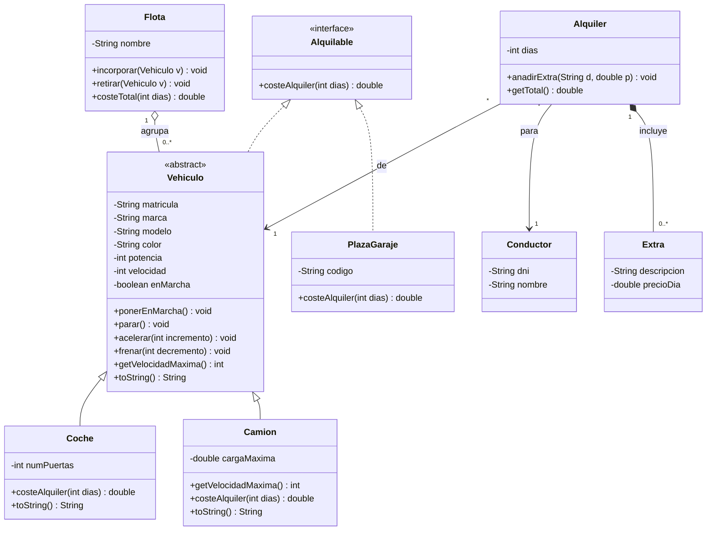

# 7. Caso práctico integrado

En este capítulo reunimos todo lo aprendido en un programa completo y pequeño: la gestión de una **empresa de alquiler de vehículos**. Es el mismo hilo que hemos seguido desde el primer capítulo, ahora con todas las piezas encajadas.

## 7.1. Enunciado

Una empresa de alquiler quiere gestionar su negocio:

- De todo **vehículo** interesa su matrícula, marca, modelo, color y potencia, además de su velocidad y de si está en marcha. Debe poder ponerse en marcha, acelerar, frenar y pararse.
- Un **coche** es un vehículo que además tiene un número de puertas. Un **camión** es un vehículo que además tiene una carga máxima y **no puede superar los 90 km/h**.
- Todo lo que la empresa **alquila** (vehículos y también plazas de garaje) debe poder calcular su **coste de alquiler** para un número de días. Las tarifas son: coche, 40 € al día; camión, 85 € al día más 50 € de seguro; plaza de garaje, 5 € al día.
- La empresa dispone de una **flota** que agrupa vehículos.
- Un **conductor** tiene DNI y nombre.
- Un **alquiler** es de un vehículo para un conductor durante unos días, y puede incluir **extras** (GPS, silla infantil…) con un precio por día.
- El programa debe mostrar la flota, mover vehículos tratándolos todos por igual, calcular lo que se factura por dos alquileres y comprobar que no se puede acelerar un vehículo parado.

## 7.2. Diseño: diagrama de clases

Antes de programar se diseña. Cada decisión del diagrama corresponde a un capítulo del curso:



## 7.3. Código

Compila y ejecuta los diez archivos juntos. Puedes descargarlos desde la sección [Descargas](#74-descargas).

=== "Alquilable.java"

    ```java
    // Alquilable.java
    public interface Alquilable {
        double costeAlquiler(int dias);      // implícitamente público y abstracto
    }
    ```

=== "Vehiculo.java"

    ```java
    // Vehiculo.java
    public abstract class Vehiculo implements Alquilable {

        private final String matricula;
        private String marca;
        private String modelo;
        private String color;
        private int potencia;
        private int velocidad;
        private boolean enMarcha;

        public Vehiculo(String matricula, String marca, String modelo, String color, int potencia) {
            if (potencia <= 0) {
                throw new IllegalArgumentException("La potencia debe ser positiva");
            }
            this.matricula = matricula;
            this.marca = marca;
            this.modelo = modelo;
            this.color = color;
            this.potencia = potencia;
        }

        public void ponerEnMarcha() {
            enMarcha = true;
        }

        public void parar() {
            velocidad = 0;
            enMarcha = false;
        }

        public void acelerar(int incremento) {
            if (incremento <= 0) {
                throw new IllegalArgumentException("El incremento debe ser positivo");
            }
            if (!enMarcha) {
                throw new IllegalStateException("El vehículo está parado: hay que ponerlo en marcha");
            }
            velocidad = Math.min(velocidad + incremento, getVelocidadMaxima());
        }

        public void frenar(int decremento) {
            if (decremento <= 0) {
                throw new IllegalArgumentException("El decremento debe ser positivo");
            }
            velocidad = Math.max(0, velocidad - decremento);
        }

        public int getVelocidadMaxima() {
            return 180;
        }

        public String getMatricula() {
            return matricula;
        }

        public String getMarca() {
            return marca;
        }

        public String getModelo() {
            return modelo;
        }

        public String getColor() {
            return color;
        }

        public int getPotencia() {
            return potencia;
        }

        public int getVelocidad() {
            return velocidad;
        }

        public boolean isEnMarcha() {
            return enMarcha;
        }

        public void pintar(String color) {
            this.color = color;
        }

        @Override
        public String toString() {
            return "Vehiculo{matricula=" + matricula + ", marca=" + marca + ", modelo=" + modelo
                    + ", color=" + color + ", velocidad=" + velocidad + " km/h}";
        }
    }
    ```

=== "Coche.java"

    ```java
    // Coche.java
    public class Coche extends Vehiculo {

        private final int numPuertas;

        public Coche(String matricula, String marca, String modelo, String color,
                     int potencia, int numPuertas) {
            super(matricula, marca, modelo, color, potencia);
            this.numPuertas = numPuertas;
        }

        public int getNumPuertas() {
            return numPuertas;
        }

        @Override
        public double costeAlquiler(int dias) {
            return 40.0 * dias;
        }

        @Override
        public String toString() {
            return super.toString() + " | Coche{puertas=" + numPuertas + "}";
        }
    }
    ```

=== "Camion.java"

    ```java
    // Camion.java
    public class Camion extends Vehiculo {

        private final double cargaMaxima;

        public Camion(String matricula, String marca, String modelo, String color,
                      int potencia, double cargaMaxima) {
            super(matricula, marca, modelo, color, potencia);
            this.cargaMaxima = cargaMaxima;
        }

        public double getCargaMaxima() {
            return cargaMaxima;
        }

        @Override
        public int getVelocidadMaxima() {
            return 90;
        }

        @Override
        public double costeAlquiler(int dias) {
            return 85.0 * dias + 50.0;       // tarifa diaria + seguro fijo
        }

        @Override
        public String toString() {
            return super.toString() + " | Camion{cargaMaxima=" + cargaMaxima + " kg}";
        }
    }
    ```

=== "PlazaGaraje.java"

    ```java
    // PlazaGaraje.java
    public class PlazaGaraje implements Alquilable {

        private final String codigo;

        public PlazaGaraje(String codigo) {
            this.codigo = codigo;
        }

        public String getCodigo() {
            return codigo;
        }

        @Override
        public double costeAlquiler(int dias) {
            return 5.0 * dias;
        }
    }
    ```

=== "Conductor.java"

    ```java
    // Conductor.java
    public class Conductor {

        private final String dni;
        private final String nombre;
        private Vehiculo vehiculoAsignado;      // asociación: 0 ó 1 vehículo

        public Conductor(String dni, String nombre) {
            this.dni = dni;
            this.nombre = nombre;
        }

        public String getDni() {
            return dni;
        }

        public String getNombre() {
            return nombre;
        }

        public Vehiculo getVehiculoAsignado() {
            return vehiculoAsignado;
        }

        public void asignar(Vehiculo vehiculo) {
            this.vehiculoAsignado = vehiculo;
        }

        public void liberarVehiculo() {
            this.vehiculoAsignado = null;
        }

        public String describirAsignacion() {
            if (vehiculoAsignado == null) {
                return nombre + " no tiene vehículo asignado";
            }
            return nombre + " conduce " + vehiculoAsignado.getMarca() + " "
                    + vehiculoAsignado.getModelo() + " (" + vehiculoAsignado.getMatricula() + ")";
        }
    }
    ```

=== "Flota.java"

    ```java
    // Flota.java
    import java.util.ArrayList;
    import java.util.Collections;
    import java.util.List;

    public class Flota {

        private final String nombre;
        private final List<Vehiculo> vehiculos = new ArrayList<>();   // 0..*

        public Flota(String nombre) {
            this.nombre = nombre;
        }

        public String getNombre() {
            return nombre;
        }

        public void incorporar(Vehiculo vehiculo) {
            vehiculos.add(vehiculo);                  // el vehículo se crea FUERA de la flota
        }

        public void retirar(Vehiculo vehiculo) {
            vehiculos.remove(vehiculo);               // retirarlo no destruye el vehículo
        }

        public int getNumVehiculos() {
            return vehiculos.size();
        }

        public Vehiculo buscarPorMatricula(String matricula) {
            for (Vehiculo v : vehiculos) {
                if (v.getMatricula().equals(matricula)) {
                    return v;
                }
            }
            return null;
        }

        public double costeTotal(int dias) {
            double total = 0;
            for (Vehiculo v : vehiculos) {
                total += v.costeAlquiler(dias);       // polimorfismo (capítulo 5)
            }
            return total;
        }

        public List<Vehiculo> getVehiculos() {
            return Collections.unmodifiableList(vehiculos);   // solo lectura: protege la colección
        }
    }
    ```

=== "Extra.java"

    ```java
    // Extra.java
    public class Extra {

        private final String descripcion;
        private final double precioDia;

        public Extra(String descripcion, double precioDia) {
            this.descripcion = descripcion;
            this.precioDia = precioDia;
        }

        public String getDescripcion() {
            return descripcion;
        }

        public double getPrecioDia() {
            return precioDia;
        }
    }
    ```

=== "Alquiler.java"

    ```java
    // Alquiler.java
    import java.util.ArrayList;
    import java.util.List;

    public class Alquiler {

        private final Vehiculo vehiculo;                       // asociación (1)
        private final Conductor conductor;                     // asociación (1)
        private final int dias;
        private final List<Extra> extras = new ArrayList<>();  // composición (0..*)

        public Alquiler(Vehiculo vehiculo, Conductor conductor, int dias) {
            if (dias <= 0) {
                throw new IllegalArgumentException("El alquiler debe ser de al menos un día");
            }
            this.vehiculo = vehiculo;
            this.conductor = conductor;
            this.dias = dias;
        }

        public void anadirExtra(String descripcion, double precioDia) {
            extras.add(new Extra(descripcion, precioDia));     // el alquiler CREA sus extras
        }

        public int getNumExtras() {
            return extras.size();
        }

        public Vehiculo getVehiculo() {
            return vehiculo;
        }

        public Conductor getConductor() {
            return conductor;
        }

        public double getTotal() {
            double total = vehiculo.costeAlquiler(dias);
            for (Extra e : extras) {
                total += e.getPrecioDia() * dias;
            }
            return total;
        }
    }
    ```

=== "PruebaFlota.java"

    ```java
    // PruebaFlota.java
    public class PruebaFlota {
        public static void main(String[] args) {

            // Vehículos: objetos que existen por sí mismos
            Vehiculo focus = new Coche("5671BCD", "Ford", "Focus", "rojo", 130, 5);
            Vehiculo ibiza = new Coche("4410KLM", "Seat", "Ibiza", "azul", 95, 3);
            Vehiculo fh = new Camion("1234XYZ", "Volvo", "FH", "blanco", 460, 18000);

            // La flota los agrupa (agregación)
            Flota flota = new Flota("Flota Centro");
            flota.incorporar(focus);
            flota.incorporar(ibiza);
            flota.incorporar(fh);

            System.out.println("=== Flota ===");
            for (Vehiculo v : flota.getVehiculos()) {
                System.out.println(v.getMatricula() + " - " + v.getMarca() + " "
                        + v.getModelo() + " - " + v.getColor());
            }

            System.out.println();
            System.out.println("=== Un vehículo completo ===");
            System.out.println(focus);

            // Mensajes a los objetos: cambian su estado
            focus.ponerEnMarcha();
            focus.acelerar(200);
            fh.ponerEnMarcha();
            fh.acelerar(200);

            System.out.println();
            System.out.println("=== Velocidades ===");
            for (Vehiculo v : flota.getVehiculos()) {
                System.out.println(v.getMatricula() + " circula a " + v.getVelocidad() + " km/h");
            }

            // Alquileres: asocian vehículo y conductor y componen sus extras
            Conductor ana = new Conductor("12345678Z", "Ana");
            Conductor luis = new Conductor("87654321X", "Luis");

            Alquiler a1 = new Alquiler(focus, ana, 3);
            a1.anadirExtra("GPS", 5.0);
            a1.anadirExtra("Silla infantil", 3.5);
            Alquiler a2 = new Alquiler(fh, luis, 2);

            Alquiler[] alquileres = { a1, a2 };

            System.out.println();
            System.out.println("=== Facturación ===");
            double total = 0;
            for (Alquiler a : alquileres) {
                System.out.println(a.getConductor().getNombre() + " paga " + a.getTotal()
                        + " EUR por " + a.getVehiculo().getMarca() + " " + a.getVehiculo().getModelo());
                total += a.getTotal();
            }
            System.out.println("Total: " + total + " EUR");

            System.out.println();
            System.out.println("=== Encapsulación ===");
            try {
                ibiza.acelerar(50);          // el Ibiza no está en marcha
            } catch (IllegalStateException ex) {
                System.out.println("Error: " + ex.getMessage());
            }
        }
    }
    ```


## 7.4. Descargas

Código fuente del caso práctico:
[Alquilable.java](../descargas/caso-practico/Alquilable.java) ·
[Vehiculo.java](../descargas/caso-practico/Vehiculo.java) ·
[Coche.java](../descargas/caso-practico/Coche.java) ·
[Camion.java](../descargas/caso-practico/Camion.java) ·
[PlazaGaraje.java](../descargas/caso-practico/PlazaGaraje.java) ·
[Conductor.java](../descargas/caso-practico/Conductor.java) ·
[Flota.java](../descargas/caso-practico/Flota.java) ·
[Extra.java](../descargas/caso-practico/Extra.java) ·
[Alquiler.java](../descargas/caso-practico/Alquiler.java) ·
[PruebaFlota.java](../descargas/caso-practico/PruebaFlota.java)

Para compilar y ejecutar desde una terminal, en la carpeta con los archivos:

```powershell
javac -encoding UTF-8 *.java
java PruebaFlota
```

## 7.5. Ejecución

```text
=== Flota ===
5671BCD - Ford Focus - rojo
4410KLM - Seat Ibiza - azul
1234XYZ - Volvo FH - blanco

=== Un vehículo completo ===
Vehiculo{matricula=5671BCD, marca=Ford, modelo=Focus, color=rojo, velocidad=0 km/h} | Coche{puertas=5}

=== Velocidades ===
5671BCD circula a 180 km/h
4410KLM circula a 0 km/h
1234XYZ circula a 90 km/h

=== Facturación ===
Ana paga 145.5 EUR por Ford Focus
Luis paga 220.0 EUR por Volvo FH
Total: 365.5 EUR

=== Encapsulación ===
Error: El vehículo está parado: hay que ponerlo en marcha
```

Fíjate en las velocidades: se ha pedido acelerar 200 km/h a los dos vehículos en marcha y **cada uno ha respondido a su manera**, el coche con su límite de 180 km/h y el camión con el suyo de 90 km/h, sin que el bucle sepa de qué tipo es cada uno.

## 7.6. Dónde aparece cada concepto

| Concepto | Dónde lo vemos |
|---|---|
| **Clase** | `Vehiculo`, `Coche`, `Conductor`, `Alquiler`… cada una con sus atributos y métodos |
| **Objeto / instanciación** | `focus`, `ibiza`, `fh`, `ana`… y los `new` del `main` |
| **Abstracción** | Cada clase conserva solo los datos relevantes para el alquiler (no hay, por ejemplo, el número de ruedas) |
| **Mensajes** | `focus.ponerEnMarcha()`, `flota.incorporar(focus)`, `a.getTotal()` |
| **Constructores y `this`** | Todos los constructores asignan con `this.atributo = ...`; los de `Vehiculo` y `Alquiler` además validan |
| **Tipos de métodos** | Consulta (`getMatricula`), modificación (`pintar`), comportamiento (`acelerar`) y redefinido (`toString`) |
| **Encapsulación** | Atributos privados; `acelerar()` lanza excepciones si se usa mal; la lista de la flota es de solo lectura |
| **Herencia** | `Coche extends Vehiculo`, `Camion extends Vehiculo`; `super(...)` en los constructores |
| **Redefinición** | `getVelocidadMaxima()` y `costeAlquiler()` en `Camion`, `toString()` en las subclases |
| **Polimorfismo** | El bucle de velocidades y el de facturación tratan a todos como `Vehiculo` y cada uno responde a su manera |
| **Clase abstracta** | `Vehiculo` no se puede instanciar y deja `costeAlquiler()` sin implementar |
| **Interfaz** | `Alquilable`, cumplida por `Vehiculo` y por `PlazaGaraje` |
| **Asociación** | `Alquiler → Vehiculo` y `Alquiler → Conductor`, con cardinalidad `* → 1` |
| **Agregación** | `Flota` agrupa `Vehiculo`s que existen por sí mismos |
| **Composición** | `Alquiler` crea y posee sus `Extra`s |

## Resumen del capítulo

Un programa orientado a objetos es una **colección de clases cuyos objetos colaboran**: se modelan con clases, se protegen con encapsulación, se organizan con herencia, se tratan de forma uniforme con polimorfismo y se conectan con relaciones. Se diseñan primero en un **diagrama de clases** y después se programan; ese diagrama es justamente lo que se estudia en el curso de UML.

## Actividades

**Actividad 1.** Añade la clase `Autobus`, subclase de `Vehiculo`, con un atributo `plazas`, una velocidad máxima de 100 km/h y un coste de alquiler de 120 € al día. Comprueba que se puede incorporar a la flota sin tocar ninguna otra clase.

??? success "Solución"
    ```java
    // Autobus.java
    public class Autobus extends Vehiculo {

        private final int plazas;

        public Autobus(String matricula, String marca, String modelo, String color,
                       int potencia, int plazas) {
            super(matricula, marca, modelo, color, potencia);
            this.plazas = plazas;
        }

        public int getPlazas() {
            return plazas;
        }

        @Override
        public int getVelocidadMaxima() {
            return 100;
        }

        @Override
        public double costeAlquiler(int dias) {
            return 120.0 * dias;
        }
    }
    ```
    Basta con `flota.incorporar(new Autobus("7788MNP", "Mercedes", "Tourismo", "gris", 350, 55))`. `Flota.costeTotal()` y los bucles de `PruebaFlota` seguirán funcionando: es el polimorfismo.

**Actividad 2.** Haz que la asociación `Conductor`–`Alquiler` sea **bidireccional**: que cada `Conductor` conozca sus alquileres. ¿Qué cuidado hay que tener?

??? success "Solución"
    El `Conductor` necesita una colección de alquileres y un método para registrarlos:

    ```java
    // En Conductor
    private final List<Alquiler> alquileres = new ArrayList<>();

    void registrar(Alquiler alquiler) {
        alquileres.add(alquiler);
    }

    public int getNumAlquileres() {
        return alquileres.size();
    }
    ```

    Y el `Alquiler` se registra a sí mismo al crearse:

    ```java
    // En el constructor de Alquiler
    this.conductor.registrar(this);
    ```

    **El cuidado:** hay que mantener **coherentes los dos sentidos**. Si el alquiler apunta a `ana`, `ana` debe tener ese alquiler en su lista. Por eso el registro lo hace el propio constructor y el método `registrar` no es público, en lugar de dejar que lo llame cualquiera.

**Actividad 3.** Añade a `Flota` un método `vehiculoMasPotente()` que devuelva el vehículo con mayor potencia (o `null` si la flota está vacía).

??? success "Solución"
    ```java
    public Vehiculo vehiculoMasPotente() {
        Vehiculo mejor = null;
        for (Vehiculo v : vehiculos) {
            if (mejor == null || v.getPotencia() > mejor.getPotencia()) {
                mejor = v;
            }
        }
        return mejor;
    }
    ```
    Con la flota del ejemplo devolvería el `Volvo FH` (460 CV).
