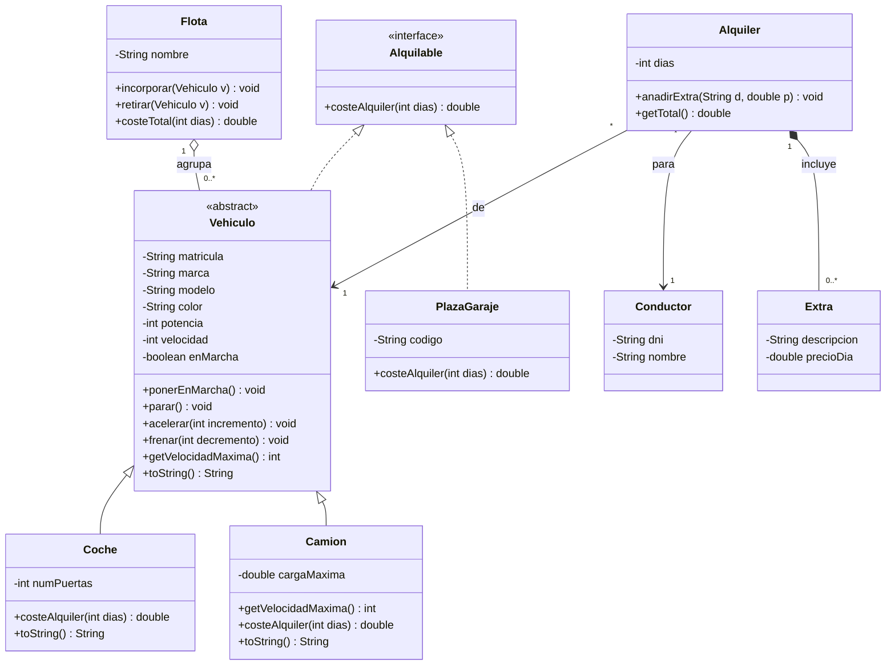

# 7. Caso práctico integrado

En este capítulo reunimos todo lo aprendido en un programa completo y pequeño: la gestión de una **empresa de alquiler de vehículos**. Es el mismo hilo que hemos seguido desde el primer capítulo, ahora con todas las piezas encajadas.

## 7.1. Enunciado

Una empresa de alquiler quiere gestionar su negocio:

- De todo **vehículo** interesa su matrícula, marca, modelo, color y potencia, además de su velocidad y de si está en marcha. Debe poder ponerse en marcha, acelerar, frenar y pararse.
- Un **coche** es un vehículo que además tiene un número de puertas. Un **camión** es un vehículo que además tiene una carga máxima y **no puede superar los 90 km/h**.
- Todo lo que la empresa **alquila** (vehículos y también plazas de garaje) debe poder calcular su **coste de alquiler** para un número de días. Las tarifas son: coche, 40 € al día; camión, 85 € al día más 50 € de seguro; plaza de garaje, 5 € al día.
- La empresa dispone de una **flota** que agrupa vehículos.
- Un **conductor** tiene DNI y nombre.
- Un **alquiler** es de un vehículo para un conductor durante unos días, y puede incluir **extras** (GPS, silla infantil…) con un precio por día.
- El programa debe organizarse como un **proyecto** con sus paquetes y su documentación Javadoc.
- El programa debe mostrar la flota, mover vehículos tratándolos todos por igual, calcular lo que se factura por dos alquileres y comprobar que no se puede acelerar un vehículo parado.

## 7.2. Diseño: diagrama de clases

Antes de programar se diseña. Cada decisión del diagrama corresponde a un capítulo del curso:



## 7.3. Organización del proyecto

Hasta ahora hemos compilado clases sueltas en una misma carpeta. Un programa real se organiza como un **proyecto**: una carpeta con una estructura clara, donde las clases se agrupan en **paquetes**.

```text
alquiler-vehiculos/
├── README.md
├── .gitignore
└── src/
    ├── modelo/                 ← clases que modelan los datos del negocio
    │   ├── Alquilable.java
    │   ├── Vehiculo.java
    │   ├── Coche.java
    │   ├── Camion.java
    │   ├── PlazaGaraje.java
    │   ├── Conductor.java
    │   ├── Flota.java
    │   ├── Alquiler.java
    │   └── Extra.java
    └── app/                    ← programa que usa el modelo
        └── Main.java
```

Un **paquete** es una carpeta que agrupa clases relacionadas. En Java:

- Cada archivo empieza con `package nombre;`, y el archivo debe estar en la carpeta con ese mismo nombre (`modelo/Vehiculo.java` declara `package modelo;`).
- Para usar una clase de **otro** paquete hay que importarla: `import modelo.Flota;`.
- El **modelo** (qué datos y reglas tiene el negocio) queda separado del **programa** que lo usa (`app`). Las clases de `modelo` no saben nada de `app`, de modo que podrían reutilizarse en otra aplicación.
- Si un miembro no lleva modificador (visibilidad de *paquete*), solo lo ven las clases del mismo paquete: es la visibilidad `~` de UML que vimos en el [capítulo 3](03-encapsulacion.md).

!!! info "Los capítulos anteriores"
    En los capítulos 1 a 6 las clases estaban «sueltas» (sin `package`) para centrarnos en cada concepto. Este es el primer ejemplo con estructura de proyecto.

## 7.4. Código

Cada pestaña muestra un archivo y, en su primera línea, la **ruta** donde se guarda dentro de `src/`. Compila y ejecuta los diez archivos juntos: puedes descargarlos todos en un proyecto listo para abrir en la sección [Descargas y ejecución](#76-descargas-y-ejecucion).

=== "modelo/Alquilable.java"

    ```java
    // modelo/Alquilable.java
    package modelo;

    /**
     * Contrato de todo lo que la empresa puede alquilar.
     * <p>
     * Lo cumplen clases que no tienen relación de herencia entre sí, como
     * {@link Vehiculo} y {@link PlazaGaraje}: lo único que tienen en común es que
     * saben calcular cuánto cuesta alquilarlas.
     */
    public interface Alquilable {

        /**
         * Calcula el coste de alquilar el elemento durante un número de días.
         *
         * @param dias número de días de alquiler
         * @return coste total en euros
         */
        double costeAlquiler(int dias);
    }
    ```

=== "modelo/Vehiculo.java"

    ```java
    // modelo/Vehiculo.java
    package modelo;

    /**
     * Vehículo genérico de la empresa de alquiler.
     * <p>
     * Es una <b>clase abstracta</b>: no se pueden crear objetos {@code Vehiculo}
     * directamente, sino de sus subclases ({@link Coche}, {@link Camion}), que
     * deben implementar {@link #costeAlquiler(int)}.
     * <p>
     * Los atributos son privados (encapsulación): el estado del vehículo solo se
     * modifica a través de sus métodos, que comprueban que las operaciones tengan sentido.
     */
    public abstract class Vehiculo implements Alquilable {

        /** Matrícula: identifica al vehículo y no cambia nunca. */
        private final String matricula;
        private String marca;
        private String modelo;
        private String color;
        private int potencia;
        /** Velocidad actual en km/h (0 si está parado). */
        private int velocidad;
        private boolean enMarcha;

        /**
         * Crea un vehículo parado y con velocidad 0.
         *
         * @param matricula matrícula del vehículo
         * @param marca     marca (por ejemplo, Ford)
         * @param modelo    modelo (por ejemplo, Focus)
         * @param color     color de la carrocería
         * @param potencia  potencia en CV; debe ser positiva
         * @throws IllegalArgumentException si la potencia no es positiva
         */
        public Vehiculo(String matricula, String marca, String modelo, String color, int potencia) {
            if (potencia <= 0) {
                throw new IllegalArgumentException("La potencia debe ser positiva");
            }
            this.matricula = matricula;
            this.marca = marca;
            this.modelo = modelo;
            this.color = color;
            this.potencia = potencia;
        }

        /** Pone el motor en marcha. */
        public void ponerEnMarcha() {
            enMarcha = true;
        }

        /** Detiene el vehículo: velocidad 0 y motor apagado. */
        public void parar() {
            velocidad = 0;
            enMarcha = false;
        }

        /**
         * Aumenta la velocidad sin superar el máximo del vehículo.
         * <p>
         * El máximo lo decide cada subclase mediante {@link #getVelocidadMaxima()}
         * (polimorfismo).
         *
         * @param incremento km/h que se quieren aumentar; debe ser positivo
         * @throws IllegalArgumentException si el incremento no es positivo
         * @throws IllegalStateException    si el vehículo no está en marcha
         */
        public void acelerar(int incremento) {
            if (incremento <= 0) {
                throw new IllegalArgumentException("El incremento debe ser positivo");
            }
            if (!enMarcha) {
                throw new IllegalStateException("El vehículo está parado: hay que ponerlo en marcha");
            }
            velocidad = Math.min(velocidad + incremento, getVelocidadMaxima());
        }

        /**
         * Reduce la velocidad sin bajar de 0.
         *
         * @param decremento km/h que se quieren reducir; debe ser positivo
         * @throws IllegalArgumentException si el decremento no es positivo
         */
        public void frenar(int decremento) {
            if (decremento <= 0) {
                throw new IllegalArgumentException("El decremento debe ser positivo");
            }
            velocidad = Math.max(0, velocidad - decremento);
        }

        /**
         * Velocidad máxima del vehículo. Las subclases pueden redefinirla.
         *
         * @return velocidad máxima en km/h (180 por defecto)
         */
        public int getVelocidadMaxima() {
            return 180;
        }

        /** @return la matrícula */
        public String getMatricula() {
            return matricula;
        }

        /** @return la marca */
        public String getMarca() {
            return marca;
        }

        /** @return el modelo */
        public String getModelo() {
            return modelo;
        }

        /** @return el color actual */
        public String getColor() {
            return color;
        }

        /** @return la potencia en CV */
        public int getPotencia() {
            return potencia;
        }

        /** @return la velocidad actual en km/h */
        public int getVelocidad() {
            return velocidad;
        }

        /** @return {@code true} si el motor está en marcha */
        public boolean isEnMarcha() {
            return enMarcha;
        }

        /**
         * Cambia el color del vehículo.
         *
         * @param color nuevo color
         */
        public void pintar(String color) {
            this.color = color;
        }

        /** {@inheritDoc} */
        @Override
        public String toString() {
            return "Vehiculo{matricula=" + matricula + ", marca=" + marca + ", modelo=" + modelo
                    + ", color=" + color + ", velocidad=" + velocidad + " km/h}";
        }
    }
    ```

=== "modelo/Coche.java"

    ```java
    // modelo/Coche.java
    package modelo;

    /**
     * Coche: un {@link Vehiculo} con un número de puertas.
     * <p>
     * El alquiler cuesta 40 € al día.
     */
    public class Coche extends Vehiculo {

        private final int numPuertas;

        /**
         * Crea un coche.
         *
         * @param matricula  matrícula
         * @param marca      marca
         * @param modelo     modelo
         * @param color      color
         * @param potencia   potencia en CV
         * @param numPuertas número de puertas
         */
        public Coche(String matricula, String marca, String modelo, String color,
                     int potencia, int numPuertas) {
            super(matricula, marca, modelo, color, potencia);
            this.numPuertas = numPuertas;
        }

        /** @return el número de puertas */
        public int getNumPuertas() {
            return numPuertas;
        }

        /**
         * {@inheritDoc}
         * <p>
         * Tarifa del coche: 40 € por día.
         */
        @Override
        public double costeAlquiler(int dias) {
            return 40.0 * dias;
        }

        /** {@inheritDoc} */
        @Override
        public String toString() {
            return super.toString() + " | Coche{puertas=" + numPuertas + "}";
        }
    }
    ```

=== "modelo/Camion.java"

    ```java
    // modelo/Camion.java
    package modelo;

    /**
     * Camión: un {@link Vehiculo} con carga máxima y velocidad limitada a 90 km/h.
     * <p>
     * El alquiler cuesta 85 € al día más 50 € de seguro fijo.
     */
    public class Camion extends Vehiculo {

        private final double cargaMaxima;

        /**
         * Crea un camión.
         *
         * @param matricula   matrícula
         * @param marca       marca
         * @param modelo      modelo
         * @param color       color
         * @param potencia    potencia en CV
         * @param cargaMaxima carga máxima en kg
         */
        public Camion(String matricula, String marca, String modelo, String color,
                      int potencia, double cargaMaxima) {
            super(matricula, marca, modelo, color, potencia);
            this.cargaMaxima = cargaMaxima;
        }

        /** @return la carga máxima en kg */
        public double getCargaMaxima() {
            return cargaMaxima;
        }

        /**
         * {@inheritDoc}
         *
         * @return 90 km/h: un camión es más lento que un coche
         */
        @Override
        public int getVelocidadMaxima() {
            return 90;
        }

        /**
         * {@inheritDoc}
         * <p>
         * Tarifa del camión: 85 € por día más 50 € de seguro fijo.
         */
        @Override
        public double costeAlquiler(int dias) {
            return 85.0 * dias + 50.0;
        }

        /** {@inheritDoc} */
        @Override
        public String toString() {
            return super.toString() + " | Camion{cargaMaxima=" + cargaMaxima + " kg}";
        }
    }
    ```

=== "modelo/PlazaGaraje.java"

    ```java
    // modelo/PlazaGaraje.java
    package modelo;

    /**
     * Plaza de garaje que la empresa también alquila.
     * <p>
     * No es un {@link Vehiculo}, pero cumple el contrato {@link Alquilable}.
     * El alquiler cuesta 5 € al día.
     */
    public class PlazaGaraje implements Alquilable {

        private final String codigo;

        /**
         * Crea una plaza de garaje.
         *
         * @param codigo código que identifica la plaza (por ejemplo, P-12)
         */
        public PlazaGaraje(String codigo) {
            this.codigo = codigo;
        }

        /** @return el código de la plaza */
        public String getCodigo() {
            return codigo;
        }

        /**
         * {@inheritDoc}
         * <p>
         * Tarifa de la plaza: 5 € por día.
         */
        @Override
        public double costeAlquiler(int dias) {
            return 5.0 * dias;
        }
    }
    ```

=== "modelo/Conductor.java"

    ```java
    // modelo/Conductor.java
    package modelo;

    /**
     * Persona que alquila vehículos.
     * <p>
     * De cada conductor interesan solo su DNI y su nombre; es una clase sencilla
     * a la que se asocian los alquileres ({@link Alquiler}).
     */
    public class Conductor {

        private final String dni;
        private final String nombre;

        /**
         * Crea un conductor.
         *
         * @param dni    documento de identidad
         * @param nombre nombre del conductor
         */
        public Conductor(String dni, String nombre) {
            this.dni = dni;
            this.nombre = nombre;
        }

        /** @return el DNI */
        public String getDni() {
            return dni;
        }

        /** @return el nombre */
        public String getNombre() {
            return nombre;
        }
    }
    ```

=== "modelo/Flota.java"

    ```java
    // modelo/Flota.java
    package modelo;

    import java.util.ArrayList;
    import java.util.Collections;
    import java.util.List;

    /**
     * Conjunto de vehículos de la empresa.
     * <p>
     * Es una <b>agregación</b>: los vehículos se crean fuera de la flota y siguen
     * existiendo aunque se retiren de ella.
     */
    public class Flota {

        private final String nombre;
        private final List<Vehiculo> vehiculos = new ArrayList<>();

        /**
         * Crea una flota vacía.
         *
         * @param nombre nombre de la flota
         */
        public Flota(String nombre) {
            this.nombre = nombre;
        }

        /** @return el nombre de la flota */
        public String getNombre() {
            return nombre;
        }

        /**
         * Incorpora un vehículo a la flota.
         *
         * @param vehiculo vehículo ya creado
         */
        public void incorporar(Vehiculo vehiculo) {
            vehiculos.add(vehiculo);
        }

        /**
         * Retira un vehículo de la flota. El vehículo no se destruye.
         *
         * @param vehiculo vehículo que sale de la flota
         */
        public void retirar(Vehiculo vehiculo) {
            vehiculos.remove(vehiculo);
        }

        /** @return el número de vehículos de la flota */
        public int getNumVehiculos() {
            return vehiculos.size();
        }

        /**
         * Busca un vehículo por su matrícula.
         *
         * @param matricula matrícula buscada
         * @return el vehículo, o {@code null} si no está en la flota
         */
        public Vehiculo buscarPorMatricula(String matricula) {
            for (Vehiculo v : vehiculos) {
                if (v.getMatricula().equals(matricula)) {
                    return v;
                }
            }
            return null;
        }

        /**
         * Calcula lo que costaría alquilar toda la flota.
         * Cada vehículo aplica su propia tarifa (polimorfismo).
         *
         * @param dias número de días
         * @return coste total en euros
         */
        public double costeTotal(int dias) {
            double total = 0;
            for (Vehiculo v : vehiculos) {
                total += v.costeAlquiler(dias);
            }
            return total;
        }

        /**
         * Devuelve los vehículos de la flota.
         *
         * @return lista de solo lectura: no se puede modificar desde fuera
         */
        public List<Vehiculo> getVehiculos() {
            return Collections.unmodifiableList(vehiculos);
        }
    }
    ```

=== "modelo/Alquiler.java"

    ```java
    // modelo/Alquiler.java
    package modelo;

    import java.util.ArrayList;
    import java.util.List;

    /**
     * Alquiler de un {@link Vehiculo} por parte de un {@link Conductor} durante unos días.
     * <p>
     * Relaciones:
     * <ul>
     *   <li><b>Asociación</b> con el vehículo y el conductor, que existen por sí mismos.</li>
     *   <li><b>Composición</b> con sus {@link Extra}: el alquiler los crea y no los comparte.</li>
     * </ul>
     */
    public class Alquiler {

        private final Vehiculo vehiculo;
        private final Conductor conductor;
        private final int dias;
        private final List<Extra> extras = new ArrayList<>();

        /**
         * Crea un alquiler.
         *
         * @param vehiculo  vehículo alquilado
         * @param conductor conductor que lo alquila
         * @param dias      duración en días; debe ser al menos 1
         * @throws IllegalArgumentException si {@code dias} es menor que 1
         */
        public Alquiler(Vehiculo vehiculo, Conductor conductor, int dias) {
            if (dias <= 0) {
                throw new IllegalArgumentException("El alquiler debe ser de al menos un día");
            }
            this.vehiculo = vehiculo;
            this.conductor = conductor;
            this.dias = dias;
        }

        /**
         * Añade un extra al alquiler. Es el propio alquiler quien crea el objeto
         * {@link Extra} (composición).
         *
         * @param descripcion nombre del extra
         * @param precioDia   precio por día en euros
         */
        public void anadirExtra(String descripcion, double precioDia) {
            extras.add(new Extra(descripcion, precioDia));
        }

        /** @return el número de extras contratados */
        public int getNumExtras() {
            return extras.size();
        }

        /** @return el vehículo alquilado */
        public Vehiculo getVehiculo() {
            return vehiculo;
        }

        /** @return el conductor que alquila */
        public Conductor getConductor() {
            return conductor;
        }

        /**
         * Calcula el importe total: coste del vehículo más todos los extras.
         *
         * @return total en euros
         */
        public double getTotal() {
            double total = vehiculo.costeAlquiler(dias);
            for (Extra e : extras) {
                total += e.getPrecioDia() * dias;
            }
            return total;
        }
    }
    ```

=== "modelo/Extra.java"

    ```java
    // modelo/Extra.java
    package modelo;

    /**
     * Complemento de un alquiler (GPS, silla infantil…) con un precio por día.
     * <p>
     * Es una <b>composición</b>: solo existe como parte de un {@link Alquiler}.
     */
    public class Extra {

        private final String descripcion;
        private final double precioDia;

        /**
         * Crea un extra.
         *
         * @param descripcion nombre del extra
         * @param precioDia   precio por día en euros
         */
        public Extra(String descripcion, double precioDia) {
            this.descripcion = descripcion;
            this.precioDia = precioDia;
        }

        /** @return la descripción del extra */
        public String getDescripcion() {
            return descripcion;
        }

        /** @return el precio por día en euros */
        public double getPrecioDia() {
            return precioDia;
        }
    }
    ```

=== "app/Main.java"

    ```java
    // app/Main.java
    package app;

    import modelo.Alquiler;
    import modelo.Camion;
    import modelo.Coche;
    import modelo.Conductor;
    import modelo.Flota;
    import modelo.Vehiculo;

    /**
     * Programa de demostración de la empresa de alquiler.
     * <p>
     * Crea una flota, mueve los vehículos tratándolos todos como {@link Vehiculo},
     * factura dos alquileres y comprueba la encapsulación.
     */
    public class Main {

        /**
         * Punto de entrada del programa.
         *
         * @param args no se utilizan
         */
        public static void main(String[] args) {

            // Vehículos: objetos que existen por sí mismos
            Vehiculo focus = new Coche("5671BCD", "Ford", "Focus", "rojo", 130, 5);
            Vehiculo ibiza = new Coche("4410KLM", "Seat", "Ibiza", "azul", 95, 3);
            Vehiculo fh = new Camion("1234XYZ", "Volvo", "FH", "blanco", 460, 18000);

            // La flota los agrupa (agregación)
            Flota flota = new Flota("Flota Centro");
            flota.incorporar(focus);
            flota.incorporar(ibiza);
            flota.incorporar(fh);

            System.out.println("=== Flota ===");
            for (Vehiculo v : flota.getVehiculos()) {
                System.out.println(v.getMatricula() + " - " + v.getMarca() + " "
                        + v.getModelo() + " - " + v.getColor());
            }

            System.out.println();
            System.out.println("=== Un vehículo completo ===");
            System.out.println(focus);

            // Mensajes a los objetos: cambian su estado
            focus.ponerEnMarcha();
            focus.acelerar(200);
            fh.ponerEnMarcha();
            fh.acelerar(200);

            System.out.println();
            System.out.println("=== Velocidades ===");
            for (Vehiculo v : flota.getVehiculos()) {
                System.out.println(v.getMatricula() + " circula a " + v.getVelocidad() + " km/h");
            }

            // Alquileres: asocian vehículo y conductor y componen sus extras
            Conductor ana = new Conductor("12345678Z", "Ana");
            Conductor luis = new Conductor("87654321X", "Luis");

            Alquiler a1 = new Alquiler(focus, ana, 3);
            a1.anadirExtra("GPS", 5.0);
            a1.anadirExtra("Silla infantil", 3.5);
            Alquiler a2 = new Alquiler(fh, luis, 2);

            Alquiler[] alquileres = { a1, a2 };

            System.out.println();
            System.out.println("=== Facturación ===");
            double total = 0;
            for (Alquiler a : alquileres) {
                System.out.println(a.getConductor().getNombre() + " paga " + a.getTotal()
                        + " EUR por " + a.getVehiculo().getMarca() + " " + a.getVehiculo().getModelo());
                total += a.getTotal();
            }
            System.out.println("Total: " + total + " EUR");

            System.out.println();
            System.out.println("=== Encapsulación ===");
            try {
                ibiza.acelerar(50);          // el Ibiza no está en marcha
            } catch (IllegalStateException ex) {
                System.out.println("Error: " + ex.getMessage());
            }
        }
    }
    ```


## 7.5. Documentación con Javadoc

Fíjate en los comentarios que empiezan por `/**`. Son comentarios **Javadoc**: describen para qué sirve cada clase, método y constructor, y con ellos se genera una **web de documentación** de la API. Los IDE también los muestran al pasar el ratón sobre un método.

```java
/**
 * Aumenta la velocidad sin superar el máximo del vehículo.
 *
 * @param incremento km/h que se quieren aumentar; debe ser positivo
 * @throws IllegalArgumentException si el incremento no es positivo
 * @throws IllegalStateException    si el vehículo no está en marcha
 */
public void acelerar(int incremento) { ... }
```

| Etiqueta | Para qué sirve |
|---|---|
| `@param nombre` | Describe un parámetro del método o constructor |
| `@return` | Describe el valor que devuelve el método |
| `@throws Excepcion` | Indica cuándo lanza esa excepción |
| `{@link Clase}` | Enlace a otra clase o método |
| `{@inheritDoc}` | Reutiliza la documentación del método redefinido (`@Override`) |

La primera frase de cada comentario es el resumen que aparece en los listados. Se documenta **qué hace** el elemento y qué condiciones impone, no cómo lo hace por dentro.

Para generar la web, desde la carpeta del proyecto:

```powershell
javadoc -encoding UTF-8 -d docs-api -sourcepath src modelo app
```

Se crea la carpeta `docs-api/`; abre `index.html` en el navegador.

## 7.6. Descargas y ejecución

Descarga el proyecto completo, con su `README.md`, listo para abrir en un IDE o compilar desde la terminal:

[:material-folder-zip-outline: alquiler-vehiculos.zip](../descargas/caso-practico/alquiler-vehiculos.zip){ .md-button .md-button--primary }

Descomprímelo y, desde la carpeta `alquiler-vehiculos`, compila y ejecuta:

```powershell
javac -encoding UTF-8 -d out src/modelo/*.java src/app/*.java
java -cp out app.Main
```

`-d out` deja los `.class` en la carpeta `out` (con una subcarpeta por paquete), `-cp out` indica dónde buscarlos y se ejecuta el nombre **completo** de la clase: `app.Main`.

## 7.7. Salida del programa

```text
=== Flota ===
5671BCD - Ford Focus - rojo
4410KLM - Seat Ibiza - azul
1234XYZ - Volvo FH - blanco

=== Un vehículo completo ===
Vehiculo{matricula=5671BCD, marca=Ford, modelo=Focus, color=rojo, velocidad=0 km/h} | Coche{puertas=5}

=== Velocidades ===
5671BCD circula a 180 km/h
4410KLM circula a 0 km/h
1234XYZ circula a 90 km/h

=== Facturación ===
Ana paga 145.5 EUR por Ford Focus
Luis paga 220.0 EUR por Volvo FH
Total: 365.5 EUR

=== Encapsulación ===
Error: El vehículo está parado: hay que ponerlo en marcha
```

Fíjate en las velocidades: se ha pedido acelerar 200 km/h a los dos vehículos en marcha y **cada uno ha respondido a su manera**, el coche con su límite de 180 km/h y el camión con el suyo de 90 km/h, sin que el bucle sepa de qué tipo es cada uno.

## 7.8. Dónde aparece cada concepto

| Concepto | Dónde lo vemos |
|---|---|
| **Clase** | `Vehiculo`, `Coche`, `Conductor`, `Alquiler`… cada una con sus atributos y métodos |
| **Objeto / instanciación** | `focus`, `ibiza`, `fh`, `ana`… y los `new` del `main` |
| **Abstracción** | Cada clase conserva solo los datos relevantes para el alquiler (no hay, por ejemplo, el número de ruedas) |
| **Paquetes e importación** | `modelo` agrupa el modelo; `Main` en `app` hace `import modelo.Flota;` |
| **Documentación** | Comentarios Javadoc en todas las clases; se generan con `javadoc` |
| **Mensajes** | `focus.ponerEnMarcha()`, `flota.incorporar(focus)`, `a.getTotal()` |
| **Constructores y `this`** | Todos los constructores asignan con `this.atributo = ...`; los de `Vehiculo` y `Alquiler` además validan |
| **Tipos de métodos** | Consulta (`getMatricula`), modificación (`pintar`), comportamiento (`acelerar`) y redefinido (`toString`) |
| **Encapsulación** | Atributos privados; `acelerar()` lanza excepciones si se usa mal; la lista de la flota es de solo lectura |
| **Herencia** | `Coche extends Vehiculo`, `Camion extends Vehiculo`; `super(...)` en los constructores |
| **Redefinición** | `getVelocidadMaxima()` y `costeAlquiler()` en `Camion`, `toString()` en las subclases |
| **Polimorfismo** | El bucle de velocidades y el de facturación tratan a todos como `Vehiculo` y cada uno responde a su manera |
| **Clase abstracta** | `Vehiculo` no se puede instanciar y deja `costeAlquiler()` sin implementar |
| **Interfaz** | `Alquilable`, cumplida por `Vehiculo` y por `PlazaGaraje` |
| **Asociación** | `Alquiler → Vehiculo` y `Alquiler → Conductor`, con cardinalidad `* → 1` |
| **Agregación** | `Flota` agrupa `Vehiculo`s que existen por sí mismos |
| **Composición** | `Alquiler` crea y posee sus `Extra`s |

## Resumen del capítulo

Un programa orientado a objetos es una **colección de clases cuyos objetos colaboran**: se modelan con clases, se protegen con encapsulación, se organizan con herencia, se tratan de forma uniforme con polimorfismo y se conectan con relaciones. Se diseñan primero en un **diagrama de clases** y después se programan; ese diagrama es justamente lo que se estudia en el curso de UML.

## Actividades

**Actividad 1.** Añade al paquete `modelo` la clase `Autobus`, subclase de `Vehiculo`, con un atributo `plazas`, una velocidad máxima de 100 km/h y un coste de alquiler de 120 € al día. Comprueba que se puede incorporar a la flota sin tocar ninguna otra clase.

??? success "Solución"
    ```java
    // modelo/Autobus.java
    package modelo;

    public class Autobus extends Vehiculo {

        private final int plazas;

        public Autobus(String matricula, String marca, String modelo, String color,
                       int potencia, int plazas) {
            super(matricula, marca, modelo, color, potencia);
            this.plazas = plazas;
        }

        public int getPlazas() {
            return plazas;
        }

        @Override
        public int getVelocidadMaxima() {
            return 100;
        }

        @Override
        public double costeAlquiler(int dias) {
            return 120.0 * dias;
        }
    }
    ```
    Basta con `flota.incorporar(new Autobus("7788MNP", "Mercedes", "Tourismo", "gris", 350, 55))`. `Flota.costeTotal()` y los bucles de `Main` seguirán funcionando: es el polimorfismo.

**Actividad 2.** Haz que la asociación `Conductor`–`Alquiler` sea **bidireccional**: que cada `Conductor` conozca sus alquileres. ¿Qué cuidado hay que tener?

??? success "Solución"
    El `Conductor` necesita una colección de alquileres y un método para registrarlos:

    ```java
    // En Conductor
    private final List<Alquiler> alquileres = new ArrayList<>();

    void registrar(Alquiler alquiler) {
        alquileres.add(alquiler);
    }

    public int getNumAlquileres() {
        return alquileres.size();
    }
    ```

    Y el `Alquiler` se registra a sí mismo al crearse:

    ```java
    // En el constructor de Alquiler
    this.conductor.registrar(this);
    ```

    **El cuidado:** hay que mantener **coherentes los dos sentidos**. Si el alquiler apunta a `ana`, `ana` debe tener ese alquiler en su lista. Por eso el registro lo hace el propio constructor y el método `registrar` no es público: tiene visibilidad de **paquete** (sin modificador), así que solo `Alquiler`, que está en el mismo paquete `modelo`, puede llamarlo.

**Actividad 3.** Añade a `Flota` un método `vehiculoMasPotente()` que devuelva el vehículo con mayor potencia (o `null` si la flota está vacía).

??? success "Solución"
    ```java
    public Vehiculo vehiculoMasPotente() {
        Vehiculo mejor = null;
        for (Vehiculo v : vehiculos) {
            if (mejor == null || v.getPotencia() > mejor.getPotencia()) {
                mejor = v;
            }
        }
        return mejor;
    }
    ```
    Con la flota del ejemplo devolvería el `Volvo FH` (460 CV).

**Actividad 4.** Crea un nuevo paquete `servicio` con una clase `Facturacion` que tenga un método estático `total(List<Alquiler> alquileres)` y devuelva la suma de los totales. Tendrás que importar las clases del paquete `modelo`.

??? success "Solución"
    El archivo va en `src/servicio/Facturacion.java`:

    ```java
    // servicio/Facturacion.java
    package servicio;

    import java.util.List;
    import modelo.Alquiler;

    public class Facturacion {

        public static double total(List<Alquiler> alquileres) {
            double suma = 0;
            for (Alquiler a : alquileres) {
                suma += a.getTotal();
            }
            return suma;
        }
    }
    ```
    Funciona porque `Alquiler` y su método `getTotal()` son `public`. Si fueran de paquete, `servicio` no podría usarlos. Se llama con `Facturacion.total(lista)`, y en `Main` habría que añadir `import servicio.Facturacion;`.
