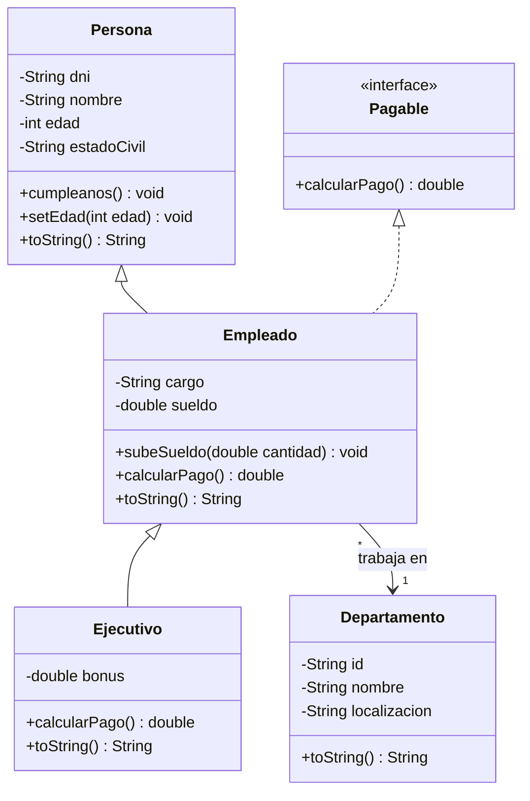

# 7. Caso práctico integrado

En este capítulo reunimos todo lo aprendido en un programa completo y pequeño: la gestión de la plantilla de una empresa.

## 7.1. Enunciado

Una empresa quiere gestionar a sus empleados:

- De toda **persona** interesa su DNI, nombre, edad y estado civil.
- Un **empleado** es una persona que además tiene cargo, sueldo y **pertenece a un departamento**.
- Un **ejecutivo** es un empleado que cobra, además de su sueldo, un *bonus*.
- Un **departamento** tiene identificador, nombre y localización.
- Todo lo que la empresa **paga** (por ahora, a sus empleados) debe poder calcular su importe de pago.
- El programa debe mostrar la plantilla, subir el sueldo a una empleada y calcular la nómina total, tratando a todos por igual aunque cobren de forma distinta.

## 7.2. Diseño: diagrama de clases



## 7.3. Código

Compila y ejecuta los seis archivos juntos. Puedes descargarlos desde la sección [Descargas](#74-descargas).

=== "Pagable.java"

    ```java
    // Pagable.java
    public interface Pagable {
        double calcularPago();
    }
    ```

=== "Persona.java"

    ```java
    // Persona.java
    public class Persona {

        private final String dni;
        private String nombre;
        private int edad;
        private String estadoCivil;

        public Persona(String dni, String nombre, int edad, String estadoCivil) {
            this.dni = dni;
            this.nombre = nombre;
            this.edad = validarEdad(edad);
            this.estadoCivil = estadoCivil;
        }

        public String getDni() {
            return dni;
        }

        public String getNombre() {
            return nombre;
        }

        public int getEdad() {
            return edad;
        }

        public void setEdad(int edad) {
            this.edad = validarEdad(edad);
        }

        public String getEstadoCivil() {
            return estadoCivil;
        }

        public void setEstadoCivil(String estadoCivil) {
            this.estadoCivil = estadoCivil;
        }

        public void cumpleanos() {
            edad++;
        }

        // Utilidad interna: no forma parte del servicio que ofrece la clase
        private static int validarEdad(int edad) {
            if (edad < 0) {
                throw new IllegalArgumentException("La edad no puede ser negativa");
            }
            return edad;
        }

        @Override
        public String toString() {
            return "Persona{dni=" + dni + ", nombre=" + nombre
                    + ", edad=" + edad + ", estadoCivil=" + estadoCivil + "}";
        }
    }
    ```

=== "Departamento.java"

    ```java
    // Departamento.java
    public class Departamento {

        private final String id;
        private String nombre;
        private String localizacion;

        public Departamento(String id, String nombre, String localizacion) {
            this.id = id;
            this.nombre = nombre;
            this.localizacion = localizacion;
        }

        public String getId() {
            return id;
        }

        public String getNombre() {
            return nombre;
        }

        public void setNombre(String nombre) {
            this.nombre = nombre;
        }

        public String getLocalizacion() {
            return localizacion;
        }

        public void setLocalizacion(String localizacion) {
            this.localizacion = localizacion;
        }

        @Override
        public String toString() {
            return "Departamento{id=" + id + ", nombre=" + nombre
                    + ", localizacion=" + localizacion + "}";
        }
    }
    ```

=== "Empleado.java"

    ```java
    // Empleado.java
    public class Empleado extends Persona implements Pagable {

        private String cargo;
        private double sueldo;
        private Departamento departamento;      // asociación

        public Empleado(String dni, String nombre, int edad, String estadoCivil,
                        String cargo, double sueldo, Departamento departamento) {
            super(dni, nombre, edad, estadoCivil);
            this.cargo = cargo;
            this.sueldo = sueldo;
            this.departamento = departamento;
        }

        public String getCargo() {
            return cargo;
        }

        public void setCargo(String cargo) {
            this.cargo = cargo;
        }

        public double getSueldo() {
            return sueldo;
        }

        public Departamento getDepartamento() {
            return departamento;
        }

        public void setDepartamento(Departamento departamento) {
            this.departamento = departamento;
        }

        public void subeSueldo(double cantidad) {
            sueldo += cantidad;
        }

        @Override
        public double calcularPago() {
            return sueldo;
        }

        @Override
        public String toString() {
            return super.toString() + " | Empleado{cargo=" + cargo + ", sueldo=" + sueldo
                    + ", departamento=" + departamento + "}";
        }
    }
    ```

=== "Ejecutivo.java"

    ```java
    // Ejecutivo.java
    public class Ejecutivo extends Empleado {

        private double bonus;

        public Ejecutivo(String dni, String nombre, int edad, String estadoCivil,
                         String cargo, double sueldo, Departamento departamento,
                         double bonus) {
            super(dni, nombre, edad, estadoCivil, cargo, sueldo, departamento);
            this.bonus = bonus;
        }

        public double getBonus() {
            return bonus;
        }

        @Override
        public double calcularPago() {
            return super.calcularPago() + bonus;
        }

        @Override
        public String toString() {
            return super.toString() + " | Ejecutivo{bonus=" + bonus + "}";
        }
    }
    ```

=== "PruebaPlantilla.java"

    ```java
    // PruebaPlantilla.java
    public class PruebaPlantilla {
        public static void main(String[] args) {

            // Un departamento (objeto) compartido por varios empleados
            Departamento informatica = new Departamento("1Inf", "Informática", "Madrid");

            // Un array de Empleado que contiene también un Ejecutivo
            Empleado[] plantilla = {
                new Empleado("153647458S", "Pepe", 35, "casado", "Analista", 1500, informatica),
                new Empleado("452697419Z", "Maria", 25, "soltera", "Programadora", 1000, informatica),
                new Ejecutivo("987654321X", "Lucía", 48, "casada", "Directora", 3000, informatica, 500)
            };

            System.out.println("=== Plantilla ===");
            for (Empleado e : plantilla) {
                System.out.println(e.getNombre() + " - " + e.getCargo()
                        + " - " + e.getDepartamento().getNombre());
            }

            System.out.println();
            System.out.println("=== Un empleado completo ===");
            System.out.println(plantilla[1]);

            // Mensaje a un objeto: cambia su estado
            plantilla[1].subeSueldo(100);

            System.out.println();
            System.out.println("=== Nómina ===");
            double total = 0;
            for (Empleado e : plantilla) {
                System.out.println(e.getNombre() + " cobra " + e.calcularPago());
                total += e.calcularPago();
            }
            System.out.println("Total: " + total);

            System.out.println();
            System.out.println("=== Encapsulación ===");
            try {
                plantilla[0].setEdad(-1);
            } catch (IllegalArgumentException ex) {
                System.out.println("Error: " + ex.getMessage());
            }
        }
    }
    ```

## 7.4. Descargas

Código fuente del caso práctico:
[Pagable.java](../descargas/caso-practico/Pagable.java) ·
[Persona.java](../descargas/caso-practico/Persona.java) ·
[Departamento.java](../descargas/caso-practico/Departamento.java) ·
[Empleado.java](../descargas/caso-practico/Empleado.java) ·
[Ejecutivo.java](../descargas/caso-practico/Ejecutivo.java) ·
[PruebaPlantilla.java](../descargas/caso-practico/PruebaPlantilla.java)

Para compilar y ejecutar desde una terminal, en la carpeta con los archivos:

```powershell
javac -encoding UTF-8 *.java
java PruebaPlantilla
```

## 7.5. Ejecución

```text
=== Plantilla ===
Pepe - Analista - Informática
Maria - Programadora - Informática
Lucía - Directora - Informática

=== Un empleado completo ===
Persona{dni=452697419Z, nombre=Maria, edad=25, estadoCivil=soltera} | Empleado{cargo=Programadora, sueldo=1000.0, departamento=Departamento{id=1Inf, nombre=Informática, localizacion=Madrid}}

=== Nómina ===
Pepe cobra 1500.0
Maria cobra 1100.0
Lucía cobra 3500.0
Total: 6100.0

=== Encapsulación ===
Error: La edad no puede ser negativa
```

## 7.6. Dónde aparece cada concepto

| Concepto | Dónde lo vemos |
|---|---|
| **Objeto** | `informatica`, `plantilla[0]`..., cada uno con su identidad y estado |
| **Clase / instanciación** | `Persona`, `Empleado`... y los `new` del `main` |
| **Abstracción** | Cada clase conserva solo los atributos relevantes para la empresa |
| **Mensajes** | `plantilla[1].subeSueldo(100)`, `e.calcularPago()` |
| **Encapsulación** | Atributos privados; `validarEdad` impide edades negativas |
| **Herencia** | `Empleado extends Persona`, `Ejecutivo extends Empleado`; `super(...)` en los constructores |
| **Redefinición** | `calcularPago()` y `toString()` en `Ejecutivo` |
| **Polimorfismo** | El bucle de la nómina trata como `Empleado` a un `Ejecutivo` y cada uno paga a su manera |
| **Interfaz** | `Pagable`, implementada por `Empleado` |
| **Asociación** | `Empleado → Departamento`, con cardinalidad `* → 1` |

## Resumen del capítulo

Un programa orientado a objetos es una **colección de clases cuyos objetos colaboran**: se modelan con clases, se protegen con encapsulación, se organizan con herencia, se tratan de forma uniforme con polimorfismo y se conectan con relaciones.

## Actividades

**Actividad 1.** Añade la clase `Becario`, subclase de `Empleado`, que cobra una ayuda fija en lugar de un sueldo. Comprueba que se puede incluir en el array `plantilla` sin tocar el bucle de la nómina.

??? success "Solución"
    ```java
    // Becario.java
    public class Becario extends Empleado {

        private final double ayuda;

        public Becario(String dni, String nombre, int edad, String estadoCivil,
                       Departamento departamento, double ayuda) {
            super(dni, nombre, edad, estadoCivil, "Becario", 0, departamento);
            this.ayuda = ayuda;
        }

        @Override
        public double calcularPago() {
            return ayuda;
        }
    }
    ```
    Basta con añadir `new Becario("111222333B", "Raúl", 21, "soltero", informatica, 400)` al array: el bucle llama a `calcularPago()` y cada objeto responde con su versión.

**Actividad 2.** Haz que la asociación sea **bidireccional**: que `Departamento` conozca a sus empleados. ¿Qué cuidado hay que tener?

??? success "Solución"
    El `Departamento` necesita una colección de empleados:

    ```java
    private final List<Empleado> empleados = new ArrayList<>();

    public void incorporar(Empleado e) {
        empleados.add(e);
    }
    ```

    El cuidado: las **dos referencias deben mantenerse coherentes**. Si cambias el departamento de un empleado con `setDepartamento(...)`, hay que quitarlo de la lista del departamento antiguo y añadirlo al nuevo; si solo actualizas un lado, el modelo queda incoherente. Por eso conviene la asociación unidireccional salvo que de verdad se necesite navegar en ambos sentidos.

**Actividad 3.** Amplía el diagrama de clases de la sección 7.2 para incluir `Becario`.

??? success "Solución"
    Se añade una clase que hereda de `Empleado` y que redefine `calcularPago()`:

    ```mermaid
    classDiagram
        class Becario {
            -double ayuda
            +calcularPago() double
        }
        Empleado <|-- Becario
    ```
