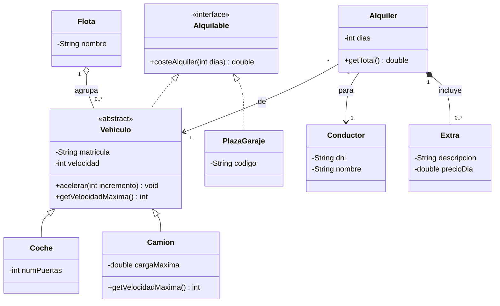
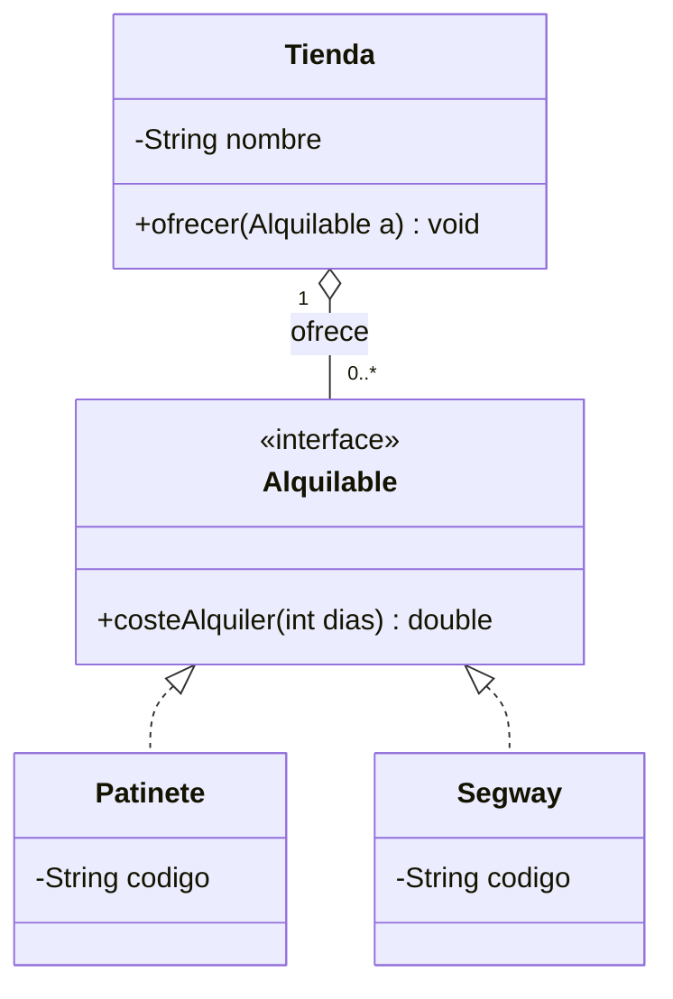

# 8. Puente hacia UML

A lo largo del curso cada concepto ha ido acompañado de un recuadro «En UML». Este último capítulo los reúne: es la **tabla de traducción** entre la forma de pensar (objetos y clases), la forma de programar (Java) y la forma de dibujar (UML).

## 8.1. Tabla de correspondencia

| Concepto de POO | En Java | En un diagrama de clases UML |
|---|---|---|
| **Clase** | `public class Coche { ... }` | Rectángulo con tres compartimentos: nombre, atributos y operaciones |
| **Atributo** | `private int velocidad;` | `-int velocidad` en el compartimento de atributos |
| **Método** | `public void acelerar(int incremento)` | `+acelerar(int incremento) void` en el compartimento de operaciones |
| **Visibilidad** | `public` · `private` · `protected` · paquete | `+` · `-` · `#` · `~` |
| **Atributo / método estático** | `static int totalCoches` | Subrayado (en herramientas gráficas) |
| **Herencia** | `class Coche extends Vehiculo` | Flecha continua con triángulo hueco hacia la superclase |
| **Clase abstracta** | `abstract class Vehiculo` | Estereotipo `<<abstract>>` (nombre en cursiva) |
| **Interfaz** | `interface Alquilable` | Estereotipo `<<interface>>` |
| **Implementación de interfaz** | `class PlazaGaraje implements Alquilable` | Flecha discontinua con triángulo hueco hacia la interfaz |
| **Asociación** | Atributo del otro tipo (`Vehiculo vehiculo` en `Alquiler`) | Línea continua (con flecha si es dirigida) |
| **Agregación** | Colección cuyas partes se reciben de fuera (`Flota`) | Línea con **rombo hueco** en el lado del todo |
| **Composición** | Colección cuyas partes crea el todo (`Alquiler` y sus `Extra`) | Línea con **rombo relleno** en el lado del todo |
| **Dependencia** | Parámetro o variable local (`EstacionITV.inspeccionar(Vehiculo)`) | Flecha discontinua |
| **Cardinalidad** | Atributo simple o colección | `1`, `0..1`, `*`, `1..*`... junto a cada extremo |
| **Objeto** | `new Coche(...)` | *(No aparece en un diagrama de clases: este describe clases, no objetos concretos)* |

!!! note "Una diferencia de notación"
    En los diagramas de este curso hemos escrito los miembros al estilo de Java (`-int velocidad`). En la notación UML formal es habitual escribir el **tipo después del nombre**: `- velocidad : int`. Los dos órdenes expresan lo mismo; lo importante es respetar la **visibilidad**, los **tipos** y los **símbolos de las relaciones**.

## 8.2. Cómo leer un diagrama de clases

Ante un diagrama de clases, recórrelo siempre en este orden:

1. **Las clases**: ¿qué «cosas» hay en el sistema? ¿Alguna es abstracta o una interfaz?
2. **El interior de cada clase**: ¿qué datos guarda (atributos) y qué servicios ofrece (métodos públicos `+`)?
3. **La herencia y las interfaces**: ¿qué clases son tipos de otras? (triángulos huecos)
4. **Las demás relaciones**: ¿quién conoce, contiene o usa a quién? Mira el tipo de línea, los rombos y las **cardinalidades**.

## 8.3. Del caso práctico al diagrama

El diagrama del caso práctico del [capítulo 7](07-caso-practico.md) condensa todo el curso. Esta es una versión reducida, con lo esencial de cada clase:



Léelo con los cuatro pasos de la sección anterior:

1. Hay nueve elementos: la interfaz `Alquilable`, la clase abstracta `Vehiculo`, sus subclases `Coche` y `Camion`, y las clases `PlazaGaraje`, `Conductor`, `Flota`, `Alquiler` y `Extra`.
2. Todos los atributos son privados (`-`); los servicios son públicos (`+`).
3. `Coche` y `Camion` son `Vehiculo`; `Vehiculo` y `PlazaGaraje` cumplen el contrato `Alquilable`. `Camion` **redefine** `getVelocidadMaxima()`.
4. Una `Flota` agrupa **cero o muchos** vehículos (que existen sin ella). Cada `Alquiler` es de **un** vehículo y **un** conductor, y **compone** sus extras: sin alquiler no hay extras.

## Resumen del capítulo

- Cada concepto de POO tiene una forma de escribirse en Java y otra de dibujarse en UML.
- Un diagrama de clases muestra **clases y relaciones**, no objetos concretos.
- Se lee en cuatro pasos: clases, interior, herencia/interfaces y relaciones.

!!! tip "Siguiente paso"
    Con estas bases estás preparado para aprender UML en profundidad: cómo se diseña un diagrama de clases a partir de unos requisitos y qué otros diagramas ayudan a modelar un sistema.

## Actividades

**Actividad 1.** Escribe el diagrama de clases que corresponde a este código:

```java
public class Aseguradora {
    private String nombre;
    private List<Seguro> seguros = new ArrayList<>();

    public Seguro contratar(Vehiculo vehiculo, double prima) {
        Seguro s = new Seguro(vehiculo, prima);    // la aseguradora crea sus seguros
        seguros.add(s);
        return s;
    }
}

public class Seguro {
    private Vehiculo vehiculoAsegurado;
    private double prima;

    public Seguro(Vehiculo vehiculoAsegurado, double prima) { ... }
    public double getPrima() { ... }
}
```

??? success "Solución"
    ```mermaid
    classDiagram
        class Aseguradora {
            -String nombre
            +contratar(Vehiculo v, double prima) Seguro
        }
        class Seguro {
            -double prima
            +getPrima() double
        }
        class Vehiculo {
            <<abstract>>
        }
        Aseguradora "1" *-- "0..*" Seguro : emite
        Seguro "*" --> "1" Vehiculo : asegura
    ```
    La lista `seguros` se dibuja como **relación**, no como atributo. Es **composición** porque la aseguradora **crea** los seguros con `new` dentro de `contratar`. El `Vehiculo` llega de fuera y no depende del seguro: es una **asociación** hacia un único vehículo (`1`) desde cada seguro.

**Actividad 2.** Escribe el esqueleto en Java de las clases de este diagrama (la interfaz `Alquilable` ya existe en el paquete `modelo` del capítulo 7; escribe las clases en ese mismo paquete):



??? success "Solución"
    ```java
    // modelo/Patinete.java
    package modelo;

    public class Patinete implements Alquilable {

        private final String codigo;

        public Patinete(String codigo) {
            this.codigo = codigo;
        }

        public String getCodigo() {
            return codigo;
        }

        @Override
        public double costeAlquiler(int dias) {
            return 8.0 * dias;
        }
    }
    ```

    ```java
    // modelo/Segway.java
    package modelo;

    public class Segway implements Alquilable {

        private final String codigo;

        public Segway(String codigo) {
            this.codigo = codigo;
        }

        public String getCodigo() {
            return codigo;
        }

        @Override
        public double costeAlquiler(int dias) {
            return 15.0 * dias;
        }
    }
    ```

    ```java
    // modelo/Tienda.java
    package modelo;

    import java.util.ArrayList;
    import java.util.List;

    public class Tienda {

        private final String nombre;
        private final List<Alquilable> catalogo = new ArrayList<>();   // cardinalidad 0..*

        public Tienda(String nombre) {
            this.nombre = nombre;
        }

        public String getNombre() {
            return nombre;
        }

        public void ofrecer(Alquilable alquilable) {
            catalogo.add(alquilable);                // agregación: llega de fuera
        }

        public double costeTotal(int dias) {
            double total = 0;
            for (Alquilable a : catalogo) {
                total += a.costeAlquiler(dias);      // polimorfismo
            }
            return total;
        }
    }
    ```
    `Patinete` y `Segway` no tienen nada en común salvo el contrato, y por eso `Tienda` trabaja con el tipo `Alquilable`.

**Actividad 3.** Responde mirando el diagrama de la sección 8.3:

1. ¿Puede existir un `Alquiler` sin ningún `Extra`?
2. ¿Puede una `Flota` estar vacía?
3. ¿Se puede escribir `new Vehiculo(...)`?
4. ¿Cuántos conductores tiene un alquiler?
5. Si se borra un `Alquiler`, ¿qué pasa con su `Vehiculo`? ¿Y con sus `Extra`?

??? success "Solución"
    1. **Sí**: la cardinalidad hacia `Extra` es `0..*`.
    2. **Sí**: la cardinalidad hacia `Vehiculo` es `0..*`.
    3. **No**: `Vehiculo` es abstracta (`<<abstract>>`); hay que crear un `Coche` o un `Camion`.
    4. **Uno**: la cardinalidad hacia `Conductor` es `1`.
    5. El `Vehiculo` **sigue existiendo** (es una asociación: existe por sí mismo). Los `Extra` **desaparecen** con el alquiler (es una composición).
