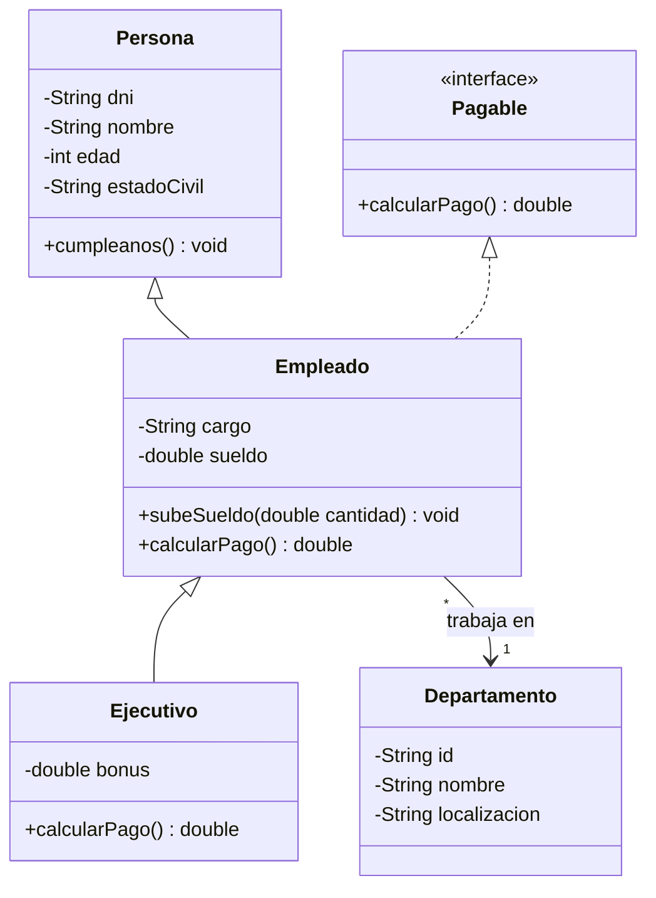
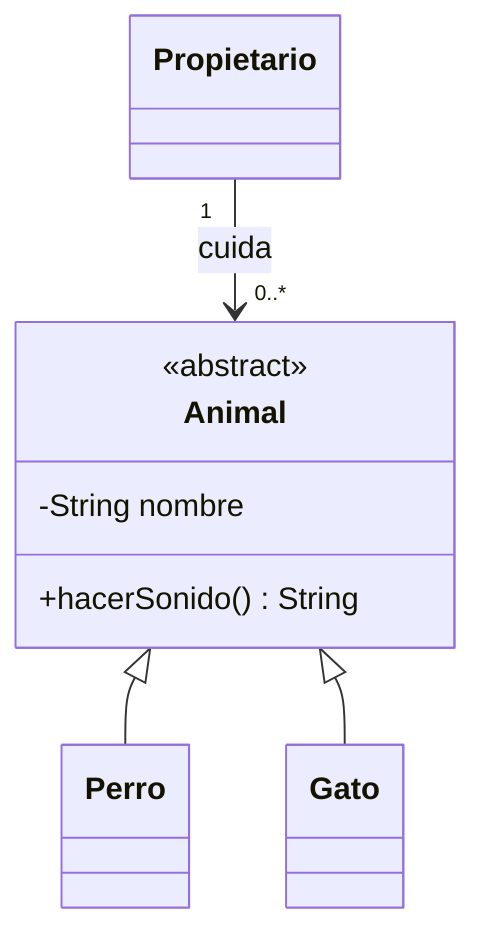

# 8. Puente hacia UML

A lo largo del curso cada concepto ha ido acompañado de un recuadro «En UML». Este último capítulo los reúne: es la **tabla de traducción** entre la forma de pensar (objetos y clases), la forma de programar (Java) y la forma de dibujar (UML).

## 8.1. Tabla de correspondencia

| Concepto de POO | En Java | En un diagrama de clases UML |
|---|---|---|
| **Clase** | `public class Cuenta { ... }` | Rectángulo con tres compartimentos: nombre, atributos y operaciones |
| **Atributo** | `private double saldo;` | `-double saldo` en el compartimento de atributos |
| **Método** | `public void ingresar(double c)` | `+ingresar(double c) void` en el compartimento de operaciones |
| **Visibilidad** | `public` · `private` · `protected` · paquete | `+` · `-` · `#` · `~` |
| **Atributo / método estático** | `static` | Subrayado (en herramientas gráficas) |
| **Herencia** | `class Empleado extends Persona` | Flecha continua con triángulo hueco hacia la superclase |
| **Clase abstracta** | `abstract class Figura` | Estereotipo `<<abstract>>` (nombre en cursiva) |
| **Interfaz** | `interface Pagable` | Estereotipo `<<interface>>` |
| **Implementación de interfaz** | `class Empleado implements Pagable` | Flecha discontinua con triángulo hueco hacia la interfaz |
| **Asociación** | Atributo del otro tipo | Línea continua (con flecha si es dirigida) |
| **Agregación** | Colección cuyas partes se reciben de fuera | Línea con **rombo hueco** en el lado del todo |
| **Composición** | Colección cuyas partes crea el todo | Línea con **rombo relleno** en el lado del todo |
| **Dependencia** | Parámetro o variable local | Flecha discontinua |
| **Cardinalidad** | Atributo simple o colección | `1`, `0..1`, `*`, `1..*`... junto a cada extremo |
| **Objeto** | `new Cuenta(...)` | *(No aparece en un diagrama de clases: este describe clases, no objetos concretos)* |

!!! note "Una diferencia de notación"
    En los diagramas de este curso hemos escrito los miembros al estilo de Java (`-double saldo`). En la notación UML formal es habitual escribir el **tipo después del nombre**: `- saldo : double`. Los dos órdenes expresan lo mismo; lo importante es respetar la **visibilidad**, los **tipos** y los **símbolos de las relaciones**.

## 8.2. Cómo leer un diagrama de clases

Ante un diagrama de clases, recórrelo siempre en este orden:

1. **Las clases**: ¿qué «cosas» hay en el sistema? ¿Alguna es abstracta o una interfaz?
2. **El interior de cada clase**: ¿qué datos guarda (atributos) y qué servicios ofrece (métodos públicos `+`)?
3. **La herencia y las interfaces**: ¿qué clases son tipos de otras? (triángulos huecos)
4. **Las demás relaciones**: ¿quién conoce, contiene o usa a quién? Mira el tipo de línea, los rombos y las **cardinalidades**.

## 8.3. Del caso práctico al diagrama

El diagrama del caso práctico del [capítulo 7](07-caso-practico.md) condensa todo el curso:



Léelo con los cuatro pasos de la sección anterior:

1. Hay cinco elementos: `Persona`, `Empleado`, `Ejecutivo`, `Departamento` y la interfaz `Pagable`.
2. Todos los atributos son privados (`-`); los servicios son públicos (`+`).
3. `Empleado` es una `Persona` y `Ejecutivo` es un `Empleado`; además `Empleado` cumple el contrato `Pagable`.
4. Cada `Empleado` trabaja en **un** `Departamento`; un departamento puede tener **muchos** empleados.

## Resumen del capítulo

- Cada concepto de POO tiene una forma de escribirse en Java y otra de dibujarse en UML.
- Un diagrama de clases muestra **clases y relaciones**, no objetos concretos.
- Se lee en cuatro pasos: clases, interior, herencia/interfaces y relaciones.

!!! tip "Siguiente paso"
    Con estas bases estás preparado para aprender UML en profundidad: cómo se diseña un diagrama de clases a partir de unos requisitos y qué otros diagramas ayudan a modelar un sistema.

## Actividades

**Actividad 1.** Escribe el diagrama de clases que corresponde a este código:

```java
public class Biblioteca {
    private String nombre;
    private List<Libro> libros;
    public void anadirLibro(Libro libro) { ... }
}

public class Libro {
    private String titulo;
    private String isbn;
    public String getTitulo() { ... }
}
```

??? success "Solución"
    ```mermaid
    classDiagram
        class Biblioteca {
            -String nombre
            -List libros
            +anadirLibro(Libro libro) void
        }
        class Libro {
            -String titulo
            -String isbn
            +getTitulo() String
        }
        Biblioteca "1" o-- "0..*" Libro : contiene
    ```
    El atributo `libros` (una colección de `Libro`) se representa mejor como **relación** que como atributo, de ahí la agregación con cardinalidad `0..*`. En muchos diagramas ese atributo ya no se repite dentro de la clase.

**Actividad 2.** Escribe el esqueleto en Java de las clases de este diagrama:



??? success "Solución"
    ```java
    // Animal.java
    public abstract class Animal {
        private final String nombre;

        public Animal(String nombre) {
            this.nombre = nombre;
        }

        public String getNombre() {
            return nombre;
        }

        public abstract String hacerSonido();
    }
    ```

    ```java
    // Perro.java
    public class Perro extends Animal {
        public Perro(String nombre) {
            super(nombre);
        }

        @Override
        public String hacerSonido() {
            return "Guau";
        }
    }
    ```

    ```java
    // Gato.java
    public class Gato extends Animal {
        public Gato(String nombre) {
            super(nombre);
        }

        @Override
        public String hacerSonido() {
            return "Miau";
        }
    }
    ```

    ```java
    // Propietario.java
    import java.util.ArrayList;
    import java.util.List;

    public class Propietario {
        private final String nombre;
        private final List<Animal> animales = new ArrayList<>();   // cardinalidad 0..*

        public Propietario(String nombre) {
            this.nombre = nombre;
        }

        public void adoptar(Animal animal) {
            animales.add(animal);
        }

        public String getNombre() {
            return nombre;
        }
    }
    ```

**Actividad 3.** Explica con tus palabras la diferencia entre una flecha de **herencia** (línea continua, triángulo hueco) y una de **implementación de interfaz** (línea discontinua, triángulo hueco). ¿En qué se parecen?

??? success "Solución"
    Ambas llevan un triángulo hueco y apuntan hacia lo «más general» (la superclase o la interfaz). La **continua** indica herencia entre clases (`extends`): se hereda código y estado. La **discontinua** indica que una clase **cumple un contrato** (`implements`): hereda la obligación de ofrecer los métodos, pero no su implementación.
